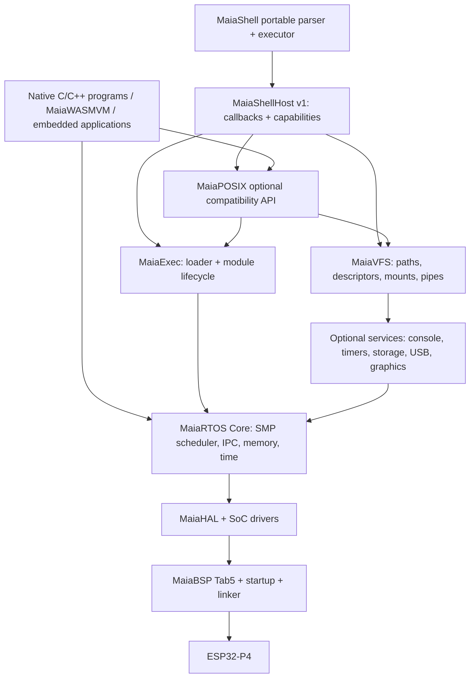

# MaiaRTOS Native Execution & Portable Maia Shell
## Architecture specification — Draft 0.1 · 2026-11-04

**Status:** proposed design; not a claim of implementation or hardware validation.  
**Targets:** ESP32-P4 / M5Stack Tab5 first; portable MaiaRTOS core.  
**Non-negotiable:** no FreeRTOS, Arduino, or ESP-IDF runtime dependency; MaiaRTOS remains useful without MaiaOS, MaiaWASMVM, or a shell.

## 1. Executive decisions

1. Keep **MaiaRTOS Core** (SMP scheduler, synchronization, memory, interrupts) separate from **MaiaHAL**, **MaiaBSP**, **MaiaVFS**, **MaiaExec**, **MaiaPOSIX**, and **MaiaShell**.
2. Reuse the existing shell's grammar, generated parser, AST planner and semantic evaluators, but **do not tie them to a loader, operating system or transport**. Introduce a narrow **MaiaShellHost v1** API implemented by distinct native, WASM and browser backends.
3. Adopt **ELF32 little-endian RISC-V relocatable objects (ET_REL)** as the *input container* for trusted native modules in the first milestone. Define a **Maia Native Module ABI v1 (MNM-1)** and a separate **signed/hashed install manifest**. `.mobj` is the preferred file extension; `.o` remains a toolchain artifact. The extension is not a new binary encoding: contents are standard ELF32 with strict acceptance rules.
4. The first native loader handles **trusted, ABI-matched, statically linked-in-module code**, explicit symbol imports from a versioned host export table, and a *documented allowlist* of relocations. Unsupported ELF features are rejected, never guessed.
5. **No Linux binary compatibility**, no `fork`, no `execve` process replacement semantics, no claims of memory isolation or full POSIX conformance. Spawn/wait are MaiaRTOS task-group operations.
6. Keep the proposed 16 MiB OS / 16 MiB applications split as a **MaiaOS deployment policy**, not a kernel or loader assumption. Measure executable-memory availability before committing to native loading on Tab5.

## 2. Actual attached shell baseline (observed, not inferred)

Files reviewed: `maia-shell(2).ebnf`, `maia-shell.cpp`, `maia-shell-parse-tree-collector.hpp`, `shell-list.hpp`, `shell-expr.hpp`, `shell-fields.hpp`, `shell-for.hpp`, `shell-for-frame.hpp`, `shell-conditional-loop.hpp`, `shell-loop-control.hpp`, `shell-glob.hpp`, `shell-path.hpp`, `shell-pattern.hpp`, plus auxiliary `maia-shell-{expr,word,test,return}.ebnf`.

- The main grammar explicitly describes itself as a **“structural, non-POSIX phase-one subset”** and warns that reserved words are globally reserved until context-sensitive lexing is added. Accordingly, do **not** advertise the current implementation as POSIX-complete.
- The grammar includes simple commands, pipelines, `&&`, `||`, redirections, subshells, brace groups, `if/elif/else`, `while`, `until`, and `for` productions. Grammar coverage does not by itself prove runtime semantic coverage.
- The attached `maia-shell.cpp` is a generated MaiaCC C++98 parser (token and rule tables); preserve generator ownership. **Never edit generated parser output as the canonical source**.
- `shell-list.hpp` builds bounded plans over a generated preorder AST; examples of present limits include eight list units, 32 flow instructions, and up to four pipeline stages in a list unit. These are implementation limits, not POSIX requirements.
- `shell-expr.hpp` explicitly performs bounded semantic evaluation with no I/O or host evaluation; it currently uses static global state and references generated expression frontend and Maia BRE components.
- `shell-path.hpp` performs lexical basename/dirname operations without VFS lookup. `shell-glob.hpp` has an existing glob/VFS integration surface; inspect before replacing it.
- Several modules use static/global fixed-size workspaces. This implies a **non-reentrant shell instance until proven otherwise**. A future per-session context migration must be staged and regression-tested.
- The attachments are a selected subset, not a full buildable shell repository. Included headers and implementation dependencies are not all present; integration assumptions require verification against the actual source tree.

**Compatibility rule:** preserve existing grammar fixtures, AST shape and status semantics as golden references. Build adapters around the shell, not a second shell parser.

## 3. Layered architecture



**Dependency direction:** shell core imports only its host interface; host adapters depend on platform facilities. The loader does not import shell code. MaiaRTOS Core imports neither POSIX nor ELF. Native modules call an explicit ABI dispatch table; they do not link against private kernel internals.

**Distributions:** `maia-rtos-core` (no shell), `maia-rtos-native` (VFS + loader + optional POSIX), `maia-rtos-shell` (native + portable shell), and `maiaos` (WASM runtime + desktop, optionally reusing shell core).

## 4. Repository boundaries

```text
maia-rtos/
  arch/riscv/                  # context, trap, atomics, IPI
  kernel/                      # SMP, tasks, IPC, allocators
  hal/esp32p4/                # registers, clocks, interrupts
  boards/m5stack-tab5/        # pins, display, keyboard, memory map
  components/vfs/             # mounts, FD table, pipes
  components/exec/            # ELF validator, linker, module lifecycle
  components/posix/           # optional subset of POSIX API
  components/shell-host/      # native MaiaShellHost implementation
  include/maia/               # public stable headers
  tools/mnm-pack/              # build-time manifest/ELF inspection
  tests/host/ tests/hardware/
  docs/abi/ docs/architecture/ docs/agents/
maia-shell/                   # independently versioned reusable shell
  grammar/ generated/ core/ include/maia_shell/
  adapters/native/ adapters/wasm/ adapters/browser/
maiaos/                       # consumer; no reverse dependency
```

An initial mono-repository integration is acceptable for rapid development, but the public interface must permit extraction without rewriting the shell.

## 5. Native module format: MNM-1

### 5.1 Container and identity

- File magic: ELF `7f 45 4c 46` (standard ELF magic); **no invented binary magic**.
- ELF class `ELFCLASS32`; data `ELFDATA2LSB`; machine `EM_RISCV`; type `ET_REL`; `e_version=EV_CURRENT`.
- ABI target profile: `maia-rv32-esp32p4-v1` as a *manifest string*, not an invented ELF machine value.
- Compiler profile initially **RV32IMAF(C only if verified)**, ABI `ilp32f` or another profile **only after confirming hardware ISA, compiler flags, floating-point calling convention and interrupt context handling**. No hard-coded assumption about ISA extensions in loader until the device capability audit passes.
- Sections: `.text`, `.rodata`, `.data`, `.bss`, `.symtab`, `.strtab`, relocation sections `.rel.*` or `.rela.*` as supported, and optional `.init_array`/`.fini_array` only after lifecycle support is implemented. Reject unknown allocatable sections unless explicitly allowed.
- Entry symbol `maia_module_main` with `int (*)(const maia_module_context_t *)` signature. A module may export additional entry points only if declared by the manifest.
- Dynamic linking (`ET_DYN`, `PT_INTERP`, `.dynamic`, PLT/GOT requiring an unsupported runtime), TLS, exceptions/unwinding, shared libraries, and C++ static constructors are **out of scope for v1** unless separately designed and tested.

### 5.2 Install manifest (sidecar JSON, not runtime parser requirement)

For development, pair `hello.mobj` with `hello.mnm.json`. On device, the manifest may be compiled into a compact, length-bounded record after offline validation. Example:

```json
{
  "schema": "maia.native.module/1",
  "name": "hello",
  "version": "0.1.0",
  "target": "maia-rv32-esp32p4-v1",
  "abi_major": 1,
  "abi_minor_min": 0,
  "entry": "maia_module_main",
  "elf_sha256": "<64 lowercase hexadecimal digits generated by packer>",
  "memory": {"stack_bytes": 8192, "heap_limit_bytes": 65536},
  "permissions": ["stdio"],
  "imports": ["maia_host_api_v1"]
}
```

The placeholder is **not** a valid digest. Packer generates it from exact ELF bytes. `name` and strings have strict size limits. The loader rejects malformed metadata, mismatched digests, unknown capabilities, unsupported ABI major versions and incompatible targets. SHA-256 provides integrity, **not authentication**: authenticated distribution needs signature verification and a trust anchor, deferred to a security milestone.

### 5.3 Binary validation and memory mapping

1. Open file via VFS and bound its maximum length.
2. Validate ELF header, section table, string offsets, section counts, alignment, arithmetic overflow and non-overlapping mapped ranges.
3. Verify manifest digest and target/ABI/permissions; require trusted install source in early firmware.
4. Build a memory plan **without executing or modifying target memory**; resolve section sizes, alignment, relocations, imports, stack and heap quotas.
5. Allocate executable and writable regions through platform memory capabilities. Enforce text as read-only after relocation where supported; **do not assume MPU or MMU isolation**.
6. Copy initialized sections, zero BSS, apply only allowlisted relocations with strict bounds and symbol resolution. Flush/invalidates instruction/data caches as required by the SoC.
7. Create a module-owned task group, FD table and resource ledger; call module entry with ABI context.
8. On return/cancellation, wait for owned tasks to terminate and release resources; never unload executable pages while a core may still execute them.

**Relocation policy:** produce an inventory from actual `readelf -r` compiler outputs; initially implement a small audited allowlist (e.g. absolute 32-bit and selected PC-relative call/branch relocations *if confirmed*). RISC-V relaxation, paired HI20/LO12 relocations, range checks, and instruction encoding require explicit unit tests. **Never claim support for a relocation because the toolchain emits it.** The packer can normalize/resolve unsupported cases offline, or reject the module.

**Executable-memory gate:** before any Tab5 loader milestone, prove where RV32 code can execute (internal SRAM, mapped flash, PSRAM, cache constraints) using official technical reference plus on-device tests. If dynamic executable RAM is unavailable, adopt **flash-backed XIP with offline linking** or a fixed firmware module registry; do not silently copy code into non-executable PSRAM.

### 5.4 Native host ABI v1

Use a fixed C ABI with size/version checks and opaque handles. All public structs are explicitly laid out and sized; do not pass C++ objects, STL containers or host pointers with undocumented lifetimes across the boundary.

```c
#include <stdint.h>
#include <stddef.h>

typedef uint32_t maia_handle_t;
typedef struct maia_host_api_v1 {
    uint32_t struct_size;
    uint16_t abi_major;
    uint16_t abi_minor;
    int32_t (*write_fd)(maia_handle_t fd, const void *buf, uint32_t n);
    int32_t (*read_fd)(maia_handle_t fd, void *buf, uint32_t n);
    int32_t (*close_fd)(maia_handle_t fd);
    int32_t (*sleep_ms)(uint32_t ms);
    void *(*alloc)(uint32_t bytes, uint32_t flags);
    void (*dealloc)(void *ptr);
} maia_host_api_v1;

typedef struct maia_module_context_t {
    uint32_t struct_size;
    uint32_t argc;
    const char *const *argv;
    const maia_host_api_v1 *host;
    maia_handle_t stdin_fd, stdout_fd, stderr_fd;
    void *module_private;
} maia_module_context_t;

int maia_module_main(const maia_module_context_t *ctx);
```

**Draft contract:** `read_fd`/`write_fd` return nonnegative byte counts or negative stable Maia error codes; `alloc` returns NULL on failure; handles are local to a module task group; `argv` and host table remain valid for the entry lifetime. The module must not cache freed pointers or invoke privileged MMIO directly. Because the CPU lacks a conventional MMU, these are **contracts for trusted code**, not enforced security boundaries.

### 5.5 Toolchain and packaging

`riscv32-...-gcc -ffreestanding -fno-pic ... -c hello.c -o hello.o` is illustrative only; the final cross-compiler prefix and `-march/-mabi` flags come from the hardware audit. Use a controlled linker script and `readelf` to inspect object sections, symbols and relocations. `mnm-pack` validates, hashes and emits `.mobj` + manifest. CI runs positive and malformed ELF fixtures on host, with fuzzing of the parser and relocation engine. A native binary built for Linux is rejected even if it is RISC-V ELF.

## 6. Portable MaiaShellHost v1

**Design objective:** the existing shell should know **what operations it requests**, not whether they run on MaiaOS WASM, MaiaRTOS native, or a browser simulator.

```c
#include <stdint.h>

typedef uint32_t msh_fd_t;
typedef uint32_t msh_job_t;
typedef struct msh_host_v1 {
    uint32_t struct_size, version;
    void *user;
    int32_t (*read)(void *user, msh_fd_t fd, void *dst, uint32_t n);
    int32_t (*write)(void *user, msh_fd_t fd, const void *src, uint32_t n);
    int32_t (*open)(void *user, const char *path, uint32_t flags, msh_fd_t *out);
    int32_t (*close)(void *user, msh_fd_t fd);
    int32_t (*pipe_create)(void *user, msh_fd_t *read_end, msh_fd_t *write_end);
    int32_t (*fd_dup)(void *user, msh_fd_t src, msh_fd_t *dst);
    int32_t (*spawn)(void *user, const char *path, const char *const *argv,
                     msh_fd_t in, msh_fd_t out, msh_fd_t err, msh_job_t *job);
    int32_t (*wait)(void *user, msh_job_t job, int32_t *status);
    int32_t (*cwd_get)(void *user, char *dst, uint32_t cap);
    int32_t (*cwd_set)(void *user, const char *path);
    int32_t (*glob)(void *user, const char *pattern, void *sink);
} msh_host_v1;
```

This is an **interface sketch**, not production-ready: specify `glob` sink ABI, directory enumeration, `stat`, environment, `isatty`, time, signals/cancellation, descriptor inheritance, nonblocking modes and errors in follow-on header revisions. Avoid assuming the same numeric FD namespace across adapters. `spawn` accepts an **executable path**, never raw ELF pointers; the native backend calls MaiaExec and the WASM backend calls its runtime loader.

### 6.1 Shell ownership

| Concern | Portable shell | Host adapter |
|---|---|---|
| Lexing, parsing, AST | Owns | Never reparse shell text |
| Expansions, quoting, field splitting | Owns semantics | Supplies environment/glob results |
| `if`, `for`, `while`, `&&`, `||` | Owns | Supplies exit status |
| Redirection, pipes | Owns orchestration | Opens/duplicates FDs and creates pipes |
| Builtins (`cd`, `export`, `exit`) | Owns semantics | CWD/environment operations |
| External command selection | Owns command resolution policy | Spawns native/WASM command |
| Filesystem and terminal I/O | Does not implement drivers | VFS/console backend |
| Scheduling, execution, cleanup | Does not own kernel | RTOS/WASM runtime |

**Subshell caution:** without process isolation or `fork`, subshell behavior must use a cloned shell *session state* and distinct job/task group, not a shared mutable global state. Pipelines should be built with bounded pipes and concurrent jobs; do not fake `|` by buffering unlimited output. For an initial subset, explicitly mark unsupported semantics rather than quietly changing shell behavior.

### 6.2 Adapter implementations

- **Native MaiaRTOS adapter:** MaiaVFS + MaiaExec + task groups + UART/terminal; shell compiled as native C++98-compatible source where dependencies permit.
- **MaiaOS WASM adapter:** existing `io.js` / `vfs.js` contracts (to be verified in the actual MaiaOS tree), MaiaWASMVM task integration; shell remains a WASM guest.
- **Browser/host adapter:** deterministic in-memory VFS, synthetic jobs, golden test fixtures; never claims real SMP execution.

**Porting sequence:** (a) inventory global state, includes and direct I/O calls; (b) write interface contract tests; (c) wrap existing calls without changing parser/AST; (d) extract per-session context to permit concurrent shell sessions; (e) compare golden command outputs/statuses across backends.

## 7. POSIX scope and compatibility claims

Implement a **POSIX-inspired API subset**, not full POSIX. Prioritize `open/read/write/close/lseek/stat`, `opendir/readdir`, pipes, `dup2`-equivalent, CWD, environment and `spawn/wait`. Map unsupported operations to documented errors. `fork` and POSIX signals/process groups require separate design and are absent in v1. Do not expose `execve` as a promise of Linux semantics; provide `maia_spawn` and `maia_wait` instead. Ensure shell's exit code convention is distinct from low-level negative API error codes.

## 8. SMP, concurrency and lifecycle

- Every native module receives a task-group ID, memory budget, handle table and cancellation token. Threads inherit a module owner and can be pinned or scheduled on any eligible core.
- Module teardown is a **two-phase operation**: request cancellation, wait/join with deadline, then reclaim FDs, buffers and executable memory only after no CPU executes module text. If a task cannot be stopped safely, quarantine the module and report a leak rather than freeing live code.
- Use explicit atomics, lock ordering, per-core run queues, IPI and cache synchronization; no ad hoc `volatile` synchronization.
- Interrupt handlers cannot call blocking shell or loader functions. The loader serializes writes to executable regions and instruction-cache synchronization across cores.
- Separate timing classes: critical kernel/ISR code in suitable internal memory, ordinary shell data in available RAM, large WASM/application heaps in PSRAM if compatible.

## 9. Security and reliability model

Native ELF modules are **trusted firmware extensions**: without MMU-based isolation, validation cannot stop arbitrary malicious machine code from accessing privileged memory. Validate binary structure to prevent accidental corruption; use signed distribution, explicit install authorization and documented capability discipline to reduce risk, but do not claim sandboxing. **WASM isolation remains a separate property of MaiaWASMVM**, subject to its own validation and host import security. Secure boot, flash encryption and hardware protection must be evaluated independently for this SoC and boot flow.

Threat tests: malformed offsets and section sizes, integer overflow, overlapping sections, invalid symbol indexes, relocation overflow, bad instruction patching, duplicate module IDs, excessive stack/heap requests, cancellation races, unload while executing, forged manifests and digest mismatches.

## 10. Test strategy and acceptance gates

| Gate | Host evidence | Hardware evidence |
|---|---|---|
| A: Shell extraction | Existing parser/AST golden fixtures unchanged | Not required |
| B: ShellHost v1 | Fake host tests for FD, spawn, wait, pipeline, redirection | UART shell smoke test |
| C: ELF parser | ELF32 valid/invalid corpus, fuzzing, sanitizers | Not required |
| D: Relocations | Known linker fixtures; exact byte/branch assertions | Execute tiny module in verified executable memory |
| E: Native loader | Lifecycle, quotas, fault injection, no resource leaks | `hello.mobj` load/run/unload repeatedly |
| F: SMP | Deterministic simulated interleavings | Concurrent module tasks on both cores, cache coherence and teardown |
| G: Shell Edition | Shell golden fixtures across native/WASM/host | `ls`, redirection, pipeline, status, loops, native command |

**Evidence policy:** label each item `DESIGN`, `STUB`, `HOST-TESTED` or `HARDWARE-TESTED`; a passing host test does not imply ESP32-P4 success. Store compiler versions, linker flags, module hashes, serial logs and benchmark conditions.

## 11. Delivery milestones

**N0 — Hardware audit:** ESP32-P4 ISA/ABI, boot path, memory execution matrix, cache, SMP wake-up, Tab5 peripherals. Output: verified hardware register references and a runnable code-location experiment.

**N1 — Shell boundary audit:** map existing direct I/O, global state, generated code and missing dependencies. Freeze golden fixtures and document current limitations.

**N2 — MaiaShellHost contract:** versioned headers, fake host, deterministic test harness, minimal wrapping of current shell.

**N3 — MaiaVFS/FD/task groups:** native console, SD/flash mount, pipe/dup and resource ownership.

**N4 — ELF validator and packer:** strict ET_REL parser, manifest, digest, malformed corpus, relocations inventory.

**N5 — Minimal native loader:** executable memory proof, module relocation, `hello.mobj`, cleanup.

**N6 — Shell Edition:** shell adapter + native loader, builtins, redirection, pipelines, script regression.

**N7 — SMP and hardening:** multi-core module execution, stress/fuzz, teardown races, benchmarks, documented limitations.

**N8 — MaiaOS integration:** preserve WASM adapter, regression comparison, optional native/WASM command selection by policy and file type.

Each milestone is a separate pull request or bounded sequence; do not implement N5 before N0 confirms execution-memory feasibility.

## 12. Agent instructions — Antigravity/Gemini first, Codex review second

### Universal rules (`AGENTS.md`)

1. Read this specification and the **actual current source** before modifying files. Do not infer implementation from filenames or comments.
2. Never introduce FreeRTOS, Arduino, ESP-IDF runtime, Linux syscalls, or hidden third-party kernel dependencies.
3. Never edit generated MaiaCC parser tables manually; change grammar/source and regenerate reproducibly.
4. Preserve C++98 compatibility where required by existing shell code; use a C ABI for platform boundaries.
5. One narrowly scoped milestone per change; provide files changed, rationale, tests, output and unresolved risks.
6. If a register address, instruction extension, linker relocation or executable memory property is uncertain, mark **UNVERIFIED** and stop before hardware-specific code.
7. Do not replace existing shell semantics with a new parser or toy executor.
8. Do not claim POSIX conformance, process isolation or security sandboxing.
9. For all parsers/loaders: validate lengths, offsets, counts, alignment and overflow *before allocation or copying*.
10. Never mark a feature complete without a reproducible test and observed result.

### Antigravity work order (small, bounded tasks)

**Prompt A — Audit only:** “Read the attached shell files and the MaiaRTOS architecture. Produce `docs/audits/shell-boundary.md`: actual functions touching I/O, globals, parser/AST ownership, direct dependencies, missing files and tests. No code changes. Distinguish observed facts from assumptions.”

**Prompt B — Interface only:** “Based on the audit, implement `include/maia_shell/host_v1.h` and a fake-host test harness. Do not modify generated parser or shell semantics. Add tests for callback version/size checks and error propagation. Report compile commands and results.”

**Prompt C — ELF validator only:** “Implement a host-only ELF32 RISC-V ET_REL *validator*, no executable loader. Include malformed fixtures and integer-overflow tests. Reject unsupported features. Document every accepted field and feature.”

### Codex audit handoff

“Review the exact Antigravity commit for correctness, C/C++ ABI stability, undefined behavior, parser compatibility, race conditions, security boundaries, ELF offset arithmetic and missing negative tests. Run the tests independently. Deliver a prioritized issue list with file/line references, then fix only confirmed defects. Do not expand scope until the milestone passes.”

### Required agent report

```text
Milestone:
Commit / files changed:
Observed behavior:
Tests executed (exact commands and output):
Hardware tests (board/firmware/log):
Known limitations:
Unverified assumptions:
Next smallest task:
```

## 13. Open decisions requiring explicit approval

1. Final ESP32-P4 ISA/march/mabi profile after silicon/toolchain audit.
2. Executable code placement: internal SRAM vs mapped flash/XIP vs PSRAM (must be measured).
3. Initial relocation allowlist, chosen from actual compiler outputs.
4. Shell concurrency: single-session first vs immediate per-session state refactor.
5. Manifest installation trust: development-only hashes vs signed package format.
6. Whether native shell and MaiaOS WASM shell share a standalone `maia-shell` repository or a source submodule.
7. Minimum supported POSIX shell semantics and explicitly deferred features.

## 14. First actionable work package

**Deliverable:** `docs/audits/shell-boundary.md` and `docs/audits/esp32p4-execution-memory.md`, with citations to actual source locations and official hardware documentation, plus a `tests/host/shell_host_contract` scaffold. No ELF execution yet. This avoids spending expensive agent cycles on a loader that cannot be placed in executable memory or a shell port that breaks existing AST semantics.

---

**Design provenance:** Sections 2 and the shell migration constraints are grounded in the supplied source files. ELF format, MNM-1 ABI, layered architecture, manifest, interfaces, security model and milestones are **new design proposals** requiring implementation and validation; they are not descriptions of existing functionality.
