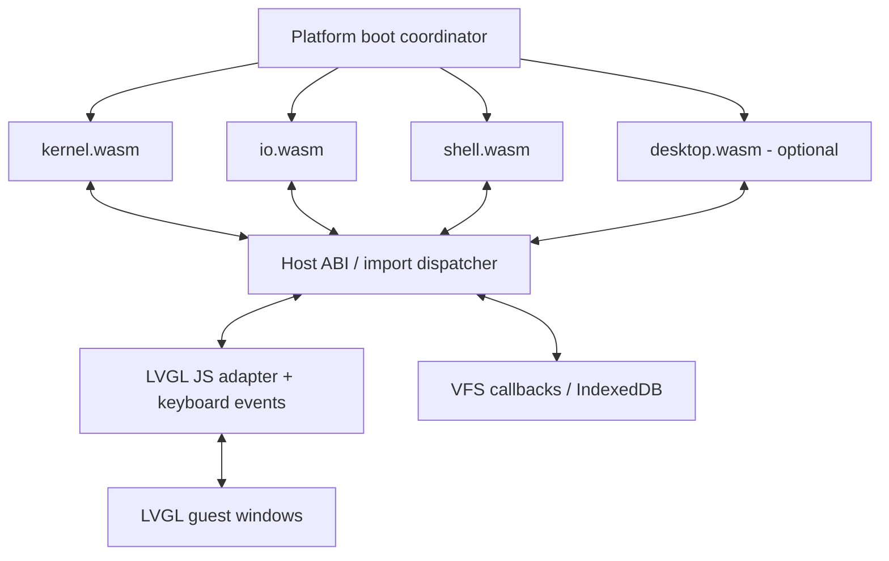

# MaiaOS Shell — implementation blueprint

**Status:** bounded MVP with MaiaCC-generated C++98 lexing/parsing integrated in the WASM guest. The app guest supports `help`, `echo`, silent `true`/`false`/`:`, string/byte/integer `printf`, bounded signed32/BRE `expr`, `basename`, `dirname`, `unset`, bounded `test` string/signed-decimal32 predicates, bounded local variables, `pwd`, `ls`, `cd`, `cat <file> [file ...]`, `clear`, `exit`, and bounded `. path` script-file execution with `return [n]` and bounded nonnested `if/then/elif/else/fi`, explicit-list `for` and bounded `while`/`until`, with `break`/`continue [1]` in the current body; one optionally negated `if` may occur inside the loop body. It is not POSIX-conformant. The reference for comparison is POSIX.1-2017, Shell Grammar, sections 2.10.1 and 2.10.2.

## Progress checklist

Last reviewed: **2026-11-04**. `[x]` means implemented and functionally validated
within the stated scope; `[ ]` means missing, partial or awaiting validation.
This tracks the current working tree, including local changes; it does not mean
every item is committed/pushed or released. Update this section after each shell
increment, including its evidence and remaining limitations. Pending items are
not approval to change contracts. Related trackers: [kernel](../kernel/README.md#progress-checklist)
and [I/O](../io/README.md#progress-checklist).

### Implemented and validated

- [x] Bounded `expr`: MaiaCC-generated final-argv frontend, iterative C++98 signed32/eager-logic/comparison/BRE evaluator, statuses0/1/2/3, existing streams/redirects/dot/if/loops.556 native sanitizer/own-WASM cases,553 production cases, allocation failure/recovery and real KEY/kernel/I/O/LVGL integration pass. Shell21pages within32; compile384KiB/match64KiB. [Contract](../../docs/planning/SHELL_EXPR_EXECUTION.md) and [commands/evidence/limits](../../docs/planning/SHELL_EXPR_VALIDATION.md).


- [x] `[ expression ]`: generated opening/final-closing argv ownership, shared bounded test semantics and command-position-only temporary lone-bracket protection through MaiaGlob; strict argument/header/redirect patterns, actual WASM/LVGL and cleanup validated. [Contract/evidence](../../docs/planning/SHELL_TEST_BRACKET_ALIAS.md).

- [x] Multiline units in dot scripts: unchanged generated parser selects the earliest complete prefix,up to8physical lines/255bytes with existing execution quotas;one failed trial per step,no partial effects,source-word restrictions and caller/return restoration. Interactive input stays one line. [Contract/evidence](../../docs/planning/SHELL_SCRIPT_MULTILINE.md).

- [x] `return [n]` in dot scripts: generated decimal0..255 status frontend,exactly-once script completion after cleanup,independent caller negation,normal context/argument errors and preserved caller PC/loop frames. [Contract/evidence](../../docs/planning/SHELL_SCRIPT_RETURN.md).

- [x] Negation of the single inner `if`: certified generated prefix and exactly-once aggregate inversion after cleanup, including successful break/continue; raw failures cancel transfers. [Contract/evidence](../../docs/planning/SHELL_LOOP_IF_NEGATION.md).

- [x] One nonnegated `if` inside a for/while/until body: generated ancestry and bounded forward region, existing elif/else, conditional break/continue, dot PC restoration;8leaves/32instructions and existing loop budgets. [Contract/evidence](../../docs/planning/SHELL_LOOP_BODY_IF.md).

- [x] `break`/`continue [1]`: checked current-body next/join after successful cleanup; raw errors cancel before negation, no suspended-dot-caller transfer, existing loop budgets preserved. [Contract/evidence](../../docs/planning/SHELL_LOOP_CONTROL.md).

- [x] Bounded `while`/`until`: one nonnested loop of any kind per execution unit,12 body entries/13 complete condition checks, ordinary status2 on attempted13th body, saved last-body status and bounded dot phase/count restoration. [Contract/evidence](../../docs/planning/SHELL_CONDITIONAL_LOOPS.md).

- [x] Explicit-list `for`: one nonnested loop per execution unit, at most12 frozen values,8 static leaves/32 instructions, generated Name/header/body ownership, ordinary status/cleanup and dot iteration restoration without replay. [Contract/evidence](../../docs/planning/SHELL_FOR_EXECUTION.md).

- [x] Bounded `test`: generated argv frontend, string predicates and signed-decimal32 comparisons, limited negation, ordinary status/if/list/dot/redirect semantics; [contract/evidence](../../docs/planning/SHELL_TEST_PREDICATES.md). The `[` alias is implemented under its separate contract; file predicates remain deferred.
- [x] Owner-reported simulator smoke acceptance of the test increment (2026-10-31); this is separate from agent browser inspection and VM/device conformance.

- [x] Freestanding C++98 -> MaiaCpp -> C89 -> MaiaC/MaiaWASM -> `shell.wasm`, with repository-local published dependencies.
- [x] Published MaiaC/MaiaCpp narrow source literals preserve raw UTF-8 and explicit byte escapes; fresh strict word guest checks exact mixed source bytes/sizeof.
- [x] Published toolchain regressions for global/static struct members, constant numeric casts and bounded static-local lifetime; word collector uses direct static fields in actual WASM.
- [x] Published MaiaCpp `6aa8eac` preserves named local plain struct declarations/lexical identity; original function-local decoder guard passes native sanitizers and own-chain WASM, replacing the test workaround. See [validated propagation](../../docs/planning/MAIACPP_LOCAL_STRUCT_TYPES.md).
- [x] MaiaCC-generated lexer/parser consumes raw input inside WASM; JavaScript and native C++98 are comparison oracles.
- [x] Separate generated syntax tree, quote removal, validation, expansion and bounded command execution.
- [x] Unquoted and backslash-escaped Unicode scalar words/paths, including supplementary characters, with exact UTF-8 bytes and UTF-16 token offsets.
- [x] IO_NUMBER requires immediate unquoted `<`/`>` adjacency; spaced numeric operands and numeric filenames work.
- [x] Compound-body separator rules and explicit `for ... in ...` header separators, preserving native-valid self-delimited compounds and subshells.
- [x] Builtins: `help`, `echo`, `true`, `false`, `:`, `pwd`, `clear`, `exit`; silent status builtins reuse ordinary expansion, redirects and completion.
- [x] `printf`: bounded `%s`, `%b`, byte-oriented `%c`, `%%`, `%d`, `%i`, `%u`, `%o`, `%x`, `%X`, byte escapes, `%b` argument `\c` stopping, format reuse, checked 32-bit integers, byte field width/precision, left alignment and integer zero padding.
- [x] `ls`: multiple file/directory operands, `-a`, `-A`, `--`, bounded enumeration and hidden-entry policy.
- [x] `basename [--] path [suffix]` / `dirname [--] path`: literal byte-path utilities, exact suffix removal, roots/empty/repeated slashes, no file access or cwd changes.
- [x] `cd`/`pwd`: per-shell cwd, relative/absolute paths and home isolation.
- [x] `cat`: multiple operands, binary/UTF-8 bytes, one open file at a time and continued operand-error reporting.
- [x] MaiaGlob filename expansion: `*`, `?`, bracket classes, preserved quoting/escapes, sorting and atomic argument limits.
- [x] Local variables: 32 bindings,31-byte ASCII names/95-byte values, one assignment-only unit, double-quoted `$NAME`, RHS references without splitting/glob, atomic `unset` and dot/caller persistence.
- [x] Unquoted `$NAME`: fixed space/tab/LF splitting of expansion data, positional quoted-empty fields, per-field MaiaGlob, command elision/promotion and stage-preserving limits; assignment RHS/redirect targets do not split. See [contract/evidence](../../docs/planning/SHELL_UNQUOTED_FIELDS.md).
- [x] Simple `${NAME}` / `${?}` with and without double quotes, generated by both frontends; name/suffix delimiting, existing fields/glob, unsplit assignments/redirects and opaque unsupported quoted forms. See [contract/evidence](../../docs/planning/SHELL_BRACED_PARAMETERS.md).
- [x] `${#NAME}`: fixed UTF-8 scalar count from the generated decoder; unset/empty0, supplementary1, combining marks separate, no locale/normalization; ordinary bounded errors for invalid encoding. See [contract/evidence](../../docs/planning/SHELL_PARAMETER_LENGTH.md).
- [x] `${NAME-word}` / `${NAME:-word}`: distinguish unset/empty locals, evaluate only the selected branch, preserve quote/field/glob ownership and never assign or consume a slot; simple/status/length fallback references, without nested defaults. See [contract/evidence](../../docs/planning/SHELL_PARAMETER_DEFAULTS.md).
- [x] `${NAME+word}` / `${NAME:+word}`: select an alternative for set/nonempty locals; skip all unselected bytes/anchors/expansions, no implicit subject emission/decoding or slot allocation; existing quotes/fields/glob and simple/status/length references, without operator nesting. See [contract/evidence](../../docs/planning/SHELL_PARAMETER_ALTERNATES.md).
- [x] `${NAME%pattern}` / `${NAME%%pattern}`: shortest/longest suffix removal through MaiaGlob with separate pattern/result quotes, generated UTF-8 scalar boundaries, aggregate work limits and no matching VFS access; fields/glob, redirects, lists/pipelines/dot and error atomicity validated. [Contract/evidence](../../docs/planning/SHELL_PARAMETER_SUFFIX_REMOVAL.md).
- [x] `${NAME#pattern}` / `${NAME##pattern}`: shortest/longest prefix removal through MaiaGlob; generated hash/length ownership, Unicode, quotes, fields/glob, bounds, exact budgets and actual WASM/LVGL validated. [Contract/evidence](../../docs/planning/SHELL_PARAMETER_PREFIX_REMOVAL.md).
- [x] Bare `$?` expansion with persistent completed status, generated word-part parsing, quote/escape protection, one status snapshot per unit and script/caller propagation.
- [x] Pipeline negation `!`: invert completed unit status after drain/close/reap, including dot caller restoration and lazy AND-OR selection.
- [x] Foreground lists: `;`, `&&`, `||`, up to eight leaf units per execution unit, lazy per-unit expansion, internal status and one final prompt.
- [x] One-line `if/then/elif/else/fi`: up to two `elif`, no compound nesting, eight total leaf units and32 bounded forward instructions; status/lazy branches, pipeline cleanup and dot PC/no replay validated. [Contract/evidence](../../docs/planning/SHELL_IF_EXECUTION.md).
- [x] VFS script input with `. path`: 16 KiB/256 physical-line snapshot, generated per-unit frontend, caller-list/status restoration and no per-line prompts; all eighteen simulator recipes run in the guest.
- [x] Simple-command `<`, `>` and `>>`, including combined input/output and numeric targets, through existing VFS APIs.
- [x] Kernel-owned pipelines of 2–4 isolated workers: `cat` stages with an optional final `wc` (`-l`, `-w`, `-c`).
- [x] Pipeline `<` on the first operand-free `cat`, with optional final `>`/`>>`, bounded pumping, cancellation and cleanup.
- [x] stdin/stdout/stderr streams to the separate I/O guest; I/O owns editing, history, caret and LVGL rendering.
- [x] Errors, partial transfers, backpressure, EOF, unsupported-form atomicity and repeated-command memory/stack stability.
- [x] Simulator read-only `/system/tests` image: eighteen repeatable command recipes, exact expected responses and UTF-8/glob input files; 222 per-line inputs validated twice through real keyboard/I/O/kernel/LVGL, plus all eighteen files twice by guest dot; display assets fit the existing terminal bound.

### Still to implement or validate

- [ ] Capture existing guest `expr` output with bounded `$(expr ...)`: assignment/argument words, generated syntax and explicit status/quote/field rules. [Proposed contract](../../docs/planning/SHELL_EXPR_COMMAND_SUBSTITUTION.md), awaiting owner approval; no production implementation yet.

- [ ] Complete contextual classification of reserved words, NAME and ASSIGNMENT_WORD; close remaining structural grammar gaps.
- [ ] Extend generated grammar to missing constructs such as `case`, functions and here-document bodies.
- [ ] Extend compound execution beyond one optionally negated if in a loop body: deeper nesting, interactive multiline input, multiline source words, nested loops, groups and subshells; prefix/multiple/redirected/pipeline assignments remain unsupported, while single assignment-only units and foreground lists execute.
- [ ] Extend bounded dot scripts to nested invocation, multiline source words/escaped-newline continuation, positional arguments, PATH lookup, a `source` alias and independent `sh file` processes.
- [ ] Environment inheritance/export/readonly/PATH semantics, custom IFS, remaining braced operators/positional parameters, arithmetic/command substitution and remaining word-expansion rules.
- [ ] Explicit file-descriptor redirection/duplication, heredoc execution and richer descriptor semantics.
- [ ] General program launch and pipeline stages beyond the fixed `cat`/final-`wc` profile; standalone `wc` remains pending.
- [ ] Remaining builtins/utilities in the [future command inventory](#future-command-inventory), including mutable filesystem commands.
- [ ] Remaining `printf` formatting: dynamic fields, additional flags, floating point, length modifiers and broader locale semantics.
- [ ] Background jobs, job control and signal/process semantics under approved kernel contracts.
- [ ] Broader interactive simulator acceptance beyond the owner-reported smoke check; automated real-LVGL tests are complete.
- [ ] Execute the same guest under MaiaWASMVM and on the native device host; publish the selected POSIX conformance matrix.

### Latest validation evidence

Bracket test alias (2026-11-01): [approved contract and exact acceptance](../../docs/planning/SHELL_TEST_BRACKET_ALIAS.md).
The generated private predicate frontend now owns `[ expression ]`, including
its final closing frame; existing bounded test semantics/status/cleanup are shared.
Only a lone ASCII `[` in actual stage command position receives a temporary
protected mask through the normal MaiaGlob compiler. Argument/redirect/header
patterns stay strict; main/word/return frontends and all kernel/I/O/worker
production remain unchanged. 457 JS/native/own-chain WASM tree/token/span/status
vectors,660 dash/Bash observations,12 invalid UTF8 frames,six slot vectors,
576/577-byte guards,ASan/UBSan and300 reuse calls pass. Production WASM passes445
fixed predicate cases,field promotion/glob commands,150 bracket dot callers with
no prefix replay,and12 true/false/usage close-failure/negation combinations.
Real KEY/kernel/I/O/LVGL runs17recipes/209inputs twice per-line and all17files
twice via dot,plus six bracket worker cases and20 multiline worker/dot returns
(1482flushes). All25 additional regression/conformance gates and66unit tests pass.
Host:1000parses/2177flushes/77911steps;boot:25sessions/28flushes. Shell21/I/O2pages
remain stable. Two strict builds reproduce shell.wasm1,703,122bytes/SHA256
`980627cdb7af612e8d28d9e24bed032b20e986a91a09185ec85f7ed6629b8ca2`.
Guide+echo/prompt4091bytes<4096;expected.json16042bytes<16384;prior16recipe bytes
remain unchanged. Root main b13f168,full staged index and seven principal owners
are preserved. Working tree only:no commit/push/npm/version/gitlink changes.
Manual browser,MaiaWASMVM/device and full POSIX conformance were not run.

Multiline dot units (2026-11-01): [approved contract and exact acceptance](../../docs/planning/SHELL_SCRIPT_MULTILINE.md).
Dot scripts now collect the earliest physical prefix accepted by the unchanged
MaiaCC-generated Input parser. One fixed framing state reuses the256-byte command
buffer,up to8physical lines/255bytes;incomplete candidates yield after one failed
trial per shell step. Only a complete,validated unit may expand or execute.
Main/word/test/return grammars and generated frontends remain byte-identical.
24 generated-JS fixtures/91prefix attempts,46fixed native-shell observations and
24C++98ASan/UBSan traces compare exact tokens/UTF-16 spans/trees. Guarded framing
checks0/1/8/9lines,255/256bytes,9corrupt-state variants,no partial append and reset.
Actual WASM passes all24fixtures,one-failed-trial-per-step timing,whole-unit
atomicity/source-word exclusions,earlier effects/start-line diagnostics,existing
loop/status/return quotas,load/close/short/stall and EOF/exit/fatal cleanup.
150dot/200loop repetitions retain stack and memory at shell21pages without replay
or budget reset. Interactive input remains one physical line;multiline source
words,escaped-newline continuation and broader nesting remain excluded.
Real KEY/kernel/I/O/shell/cat/wc/LVGL runs16immutable recipes/203per-line inputs
twice and all16files twice via dot. Recipe16 has distinct fixed terminal rejection
versus guest dot output.20additional multiline/worker/return resumptions and6new
worker-failure cases pass with existing128KiB transfer/trap/cancel/reap regressions
(1459flushes). Host1000parses/2375flushes/77911steps and25sessions/41flushes retain
shell21/I/O2pages.24baseline regression gates,two focused return gates,isolated
fields/word conformance and66unit tests pass. Two strict builds reproduce
shell.wasm1,691,894bytes/SHA256
`8d87228dcb99dc01d6407c03fa30acf2bc2938e60e47752956677309259b6483`.
All existing generated frontends,kernel/I/O/worker production,ABI,fonts/manifests,
glob policy,seven clean principal owners and the entire prior staged index/pins
are preserved. Guide+echo+prompt4073bytes<4096;expected.json15972bytes<16384.
Working tree only:no commit/push/npm/version changes. Manual browser,
MaiaWASMVM/device and broader POSIX conformance remain separate.


Script return (2026-11-01): [approved contract and exact acceptance](../../docs/planning/SHELL_SCRIPT_RETURN.md).
`return` and unsigned decimal `return n` (0..255) terminate only the active dot
body after successful resource cleanup. Requested status is distinct from raw
execution failure. The return abandons script unit/aggregate negation and resumes
the generated caller PC once; the caller's own negation completes independently.
Invalid operands/context return normal2. A tiny MaiaCC-generated operand frontend
and one fixed certified request preserve the existing syntax/execution owners.
47 generated-JS body fixtures /188 fixed dash/Bash comparisons,16 operand grammar
cases,526 sanitized numeric vectors,6 exact JS/native trees/token spans and7
native generated plans pass. Native request tests cover256 requested statuses
per selected EXEC,13 corrupt origin/context variants,raw cancellation and one-op
continuation. Actual WASM passes47 fixtures with plain/negated callers,all256
statuses,range/arity/fields/context errors,abandoned joins,raw open/input-output
close cancellation,blocked drain,nested-dot/expansion recovery,150 dot/200 loop
repetitions and EOF/exit/fatal cleanup. Shell memory stays21 pages.
Real KEY/kernel/I/O/shell/cat/wc/LVGL runs15 immutable recipes /200 commands twice
per-line and all15 files twice via dot. Recipe15 has distinct fixed dot/per-line
expectations;the guest executes its return.20 additional return/worker caller
resumptions and6 worker-failure/return combinations pass with the existing128KiB
partial-transfer/trap/cancel/reap cases (1318 flushes). Host1000 parses/2333 flushes/
77911 kernel steps and25 sessions/41 flushes retain shell21/I/O2 pages.
All24 additional regression gates,isolated fields/word conformance and66 unit
tests pass. Two strict builds reproduce shell.wasm1,689,597 bytes/SHA256
`d54d3d1f619d3f4b5e980f8b2e75ec9ca5d2fa9dcdc7b1e449c2f7b6e5189cd2`.
Existing main/word/test frontends,kernel/I/O/worker production,ABI,fonts/manifests,
glob policy,seven clean principal owners and the entire staged index/pins are
preserved. Guide+echo+prompt4031 bytes<4096;expected.json15836 bytes<16384.
Working tree only:no commit/push/npm/versions. Functions,nested dot,multiline,
manual browser acceptance and MaiaWASMVM/device remain separate.


Inner-if negation (2026-11-01): [approved contract and exact acceptance](../../docs/planning/SHELL_LOOP_IF_NEGATION.md).
The one loop-body if now accepts its own generated `!` prefix. Ordinary completion
inverts at its join; successful break/continue inverts the skipped aggregate once
from its certified origin after cleanup and unit negation. Raw failure cancels
transfer before negation. Static prefix/region validation keeps other nesting
excluded; no runtime if stack, grammar, syscall or kernel/I/O policy changes.
139 generated-JS fixtures / 278 per-shell comparisons (52 explicit dash/Bash
differences),46 C++98 ASan/UBSan exact traces and139 actual WASM fixtures pass.
Negated cases retain150 dot/200 loop repetitions,raw operand/open/close/drain
failure handling,0/12/13 bounds,PC/no replay,UTF-8/lazy effects and EOF/exit/fatal
cleanup. Real KEY/kernel/I/O/shell/cat/wc/LVGL executes14 immutable recipes /
195 commands twice per-line and all14 files twice via dot.20 additional dot/worker
resumptions,12 new worker-failure/control combinations and existing128KiB partial
transfer/trap/cancel/reap cases pass (1336 flushes). Host1000 parses/2249 flushes/
77911 kernel steps and25 sessions/28 flushes retain shell21/I/O2 pages.
All23 additional native/frontend/guest gates,isolated word conformance and66 unit
tests pass. Two strict builds reproduce shell.wasm1,671,325 bytes/SHA256
`b435617fc213a34afec71cc794cae68b088c67fd81bf1a451c6492a078c9a554`.
Generated frontends,kernel/I/O/worker production,ABI,fonts/manifests,glob policy,
seven clean principal owners and the entire preexisting index/pins are preserved.
Working tree only: no commit/push/npm/version changes. Browser manual acceptance,
MaiaWASMVM/device and broader POSIX/nesting/multiline remain separate.


Loop-body if (2026-10-31): [approved contract and exact acceptance](../../docs/planning/SHELL_LOOP_BODY_IF.md).
One nonnegated if inside a for/while/until body executes through the generated
DoGroup/IfClause tree,shared flat-span cursor and existing forward if instructions.
A static descriptor validates loop ancestry,region entry/join and exact EXEC/AST
ownership. No recursive construction or runtime branch frame is introduced.
23generated-JS ownership/46dash-Bash byte-status comparisons,20C++98ASan/UBSan
traces and23actual WASM fixtures pass. Tests cover96/102dispatches,0/12/13bounds,
region/root/unit corruption,8leaves/32/33slots,conditional control,raw-close
cancellation,blocked drain and dot PC/no replay/budget preservation.150dot callers/
200loops keep stack/memory stable at shell21pages. Existing loop frames/control
and generated frontends remain unchanged;only one normal-completion reset is
added in shell.cpp. Two newly supported old negative cases become positives;
deeper nesting remains explicitly rejected.
Real KEY/kernel/I/O/shell/cat/wc/LVGL:13recipes/184commands twice per-line and all13
files twice via dot;20new branch/dot/worker resumptions,12new inner-if worker-
failure combinations and existing128KiB transfer/trap/cancel/reap tests pass
(1172flushes).19native/guest regression gates,three frontend gates,the isolated
word rerun,fields guest and66unit tests pass. The first word run exceeded its
unchanged10second native subprocess timeout;the identical test passes in isolation,
without changed expectations or timeout. Guide+echo+prompt3860bytes<4096;
shell21/I/O2pages retain32/8page budgets. Two final strict builds reproduce
shell.wasm1,670,152bytes/SHA256`447bdf4b392e15e4e79404e596f3087dfa540eb6606be4fd2a027770e731d945`.
Main/word/test grammars/generated files,kernel/I/O/worker production,ABI/plans,
fonts/manifests/glob policy,the entire staged index/pins and seven clean principal
owners are preserved. Root main b13f168 remains local;no commit/push/npm/versions.
At that checkpoint,negated inner if,other compound nesting,multiline and MaiaWASMVM/device/manual
browser acceptance remain separate. See the contract for exact measured output.

Previous loop-control checkpoint:

Loop control (2026-10-31): [approved contract and exact acceptance](../../docs/planning/SHELL_LOOP_CONTROL.md).
`break`/`continue` accepts no operand or exact1 in the current generated body.
One fixed request certifies descriptor/PC/unit and its existing join/next; raw
close/drain failure cancels before negation, successful completion transfers once.
Pure for-frame/copy/validator extraction preserves existing semantics and allows
native checks of the actual production helper. No suspended-dot-caller transfer.
29generated-JS fixtures/54common dash-Bash byte/status comparisons and4separately
recorded negation differences,16nativeASan/UBSan exact traces and29actual guest
fixtures pass. First/middle/final control,0/12/13bounds,corrupt/dual-active frames,
raw close failure with negation,blocked diagnostic drain and dot/IO/EOF/exit/fatal
cleanup pass;150dot/200loops retain stack/memory at shell21pages.
KEY/kernel/I/O/shell/cat/wc/LVGL:12recipes/171commands twice per-line and all12dot
files twice;20control/dot/worker resumes,12explicit-control worker-failure cases
and previous128KiB partial-transfer/trap/cancel/reap tests pass (1193flushes).
All16remaining regression gates,five earlier native gates,isolated fields guest,
focused control suites and66unit tests pass. Shell21/I/O2pages remain within the
unchanged32/8page budgets. Guide+echo+prompt3764bytes<4096.
Two strict builds reproduce shell.wasm1,666,203bytes/SHA256
`70dff66b805db5a8f5e19e4c8f9ccb3832938515da4b05987c631a608b8f15f9`. Main/word/test grammars/generated artifacts, kernel/I/O/worker production,
ABI/plans,fonts/manifests/glob policy,seven clean principal owners and the entire
preexisting staged index/pins remain unchanged. Root main b13f168 stays local;
no commit/push/npm/versions. Manual browser,MaiaWASMVM/device and fullPOSIX
acceptance remain separate. Exact host/boot output is in the approved contract.

Previous conditional-loop checkpoint:

Bounded while/until (2026-10-31): [approved contract and exact commands/results](../../docs/planning/SHELL_CONDITIONAL_LOOPS.md).
20 independent generated-JS ownership cases/40 dash-Bash byte/status oracles,
11 C++98 ASan/UBSan exact phase/count/status traces and20 actual WASM fixtures
pass. Tests cover0/1/12 bodies, natural13th condition versus attempted13th body,
103 actual maximum leaf dispatches, saved last-body status, lazy effects,
full-table/Unicode/field limits and isolated malformed UTF-8 condition values.
150 dot callers/200 loops retain stack/memory at shell21pages; conditions/bodies
preserve their phase/count/status across stalled/short/failed script reads/closes.
KEY/kernel/I/O/cat/wc/LVGL runs11recipes/158commands twice per-line and all11files
twice via dot. Worker resumptions,13-condition budget exhaustion, until failure/
trap recovery and existing128KiB partial-transfer/cancel/reap tests pass
(990pipeline flushes). The until-trap fixture holds its first input at WOULD_BLOCK
until the trap is armed, restores reads, then checks real failure/recovery.
All21 prior/focused acceptance gates, separate field/pipeline gates and66unit
tests pass. Guide+echo+final prompt3676bytes<4096; stable shell21/I/O2pages.
Two strict builds reproduce shell.wasm1,663,448bytes/SHA256
`57fa2c8c4a181b989f8c1af36a56c1a2fbfc77bbe258493a11bcec951d6e0a40`.
Main/word/test grammars/generated files, kernel/I/O/worker production, ABI/plans,
fonts/manifests/glob policy, the entire preexisting index and seven clean principal
owners are preserved. Root main b13f168 remains local; no commit/push/npm/version.
Manual browser acceptance of this increment, MaiaWASMVM/device and full POSIX
remain pending. The exact host/boot counters are recorded in the contract.

Previous explicit-list checkpoint — Explicit-list for (2026-10-31): [approved contract and exact commands/results](../../docs/planning/SHELL_FOR_EXECUTION.md).
25 independent generated JS ownership/50dash-Bash output/status oracles and25
production WASM fixtures pass. NativeASan/UBSan:9 exact finite traces, certified
backward edges/invalid metadata, one-op yields,96dispatches and capacity canaries.
Actual loops freeze fields/glob once, retain dot snapshots without replay,
handle empty/full-table/name/value/slot limits and failures, and keep stack/memory
stable through150dot callers/200loops. Actual96dispatches, stalled/short/error
dot loads, close failures, EOF/exit/fatal transport and malformed-value laziness pass.
All prior acceptance gates pass, including main6426/word710 and predicate225.
KEY/kernel/I/O/LVGL:10recipes/146commands twice per-line and all10files twice
via dot;20loop/dot/worker resumptions,6loop failure modes and loop trap/owner exit
pass with prior partial-transfer/cancel/reap cases (769pipelineflushes).
Host1000parses/77911steps/2165flushes; boot25sessions/41flushes; unit66pass.
Stable shell21/I/O2pages; guide+echo+final prompt3597bytes<4096.
Two builds reproduce shell.wasm1656737bytes/SHA256
`1a7c95591845cf76c13727258a971554f951c4a612022b4b627975c1b1064961`.
Main/word/test grammars/generated files, kernel/I/O, ABI/plans, manifests, fonts,
glob policy, full index and seven clean principal owners are preserved.
Root main b13f168 remains local with prior staged pins; no commit/push/npm/version.
Interactive for smoke acceptance and VM/device/full POSIX remain pending.

| Gate | Last recorded result (2026-10-31 review) |
|---|---|
| `npm run build:shell -- --check-c89` | 2026-10-31 loop pass; two identical shell.wasm builds,1,670,152 bytes; stable 21 pages within the unchanged 32-page budget. |
| `npm run test:shell-loop-if-native` / `test:shell-loop-if` | 139generated/actual fixtures,278per-shell comparisons (52explicit differences),46sanitized traces,96/102dispatches,AST/region corruption,conditional control,dot/raw-close/EOF/fatal cleanup and150dot/200loops pass. |
| `npm run test:shell-loop-control-native` / `test:shell-loop-control` | 29generated/actual fixtures,54common reference comparisons plus4recorded negation differences,16sanitized traces,failed raw-close cancellation,0/12/13bounds,dot/IO/EOF/fatal cleanup and150dot/200loop repeats pass. |
| `npm run test:shell-conditional-native` / `test:shell-conditional` | 20JS/40dash-Bash oracles,11sanitized traces,20actual fixtures,103dispatches,0/1/12/13 boundaries,150dot/200loop repeats, failed conditions/cleanup and21pages pass. |
| `npm run test:shell-for-native` / `test:shell-for` | 25JS/50native oracles,10sanitized plan traces,25actual byte/status fixtures,96actual dispatches,150dot/200loop repetitions; frozen headers, bounds/table/I/O failures, caller restore, EOF/exit/fatal cleanup and21pages pass. |
| `npm run test:shell-predicates-native` / `test:shell-predicates` | 225 JS/native/own-WASM exact trees/statuses,330 native oracles,219 actual builtin cases, ASan/UBSan, guards/invalid UTF8/decimal limits,300 probe and150 dot/predicate repetitions, no VFS effects inside predicates and delayed cleanup pass. |
| `npm run test:shell-grammar` / `test:shell-parser` | 2026-10-31 conditional rerun: 163 native syntax fixtures including 2 known contextual gaps; 185 raw JS/native cases and 27 recursion profiles pass. Independent operator/quote/branch ownership, numeric/Unicode spans and opaque exclusions. |
| `npm run test:shell-equivalence` | 2026-10-31: 6,426 raw JS/native C++98/WASM inputs (3,243 accepted / 2,353 syntax / 830 lexical); exact tokens/spans/trees and restored stack. |
| `npm run test:shell-word` / `test:shell-status` | 710 JS/native/WASM word trees, 327 regular byte/mask expectations, 252 independent field cases, 16 Unicode counts, 17 invalid byte cases; sanitizers/guards/limits/stack and six reproduced artifacts pass. All seven choice/removal forms keep depth 9 over 1–32 fragments, with no cycles. Actual status/builtin/negation/cleanup suites pass. |
| `npm run test:shell-scripts-native` / `test:shell-scripts` | Earlier C++98 ASan/UBSan: 19 unchanged physical-framing cases. Latest actual WASM: bounded snapshots, generated line execution/caller restore, native shell comparisons, partial/blocked/error reads, quotas, no partial-body effects, 150 repetitions, queued terminal input, EOF/exit/fatal cleanup pass. |
| `npm run test:shell-lists-native` / `test:shell-lists` | 2026-10-31 C++98 ASan/UBSan:31 flat plans +25 exact conditional traces,50 fixed native outputs/statuses; actual WASM25fixed +48AND-OR comparisons,150conditional dot repeats and delayed cleanup; latest actual WASM lists, 72 native-shell selection comparisons, eight/nine-unit and word bounds, skipped-side-effect checks, sticky async failures, 150 repetitions and EOF/exit/fatal cleanup pass. |
| `node scripts/test-printf-integers-native.mjs` | 2026-10-27: C++98 ASan/UBSan; integer/byte/field profiles, 108 native field comparisons, independent sign/precision/UTF-8 bytes, exact 2048-byte boundaries and rejection atomicity pass. |
| `npm run test:shell-redirection` / `test:shell-pipelines` | Actual binary/printf fields/native oracles, redirection failures/atomicity and cleanup pass. KEY/kernel/I/O/cat/wc/LVGL: 1459 flushes; sixteen VFS recipes / 203 per-line inputs twice and all sixteen dot files twice, selected program/argv/paths, bounded transfers and trap/cancel/reap. |
| `npm run test:shell-lvgl` / `test:shell-boot` | Pass through real kernel/I/O/LVGL; 2375flushes/1000parses/77911kernel steps,stable shell21/I/O2pages;25sessions/41flushes,zero surviving windows/endpoints. |
| `npm run test:shell-fields` | Native oracles and actual WASM: quotes/fields/glob, 31/32 names, 95/96 words, 12/13 slots, static atomicity, unsplit redirects, full table, dot/lazy/status; 400 field / 200 braced / 100 length / 100 default / 100 alternate / 100 suffix / 100 prefix cycles. Isolated invalid-value guest proves skipped decode, nonempty subject selection without decoding/emission, and selected failures/cleanup. |
| `npm run test:shell-variables` | Native shell byte oracles; generated name/assignment/parameter ownership, quote protection/no reinjection, exact bounds/atomic mutations, dot/caller persistence, instance isolation, close/EOF and400 stable cycles pass. |
| `npm run test:shell-paths` | 13 independent +704 native byte comparisons, C++98 ASan/UBSan and the same actual WASM cases; generated quoting/glob, bounds, no standalone VFS effects, redirects/close/status/dot/EOF and150 stable repetitions pass. |
| `npm run test:shell-files` / `test:shell-glob` / `test:shell-directories` / `npm test` | Files/directories last rerun2026-10-27; glob rerun2026-10-31. Latest npm test:66pass, including immutable system image and guides/recipes/expected text fitting the unchanged4096byte I/O display including command echo. |

Named-alternate follow-up (2026-10-30): [approved contract and complete evidence](../../docs/planning/SHELL_PARAMETER_ALTERNATES.md).
`${NAME+word}` / `${NAME:+word}` test set/nonempty state and render only the
selected alternative. Main parity 6,190; word 473 / 137 field cases; sanitizers,
artifact reproduction, real guest regressions, 80 recipe commands, 1,000 parses,
25 sessions and 66 unit tests pass. Production shell.wasm: 1,534,819 bytes,
SHA-256 `20e9c8e2333f37e3749674e081e86bd44ecff2854dbca7937a24773b6c8c48f8`. Root main b13f168 stays
local/unpublished, with prior work and all staged pins preserved. Kernel/I/O
production and compiler principals are unchanged; interactive browser/VM/device
acceptance and operator nesting remain pending.

Named-default follow-up (2026-10-30): [approved contract and complete evidence](../../docs/planning/SHELL_PARAMETER_DEFAULTS.md).
Exactly `${NAME-word}` / `${NAME:-word}` execute with selected-branch evaluation;
other default nesting/operators retain the stated exclusions. Main parity6,081,
word432/101fields, sanitizers/reproduction, actual guest regressions,73recipe
commands,1,000parses,25sessions and66unit tests pass. `shell.wasm`1,529,480bytes,
SHA-256`fbb18ff248c6c6fc694ee294fb9e84b694f07fe08b1b65779b74ea3a89fabed2`.
Kernel/I/O production and compiler principals/pins are unchanged. Root remains
local/unpublished onmainb13f168 with all prior work and staged pointers preserved.

Local struct compiler follow-up (2026-10-28): MaiaCpp `6aa8eac`, MaiaJS
`f9b7dee` and MaiaGlob `48ad753` are published and validated in protocol order.
MaiaOS records its own Cpp/Glob pins, preserving the pre-existing Regex staging.
The decoder guard again declares its original Frame inside the function.
Strict build, 382 word cases, 176 regular byte/mask expectations, 66 field cases,
16 Unicode counts, 17 malformed byte cases, sanitizers and artifact reproduction
pass. Main frontend parity: 5,960 cases. Fields, variables, status, lists, scripts,
redirection, glob and 31 native list plans also pass.
Actual KEY/kernel/I/O/shell/cat/wc/LVGL tests run five recipes (66 commands) and
all five dot files twice, with 416 pipeline flushes. The host runs 1,000 parses
at stable shell 20 / I/O 2 pages; 25 boot sessions and 66 unit tests pass.
Production `shell.wasm` remains 1,462,003 bytes, with byte-identical SHA-256
`3daa3b4152e4cbfb1f37b0b840a0b478ca102995bc55119b17cb7fec088a5802`.
All 34 recursive gitlinks match clean checkouts and their intended published
remotes. No shell syntax, ABI or kernel/I/O production changes. No MaiaOS
commit/push, npm publication, version change, history rewrite or interactive
browser/VM/device validation. The finding at the earlier length checkpoint below
is resolved within the owner's AST-strict plain-struct scope; broader local-class
conformance is not implied.

Earlier checkpoints retain their original artifact hashes and test counts.

Parameter-length follow-up (2026-10-27): `${#NAME}` counts UTF-8 scalars using
the generated word decoder and independent fixed buffers, preserving the active
tree and supplementary pairs. Sixteen native/bash/zsh/WASM expectations and17
malformed byte cases pass, including decoder guards and value/stack stability.
Invalid values are ordinary status2 before effects; an isolated test-only full
shell build proves negation/lists/dot/assignment/redirect/worker rejection and
session recovery. Production exports exclude all test injection functions.
Fresh strict shell.wasm1,462,003bytes,SHA256
`3daa3b4152e4cbfb1f37b0b840a0b478ca102995bc55119b17cb7fec088a5802`.
Real pipelines380flushes/five recipes66commands/all five dot files twice;
LVGL2264flushes/1000parses/stable shell20/I/O2pages;boot25sessions/41flushes.
All latest gates above pass. Local mainb13f168; no publication/version/compiler/
kernel/I/O production change or interactive browser/VM/device validation.
At that checkpoint, local struct type declarations lowered incorrectly in
MaiaCpp and test guards used a file-scope type. The subsequent compiler
follow-up above resolves the selected scope; original evidence is [recorded here](../../docs/planning/SHELL_PARAMETER_LENGTH.md#separate-toolchain-finding--local-struct-declaration).

Earlier checkpoints retain their original artifact hashes/test counts.

Simple-braced follow-up (2026-10-27): `${NAME}` and `${?}` now expand in
ordinary/quoted words, assignment RHS and redirect paths through regenerated
main/word frontends. `"${NAME}_backup"` delimits the name; quoted values stay
protected and unquoted values reuse fixed fields then MaiaGlob. Unsupported
quoted operators/nesting/unfinished forms retain opaque literal ownership;
unsupported unquoted forms reject before whole-line effects.
Fresh strict shell.wasm1,457,603bytes,SHA256
`31119c11d125b3767009e8649abddca516c0983521d8f7c2c17883d4466f28fa`.
All latest evidence above passes, including61recipe commands/all five dot files
twice through real kernel/I/O/LVGL,392pipeline flushes,1,000 repeated parses at
shell20/I/O2pages and25 boot sessions. Changes remain local on mainb13f168;
no compiler/kernel/I/O production changes, commit/push/npm/version change or
interactive browser/MaiaWASMVM/device validation.

Earlier checkpoints below retain their original artifact hashes/test counts.

UTF-8 compiler follow-up (2026-10-27): published MaiaC `4fc3ee9`, MaiaCpp
`58adfa3` and MaiaGlob `f1915ac` are consumed through recorded own submodules.
Fresh strict shell build,318 word cases (including raw source accents/emoji mixed
with explicit FF),5839 main frontend cases,variables/status/scripts/redirections,
real kernel/I/O/LVGL pipelines,boot and66unit tests pass. Five recipes/51commands
and all five dot files twice;1000 parses stay at shell20/I/O2pages and25 sessions
clean up. shell.wasm remains1451733bytes and byte-identical to the previous build.
No shell syntax/ABI/font change. The root remains local/uncommitted; dependency
fixes are published. See [selected scope and separate legacy limits](../../docs/planning/UTF8_SOURCE_STRING_LITERALS.md).

Unquoted-field follow-up (2026-10-27): generated parts now render separate
quote/split provenance and positional empty anchors. A fixed semantic helper
splits only eligible space/tab/LF bytes; argv retains original stage ownership.
No syntax is reconstructed from values. Both assignment RHS and redirect paths
remain unsplit. Runtime zero-argv units complete normally, including redirects,
late close errors and negation; empty pipeline stages fail before file opens or
launch. No EBNF/compiler/ABI/kernel/I/O source change.

Fresh strict build: shell.wasm1,454,114bytes, SHA256
`8ed7f9e539355b22b78930bd777c259e04bfb3b0386e6d012f3e3d172c3f7309`.
Word335 JS/native/WASM tree/token/span cases,162 regular byte/mask expectations,
34 independent native/dash/WASM field cases and6-artifact reproduction pass.
`npm run test:shell-fields` covers native byte oracles,95/96 pre-split/12-slot
bounds, empty anchors, no reinjection, atomic glob/file/unset failures, dot/caller
persistence, isolation, delayed close/negation/EOF and400 stable cycles.
Retained status/locals/list/script/redirect/path/glob gates pass; main5839 parity,
native31 list sanitizer plans,66unit tests,56recipe commands/all five dot files
twice,1000 LVGL parses stable shell20/I/O2pages and25 boot sessions pass.
Custom IFS, wider expansion/environment and general POSIX/VM/device/browser
acceptance remain pending. Changes/artifact are local; no commit/push/release.

Status builtins (2026-10-27): `true` and `:` silently succeed; `false` silently
returns1. Expanded arguments are ignored, while normal expansion/redirect errors
still apply. `:` can create/truncate an empty file through existing `>` handling.
Completed status is visible to `$?`, AND-OR selection and dot return only after
owned files close. These are simple-command builtins, not pipeline workers;
C++98/strict-C89/WASM, native `/bin/sh` comparisons,200 repeated builtin groups,
close/input/output failures and skipped side-effect checks pass. No assignment
or POSIX special-builtin fatal-error semantics are added.

Earlier local-variable follow-up (2026-10-27; unquoted restrictions superseded by the field contract): approved bounded bindings and unset now
execute from generated word/assignment syntax. No manual name/dollar/equals scan.
The table is private to each shell; expansion is single-pass data insertion.
Main grammar was unchanged. That first slice statically rejected ordinary
unquoted named references; the completed field follow-up above supersedes it.
Native and actual WASM checks cover exact capacity, atomic failures, no skipped
mutation, quote masks, no glob/source reinjection, scripts and400 stable cycles.
Production shell.wasm1,451,733bytes, SHA256
`da911addef11b8609d853001f36404465175b967016bcaa8062aaff13f02b1a5`.
Main parity5,839; focused word318 JS/native/WASM and162 regular byte/mask cases
plus seeded name/assignment probes; native list31 sanitizer cases all pass.
Five recipes/51commands and all five dot files run twice via actual KEY/kernel/
I/O/LVGL. Pipelines325flushes;LVGL2,227flushes/1,000parses/77,911kernelsteps,
stable shell20/I/O2pages;boot25sessions/41flushes;66unit tests. Existing status/
list/script/redirect/printf/path checks pass. No compiler/dependency/ABI/worker
or kernel/I/O implementation change, publication or versions. See
[local variable scope/evidence](../../docs/planning/SHELL_LOCAL_VARIABLES.md).
A separate raw-UTF-8 C89/C++98 source-string limitation is recorded for owner
approval in [the compiler investigation](../../docs/planning/UTF8_SOURCE_STRING_LITERALS.md);
UTF-8 input/value data works in the shell. Browser/VM/device gates remain unrun.

Earlier path utility follow-up (2026-10-27): basename/dirname execute in the existing
simple-command dispatcher; the helper only transforms expanded operand bytes.
Native sanitizer and actual WASM cases pass:13 independent +704 byte comparisons,
empty/root/relative/UTF-8 paths, suffix rules, option marker, word bounds, lazy
expansion, unchanged cwd, redirection failures/close/status, scripts and EOF.
150 repeated utility/file groups retain stable resources. Shell.wasm1,422,245bytes,
SHA256 `74501984f742317aa31e288aaaa98849db893330989cc70f212b7c47435862d2`.
Five recipes/46commands and all five dot files run twice via actual
KEY/kernel/I/O/LVGL. Pipelines257flushes; LVGL2,125flushes/1,000parses,
77,911kernelsteps,stable shell20/I/O2pages;boot25sessions/41flushes;66unit tests.
Status/list/script/redirect and prior printf field regressions pass. Main/word
parity and unchanged native helpers retain earlier evidence and were not rerun.
No compiler/grammar/dependency/kernel/I/O implementation change or publication.
See [scope and evidence](../../docs/planning/SHELL_PATH_UTILITIES.md).

Earlier printf fields follow-up (2026-10-27): width and byte precision on strings/integers,
left alignment and integer zero padding execute in the existing guest formatter.
108 native sanitizer comparisons and independent bytes pass. Actual WASM covers
limits/extremes, UTF-8 splitting, exact2048-byte output, no partial stdout on
validation errors, reuse/missing args, partial/blocked/failed file writes and100
stable formatted-file repetitions. Status/list/script and previous byte/escape
regressions pass. That checkpoint shell.wasm is1,420,648bytes, SHA256
`a654a02f936c5ad61a76c69f82fe0113b35d78d0a4a0f7f6d8d845f257972e84`.
Five recipes/43 commands and all five dot files run twice through actual
KEY/kernel/I/O/LVGL. LVGL2,090flushes/1,000parses,stable shell20/I/O2pages;
pipelines256flushes;boot25sessions/41flushes;66unit tests pass.
Generated frontends, kernel/I/O implementation and dependency pins are unchanged;
main5839/word306/158 parity and unchanged native helpers retain earlier results,
not rerun for this utility-only change. See [field scope and evidence](../../docs/planning/SHELL_PRINTF_FIELDS.md).
No commit/push/npm/version change; interactive browser/VM/device remain unrun.

Earlier pipeline negation follow-up (2026-10-27): the generated Pipeline prefix now
executes with exactly one late status inversion. Tests cover skipped effects,
runtime overflow/glob/redirect failures, delayed close errors, empty/failing/
blocked dot input, caller restoration,150 repeated negated scripts, exit and EOF.
Real KEY/kernel/I/O/LVGL tests exercise last-worker policy and six failure modes
both normally and negated, plus late output close failure and all five recipes.

That checkpoint shell.wasm is1,418,431 bytes, SHA256
`e3a5bd5b7dbdbe07cbaf7ba61b4be7d37a3be4c6fece9ceb83da1afff3e19e6a`.
The five simulator recipes now contain40 per-line commands; all five dot files
also execute twice through real keyboard/kernel/I/O/LVGL. Status/list/script/
redirect suites, native25 planner sanitizer cases, word306/158 sanitizer/
reproduction cases and66 unit tests pass. Main frontend parity:5,839 cases,
2,861 accepted/2,168 syntax/810 lexical failures; exact tokens/spans/trees.
LVGL:2,158 flushes/1,000 parses,stable shell20/I/O2 pages; pipelines256 flushes;
boot25 sessions/28 flushes. Grammar/generated frontends and dependency pins are
unchanged. See the [completed negation plan](../../docs/planning/SHELL_PIPELINE_NEGATION.md).
No commit/push,npm or versions in this increment.

Earlier static-storage checkpoint (2026-10-27): MaiaC `8c750f2`, MaiaCpp `9329dfc`,
MaiaJS `54b4b17` and MaiaGlob `3af05e2` are published after their owner/consumer
checks. MaiaOS records the published Cpp/Glob gitlinks locally. Direct
`gShellWordTree` fields replace the local-pointer workaround; EBNF and generated
frontends remain byte-identical. The rebuilt shell is 54 bytes smaller, SHA256
`81e2e570357dd314e36b4bd89323861f9982f287d627cc0b91525f0772c3003c`.
All runtime/word/parity gates above were rerun except explicitly marked earlier
native helpers. Actual LVGL: 2,122 flushes/1,000 parses, stable shell20/I/O2 pages;
pipelines:194 flushes; boot:25 sessions/28 flushes. No ABI, budgets, kernel/I/O
source or worker change. MaiaOS source/artifact changes remain uncommitted;
no npm/version change. See the [approved consistency plan](../../docs/planning/MAIAC_STATIC_STRUCT_MEMBERS.md)
for compiler evidence and remaining bounded-subset limitations.

Evidence describes reference WebAssembly/LVGL execution, not interactive-browser,
MaiaWASMVM or device conformance. See the [latest completed increment](../../docs/planning/SHELL_LOCAL_VARIABLES.md)
and [handoff](../../docs/AGENT_HANDOFF.md) for commits and detailed results.

## Architecture



The browser is the real host. Separate WASM modules do not magically share memory or link symbols. Implement a **versioned C ABI** through JS import/export dispatch and copy buffers across separate linear memories. A single shared-memory design is a separate, advanced option requiring compatible toolchains and browser isolation.

The diagram is the module decomposition. The browser coordinator is `platform/desktop-web/main.js`; there is no separate `bootloader.js`. The kernel, Calculator, Clock, I/O, Shell and fixed cat/wc workers have buildable WASM artifacts; `desktop.wasm` remains planned. The Shell guest is C++98 compiled by MaiaCpp AST-strict -> C89 -> MaiaC -> WASM and talks to the separate I/O guest through streams. I/O creates the LVGL terminal window/labels and receives keyboard events; the host does not render a separate shell DOM panel.

## MaiaCC parser generation

The shell grammar source is `apps/shell/maia-shell.ebnf`. Parser generation is owned by the in-repository MaiaCC toolchain (`maiacpp/maiacc`); REx is an internal stage of MaiaCC's EBNF pipeline, not a separate compiler dependency for MaiaOS. The build generates a C++98 lexer/parser header and links it into `shell.wasm` with the repository-local MaiaRegex instruction runtime and MaiaC libc. JavaScript parser generation supplies independent test oracles.

1. Edit only `apps/shell/maia-shell.ebnf` for grammar changes; never hand-edit generated parsers.
2. Use the MaiaCC parser generator from the recursive submodule and regenerate the target parser from EBNF.
3. Run the shell grammar fixtures and validate lexer/parser token and source-offset agreement.
4. Treat the generated JavaScript parser as a grammar-test oracle; the runtime guest calls the generated `maiaCCLexerTokenize` and `maiaCC_parse` on raw input. The collector contains no replacement lexical rules.
5. Compile the runtime guest through MaiaCpp AST-strict -> C89 -> MaiaC -> WASM; do not use Emscripten for `shell.wasm`.

**Important:** the grammar is only a structural subset. It covers basic simple commands, assignments, file redirections, pipelines, AND/OR lists, subshells, brace groups, `if`, `while`, `until`, and `for`. It does not yet cover `case`, function definitions, here-document bodies, or the full POSIX word-expansion sequence (bounded filename expansion is implemented separately below). Its quoted-word lexer is deliberately limited. IO_NUMBER uses generated positive lexical context (`[0-9]+ & [<>]`) to require immediate operator adjacency. Reserved words are still global, and parser-context classification for reserved words, `NAME` and `ASSIGNMENT_WORD` remains incomplete. No POSIX-conformance claim should be made until the remaining rules are implemented and differentially tested.

The current grammar is exercised through `ParseTreeCollector` fixtures. Valid fixtures cover simple commands, assignments, redirections, pipelines, AND/OR lists, comments, quoting, compound groups and loops. Invalid fixtures cover repeated separators and adjacent pipeline operators. This verifies generation and the declared subset only; it does not replace the POSIX lexical-convention rules.

The test runner reads this exact `maia-shell.ebnf` file and regenerates a temporary JavaScript parser on every run. This validates the declared grammar subset only. The runtime guest embeds the generated C++98 lexer/parser. Its bounded tree adapter and simple-command dispatcher are separate from generated syntax. MaiaCC grammar coverage is not a claim that compound commands or assignments execute. Stdout redirection is the separately tested extension described below.

## Current MVP behavior

### Simulator test recipes

Reload the simulator, launch the shell and enter:

```sh
ls /system/tests
cat /system/tests/README.txt
cat /system/tests/01-files.sh
cat /system/tests/01-files.expected.txt
. /system/tests/01-files.sh
. /system/tests/04-lists.sh && echo completed
. /system/tests/05-status.sh
. /system/tests/09-test.sh
. /system/tests/10-for.sh
. /system/tests/11-conditional.sh
. /system/tests/12-loop-control.sh
. /system/tests/13-loop-if.sh
. /system/tests/14-loop-if-negation.sh
. /system/tests/15-return.sh; echo $?
. /system/tests/16-multiline.sh
. /system/tests/17-bracket.sh
```

Enter each recipe command separately and compare with the expected file; `$`
marks a command in those comparison files and is not input. `01-files.sh`
exercises cwd/glob/quotes/UTF-8/printf, `02-streams.sh` exercises `%b`/`%c`, redirections
and cat/wc pipelines, `03-errors.sh` exercises deliberate failures followed
by recovery, `04-lists.sh` exercises sequential/conditional execution and pipeline status,
and `05-status.sh` checks status, local variables/fields, simple `${NAME}` / `${?}`, literal quoting and worker/redirect completion. Execute a complete file with `. path` or enter its physical lines separately.
Recipe17 exercises `[ expression ]`, string/numeric predicates and bracket data.
Recipe18 exercises signed32 `expr`, precedence/grouping, preserved raw strings,
UTF-8 scalar BRE lengths/captures, statuses/error recovery, if/for and VFS output.
Run `. /system/tests/18-expr.sh`; quote operators (`expr 2 + 3 '*' 4` prints14).
The bounded builtin cannot assign/capture output or run as a pipeline worker.

Recipe16 contains a three-line if: source it with dot to print `multiline`;
its isolated terminal lines deliberately report syntax errors. Recipe03 intentionally has invalid syntax on line4: dot aborts that file at line4,
so its remaining lines are tested only in the per-line mode. Recipe15 prints
`before` and returns7 when sourced; its per-line transcript instead reports
normal context errors and continues. Script output does
not echo command markers; `. /system/tests/03-errors.sh || echo recovered`
checks its failure return. Multiline paste is still pending. The recipes now exercise
unquoted UTF-8 filenames; spaces and shell metacharacters still require quoting
or escaping. Unicode words are byte-preserving, without normalization.
Lexical support does not imply full Unicode glyph coverage in the Latin font.

The platform loads the versioned [system-image assets](../../platform/desktop-web/vfs/system/tests/README.txt)
into the shared VFS before guest startup. `/system/tests` remains read-only;
only `/tmp/maia-test.txt` and `/tmp/maia-count.txt` are written by the recipes.
Repetition truncates the first output before appending; existing `/home` and
`/shared` files are preserved. The host mounts bytes only; the C++98 shell
executes dot scripts through its generated frontend and existing imports.
`npm run test:shell-pipelines` submits individual commands and dot invocations
through actual I/O key events and verifies real LVGL text,
immutable image bytes and resource cleanup. Browser interaction and MaiaWASMVM
execution remain separate pending gates.

### Bounded test predicates

The approved builtin `test` and its `[ expression ]` alias consume final expanded arguments through its own
MaiaCC-generated finite frontend. It is silent and returns0/1 for true/false;
invalid expressions/integers return2 with a stderr diagnostic. Use `echo $?`,
`&&`/`||` or the existing bounded `if` to observe the result:

```sh
N=ready; if test "$N" = ready; then echo yes; else echo no; fi
test -2147483648 -lt 2147483647 && echo smaller
test '!' ação = acao; echo $?
if [ -n "$N" ]; then echo nonempty; fi
. /system/tests/09-test.sh
. /system/tests/17-bracket.sh
```

Support: zero operands=false, one=nonempty string, two=`! value`/`-n value`/
`-z value`, three=binary comparison or negated unary, four=negated binary.
Binary operators: byte equality `=`/`!=` and signed-decimal32 `-eq`, `-ne`,
`-lt`, `-le`, `-gt`, `-ge`. Optional sign and leading decimal zeroes are accepted;
overflow, whitespace, floats and base prefixes are errors in numeric positions.
Quote `'!'` when passing it as an argument: the main grammar still reserves
unquoted `!`; outer `! test ...` follows ordinary completed-status negation.
The alias requires a separate final `]` argument, owned by the generated argv
frontend; `[ "]" = "]" ]` treats earlier brackets as data. Private storage is
six frames/576bytes plus guard,seven tokens/128nodes; `test` retains its original
arity. No recursive predicate negation, `==`, file tests, `-a`/`-o` or worker.

All ordinary expansions/glob occur first. Values are data, including spaces,
quotes, backslashes and metacharacters; no shell-source reconstruction occurs.
The builtin itself has no VFS/process calls. Selected redirects open before it,
so `test > file` can truncate even when returning1/2. Skipped branches perform
neither predicate parsing nor redirection. Existing glob validation can reject
malformed UTF-8 before builtin dispatch. The only new pattern policy is temporary
protection of an exact lone `[` in actual command position, including fields
promoted by expansion. `echo [`, `test [`, for-header values, redirection targets
and unquoted bracket data keep their strict malformed-pattern errors. Quote data
as usual. No MaiaGlob or main/word grammar change is introduced.
Main/word grammars, ABI, kernel/I/O and public execution plan remain unchanged.
See the [bracket contract](../../docs/planning/SHELL_TEST_BRACKET_ALIAS.md) and
[original predicate contract](../../docs/planning/SHELL_TEST_PREDICATES.md) for
limits and exact acceptance evidence.

### Bounded explicit-list for

The approved explicit-list form executes existing commands on a frozen list:

```sh
for N in a b; do echo "$N"; done
for F in /system/tests/data/[ab].txt; do cat "$F" | wc -c; done
. /system/tests/10-for.sh
```

At most one loop per execution unit,12 original/final header values of95bytes,
eight static leaf units across the unit and32 private flow instructions. Header
words expand once, before binding/body effects, using existing quoting, fields
and MaiaGlob. Quoted empty is one iteration; an empty list performs none and
returns0 without changing the binding. Body words expand anew each iteration.
The loop binding remains whatever the final body left; it is not a scoped local.
Normal nonzero status does not stop iteration; the last body result becomes the
loop result. Outer `!`, `;`, `&&` and `||` use ordinary completed status.

Dot inside a body saves the frozen list/index and restores the generated caller
plan without repeating its header or earlier work. A script line may run its own
loop while its caller is suspended; nested dot remains excluded. Pending output,
VFS closes and kernel pipeline reaping finish before the next iteration. Private
control dispatch yields after32operations; the guest scheduler quantum stays16.

Explicit `in` is required. Other compound nesting, implicit positional lists,
multiple loop constructs per unit, higher loop-control levels, interactive multiline/source-word continuation, compound-level redirects
and use as a pipeline stage remain excluded. Nonnested if may be an outer sibling.
Skipped loops have no expansion/binding/body effects; selected header failures
leave the binding/body unchanged, while earlier outer effects remain visible.
See [contract and acceptance](../../docs/planning/SHELL_FOR_EXECUTION.md).

### Bounded while and until

Both forms use generated condition/body ownership and existing commands:

```sh
N=aaa; while test -n "$N"; do echo "$N"; N=${N#a}; done
N=aaa; until test -z "$N"; do echo "$N"; N=${N#a}; done
. /system/tests/11-conditional.sh
```

`while` enters its body for a zero condition status; `until` enters for nonzero.
Reevaluate words/fields/glob on each selected visit. The result is the last body
status, or0 if no body ran; terminating condition effects remain visible. Thus a
failed while condition can print a diagnostic and still yield0 with no body.
Ordinary nonzero body results do not implicitly break the loop.

The resource profile permits12body entries and13complete condition evaluations.
If that last condition still selects another body, print
`shell: loop iteration limit exceeded` and return2 after cleanup. Do not execute
a13thbody or14thcondition. A naturally terminating13thcondition returns the
saved body status. Existing outer negation/list/dot status rules then apply.

One loop of any kind per execution unit, only the approved optionally negated body-if nesting,8static leaves/
32instructions,32control operations per dispatch and16guest scheduler steps.
Dot in either phase preserves the count/last-body status/next PC without replay.
A script line can run its own loop while its caller is suspended; nested dot
stays excluded. No new parser, syscall, host loop evaluator or kernel policy.
See [approved contract and acceptance](../../docs/planning/SHELL_CONDITIONAL_LOOPS.md).

### One if inside the loop body

```sh
for N in a b c; do if test "$N" = b; then break; fi; echo "$N"; done
for N in a b c; do if test "$N" = b; then continue; fi; echo "$N"; done
. /system/tests/13-loop-if.sh
. /system/tests/14-loop-if-negation.sh
. /system/tests/15-return.sh; echo $?
. /system/tests/16-multiline.sh
```

At most one optionally negated if belongs to the current loop body. Reevaluate it on each
iteration,with existing elif/else/status and lazy branch rules. Selected
break/continue in its conditions or branches skips the unfinished if and body
remainder after cleanup. Dot restores its exact generated PC without repeating
conditions. Keep8total leaves/32instructions/32tokens and existing loop bounds.
Nested if,loops inside if,if in loop conditions,multiple inner if constructs,
compound redirects/stages and interactive multiline/source-word continuation remain
excluded before effects. See [body-if contract](../../docs/planning/SHELL_LOOP_BODY_IF.md) and [approved negation](../../docs/planning/SHELL_LOOP_IF_NEGATION.md).

### Bounded loop control

```sh
for N in a b; do echo "$N"; break; echo NEVER; done
for N in a b; do echo "$N"; continue; echo NEVER; done
. /system/tests/12-loop-control.sh
```

`break` exits the current body loop; `continue` advances its frozen for index or
reevaluates the while/until condition. Accept no operand or exactly `1`; other
operands or a command outside the current body return2. Existing limits stay:
continue cannot bypass the12body/13condition budget. A skipped command has no
control effect. Successful raw status is0; ordinary unit `!` applies before the
certified transfer (so `! break` exits with status1 in this profile).

Wait for output/handle cleanup before transferring. Open/close/drain failure
cancels the request even if negation makes that failure's final status0; earlier
file effects remain. Dot-local loops may use control; a script without its own
active loop cannot target its suspended caller. Higher levels, other compound nesting,
interactive multiline/source-word continuation and control across dot stay excluded. See
[approved contract and acceptance](../../docs/planning/SHELL_LOOP_CONTROL.md).

### Foreground sequences and conditions

```sh
printf 'hello\n' > /tmp/a; cat /tmp/a
cat /missing && echo skipped; echo continued
cat /missing || echo recovered
cat < /tmp/a | wc -l && echo counted
```

The shell executes up to eight assignment/simple-command/pipeline units per execution unit.
Pipelines bind before `&&`/`||`; those two operators associate left to right.
`;` selects the next unit unconditionally. Only selected units expand filenames,
open redirects, change cwd or launch workers. A later unit sees earlier file/cwd
changes. All supported structure and static limits are checked before any effect;
unsupported background/compound, prefix/multiple/redirected/pipeline assignment or descriptor forms reject
an entire line, even inside a branch that would be skipped.

Ordinary failure retains previous successful effects and selects `||`, while
`;` continues. Multi-operand errors stay nonzero even when a later operand succeeds.
The kernel's existing pipeline completion status is authoritative (last worker,
or group rollback failure); shell-owned transport/file failures also make the
unit fail. Completion drains output, closes handles and reaps workers before
advancing. There is one final prompt; `exit` or fatal transport failure stops
the remaining units. Bare `$?` exposes completed status; numeric exit status
arguments, interactive continuation,source-word continuation and extended script semantics remain pending. Bare exit/EOF
retain their existing process lifecycle behavior. Existing token/line/word and
pipeline limits still apply; this is not general POSIX list conformance.
A single generated `!` prefix negates the completed unit status: zero becomes1,
nonzero becomes0. Output and diagnostics stay unchanged. It applies after
owned-handle closure and worker reaping, including the return from `. path`.
The kernel still reports the raw last-worker result; the shell applies logical
negation. Syntax/static-limit rejection remains status2 before any effect;
`!` does not recover fatal errors or cancel exit. Examples:

```sh
! false && echo recovered
! cat /system/welcome.txt | wc -l; echo $?
! . /system/tests/03-errors.sh && echo rejected-script
```

See the [list contract](../../docs/planning/SHELL_FOREGROUND_LISTS.md) and its
[approved negation extension](../../docs/planning/SHELL_PIPELINE_NEGATION.md).

### Previous-command status and generated word parts

```sh
cat /missing; printf 'status=%s\n' "$?"
cat /system/welcome.txt | wc -l; echo $?
. /system/tests/03-errors.sh || printf 'script=%s\n' "$?"
```

Bare `$?` expands unquoted or inside double quotes. Single-quoted/escaped dollars
remain literal; the parser does not recognize a parameter across quote boundaries.
Each selected simple-command/pipeline unit captures the previous completed status
once, shared by all argv and redirect words. Expand before existing glob handling;
quote/escape masks continue to distinguish literal `?` from wildcard `?`.

Status starts at zero and persists across physical lines. Update after output
and owned handles drain/close and workers reap. Blank/comments/skipped units do
not change it; rejected input is 2. Operational failure is 1, usage/expansion is 2,
unknown command is 127, and pipelines retain existing kernel last-stage/rollback
status. The query command itself normally succeeds and sets the next status to 0.
Dot bodies inherit caller status; empty dot succeeds, body/caller completion and
abort results propagate through existing generated caller reconstruction.

The main EBNF still owns shell tokens/word boundaries. A second
[word-parts EBNF](maia-shell-word.ebnf), generated by MaiaCC for JS/C++98, owns
quotes, escapes and StatusParameter nodes. [shell-word.hpp](shell-word.hpp) renders
those nodes; no handwritten word lexer/parser or source replacement is used.
Static validation does not expand parameters. Selected runtime output must fit
95 bytes; overflow fails the unit before glob/opens/launch, without treating it
as a fatal internal error. Auxiliary scratch is fixed at 256 tokens/2048 nodes;
actual shell memory is 21 pages within the unchanged 32-page budget.

The original [status contract](../../docs/planning/SHELL_STATUS_PARAMETER.md)
added bare `$?`. Approved follow-ups now also implement bounded local variables,
field splitting, simple `${NAME}` / `${?}`, length and named defaults. Remaining parameter operators,
custom IFS, substitution and numeric process-exit semantics remain pending.

### Bounded VFS script execution

`. path` executes one snapshot in the current shell, including foreground lists,
redirects, glob and existing cat/wc pipelines. Paths resolve directly against cwd,
without PATH search; use quoting for spaces. No positional arguments, nesting,
source alias, invocation redirects or independent sh process are implemented.
The unchanged four-handle/32-page limits apply; the loader closes its one handle
before body commands. A later invocation reads current file bytes; writes to a
source file do not alter its already loaded snapshot.

The loader validates at most 16,384 bytes, 256 physical lines, 255 bytes per line and
no NUL before body effects. Each candidate uses the unchanged generated lexer/parser;only a complete unit
is planned,validated and executed. At most8physical lines/255combined bytes
form one unit;incomplete prefixes yield after one failed trial per shell step.
This is bounded physical framing,not a handwritten shell parser. Blank/comments preserve the last command status;
ordinary command failure continues, while syntax/unsupported static forms abort
the remaining file with a physical line diagnostic and retain earlier effects.
Empty scripts succeed; no implicit errexit or script command echo is added.

`return` exits only the current dot body with its preceding status; `return n`
accepts one unsigned decimal0..255 operand (leading zeros remain decimal).
Cleanup completes before returning,with no later script commands or unfinished
script negations executed. The caller's own dot negation remains independent.
Outside dot,or for invalid/extra operands,it reports normal status2 and execution
continues under ordinary list rules. Functions and nested dot remain pending.


Completion restores the caller with the generated frontend and its saved next-unit
index; caller prefixes do not rerun and suffixes expand at execution time. Script
EOF returns to that caller, independently of terminal EOF and command `<` input.
Bare cat does not consume source lines. Bare exit/fatal transport stops script
and caller remainder. One prompt appears only after the whole caller list.
Bounded multiline compounds and list/pipeline continuation execute in dot scripts;
interactive multiline input, source-word continuation and full POSIX dot conformance
remain pending. See [multiline contract and evidence](../../docs/planning/SHELL_SCRIPT_MULTILINE.md)
and the [snapshot contract](../../docs/planning/SHELL_VFS_SCRIPT_INPUT.md).

### Guest execution path

The browser launches a real `io.wasm` service alongside `shell.wasm` while
`kernel.wasm` keeps stepping. Every guest has a separate linear memory. The I/O
service owns its LVGL window, terminal output, keyboard editing, caret and
sixteen-command session history. The shell generates prompt bytes, parses with the generated
C++98 lexer/parser and executes commands/VFS operations.

| Guest | Imports / responsibility |
|---|---|
| I/O | `maia.gfx.window_create/label_create/label_set_text`, `maia.events.poll`, `maia.stream.read/write/close`, `maia.process.exit` |
| Shell | `maia.stream.read/write/close`, `maia.vfs.open/read/write/close/opendir/readdir`, `maia.process.exit/pipeline_start/pipeline_wait/pipeline_cancel`, toolchain memory/allocator support |

The shell reads stdin on handle0 and writes stdout/stderr on1/2. The I/O service
writes canonical stdin on3 and reads terminal output on4/5. The terminal binds
stdout/stderr to aliases of the same ordered sink. Partial transfers, bounded
buffers, WOULD_BLOCK, EOF and peer closure are specified in
[ABI v0](../../docs/specifications/abi-v0.md). Each guest yields from its step
function; no browser main-thread blocking or JavaScript terminal is involved.
Only I/O requests `tty.input`; the host routes keys while the LVGL canvas has
focus. Prompt, edited input and caret share a single live-line LVGL label.

The command set includes `help`, `echo`, `printf FORMAT [ARG ...]`, `basename [--] path [suffix]`,
`dirname [--] path`, `unset [--] [name ...]`, `true`, `false`, `:`, `. path`, `pwd`, `ls [path ...]`, `cd [path]`,
`cat <file> [file ...]`, `clear`, `exit`. `clear` emits the supported terminal clear/home escape sequence.
The additive `maia.vfs.opendir/readdir` imports supply bounded directory snapshots.
MaiaGlob performs bounded `*`, `?` and bracket-class expansion in the guest,
preserving quoted/escaped bytes. Each source word's matches are sorted by UTF-8
bytes; unmatched words remain literal. Expansion completes before command
dispatch, with errors instead of partial execution when a limit is reached.
`ls` accepts multiple file/directory operands and continues after an operand
error; directory headings appear with multiple operands. Leading `-A` includes
hidden entries; `-a` additionally displays `./` and `../`. Default listings omit
hidden children, while explicitly named hidden operands remain accessible.
`--` ends option processing for dash-prefixed names. See
[ls visibility options](../../docs/planning/SHELL_LS_OPTIONS.md).
`cat` reads the final expanded operands sequentially, with one file handle at a time.
The shell owns its cwd; no host-global chdir is performed. Mutable directory
operations, general spawning and descriptor transfer remain future work.
The shell retains `maia_app_start`/`maiaos_step`; I/O uses
`maia_io_start`/`maiaos_step`. Both compile through MaiaCpp AST-strict -> C89 ->
MaiaC/MaiaWASM; Emscripten builds only the separate platform LVGL module.

## Current integration boundary

The [progress checklist](#progress-checklist) is the maintained feature/status
summary. The current reference vertical slice is **kernel + I/O service + shell
app + real LVGL callbacks**, with bounded copied-byte streams. Device firmware
and MaiaWASMVM integration are still pending. Detailed contracts follow below.

## Integrated lexer/parser validation

```sh
npm run build:io -- --check-c89
npm run build:shell
npm run build:shell -- --check-c89
npm run test:shell-parser
npm run test:shell-host
npm run test:shell-lvgl
npm run test:io-streams
npm run test:shell-boot
npm run test:shell-directories
npm run test:shell-files
npm run test:shell-glob
npm test
```

The build uses only `maiacpp/maiacc`, `maiacpp/maiaregex` and `maiacpp/maiac`
from this repository. `generated/maia-shell-parser.hpp` and its copied Regex
header are reproducible build outputs. C++98 is lowered in AST-strict mode;
MaiaC/MaiaWASM produce the guest. The optional `--check-c89` validation uses
Clang's strict C89 checker with the wasm32 pointer ABI. Normal guest builds
require only the Maia toolchain and Node; Clang never generates the guest.

The raw-input suite regenerates both backends in temporary directories and
compares 111 cases: lexing success/failure, token types/values/UTF-16 offsets and
complete accepted trees. Native C++ receives raw input, not JS-produced tokens.
It includes Unicode quotes, malformed quotes/escapes and collector exhaustion.
The previous pre-tokenized parity runner below remains a separate check.

Guest tests deliver keyboard events to I/O through `maia.events`, transport canonical
bytes to the actual shell and verify exact LVGL
output, all eight commands, quotes/comments, syntax errors, unsupported compound
execution and capacity limits. One thousand repeated parses must restore their
frames and reuse allocations without growing linear memory. `--lvgl` uses the
actual platform LVGL module and requires valid RGB565 flushes; callback-only
checks are also retained. Browser UI interaction is a separate unrun check.

Limits remain explicit: 255 editable UTF-8 bytes, 32 lexer tokens including EOF,
12 command words, 95 decoded bytes per word, 1024 tree nodes and a 4096-byte
terminal buffer. These are bounded MVP resources, not a full POSIX shell.
Errors distinguish malformed syntax, unimplemented execution and capacity.
The I/O live-line display is bounded at 4095 UTF-8 bytes plus NUL, including
255 editable UTF-8 bytes and a caret. I/O inserts complete Unicode scalars and
edits by codepoint, preserving the byte limit; see
[the input plan](../../docs/planning/SHELL_UTF8_INPUT.md). Output UTF-8 is decoded incrementally;
invalid/truncated sequences render U+FFFD. Prompt, input and caret share one LVGL
label; submitted commands move into the history label. The terminal supports
clear/home only, and resets history at its fixed 4096-byte budget.

C++ libc/Regex allocations run in the guest. Host `env` bindings implement only
memory size/grow and forward allocator bridges to guest malloc/free when linked;
The additive stream ABI is documented separately; existing syscall signatures remain unchanged. The existing LVGL configuration is preserved. The real-LVGL test advances
its timer/render loop after guest events, matching the platform scheduler;
starving that loop in a synthetic stress test exhausts temporary GUI resources.

The original integration kept the grammar unchanged; the later generated
IO_NUMBER context correction fixes descriptor adjacency. Reserved-word context
remains a known lexical gap. The generated grammar now rejects missing required
separators such as `if true then echo yes; fi` and `for x in a do echo hi; done`,
while preserving self-delimited bodies such as `if (true) then (echo hi) fi`.
These separator tests check syntax; compound execution follows the bounded
if/loop and dot-script contracts documented above.
Native syntax treats `else` as an argument in `if true; then echo yes else echo no; fi`;
that remains an explicit contextual-lexer gap, alongside `echo if`.
See [separator correction and recursion evidence](../../docs/planning/SHELL_COMPOUND_SEPARATORS.md).
Additional expansion forms and interactive multiline editing remain future work;
implemented expansions and bounded multiline dot execution are documented above.

## Parser test runner

The current manifest loads `shell.wasm`. The retained `shell.js` is a legacy
wrapper artifact, not the current guest entry or the generated JS parser oracle.
`maia-shell.js`, `maia-shell.cpp` and `maia-shell.xml` are comparison artifacts
regenerated by `node apps/shell/rtest.js --cpp`; the runtime build separately
generates `generated/maia-shell-parser.hpp` from the same EBNF.

For deterministic differential testing of the generated lexer/parser on raw
UTF-8 inputs, run `npm run test:shell-equivalence`. It regenerates both backends
from this EBNF, evaluates JavaScript, compiles the C++98 adapter natively, then
compiles a test-only C++98 adapter through MaiaCpp -> C89 -> MaiaC/MaiaWASM.
The same raw bytes reach each generated lexer. Comparisons include complete
token streams and UTF-16 offsets, lexical failure positions and partial token
streams, syntax acceptance, and complete accepted tree hierarchy/terminal values.

The deterministic corpus includes existing fixtures, ASCII/control characters,
Unicode boundaries, fragment pairs, seeded mutations, structured commands,
long words, incomplete inputs and nesting through 128 subshells. Seed:
`0x4d414941`. Test-only WASM buffers (4096 input bytes, 2048 tokens, 8192 nodes)
allow comparison beyond the interactive shell's 255-byte/32-token budget;
production limits are unchanged. Matching, parsing, Regex and allocation execute
inside the WASM test module. Its host imports supply existing libc memory
primitives only; graphics callbacks fail if unexpectedly invoked. This test
does not claim GUI, execution, device/VM or full POSIX conformance.

`MAIA_SHELL_KEEP_BUILD=1 npm run test:shell-equivalence` retains generated
sources, native binary, WASM and `report.json` in the printed temporary directory.
Failure artifacts are always retained. A finite matching corpus is evidence of
equivalence on those inputs, not a proof for every input or resource limit.

Parsers in this project must be generated automatically from EBNF exclusively with MaiaCC/tREx. Do not implement syntax rules in handwritten replacement parsers or edit generated files manually.

The isolated cross-language suite uses the local `maia-shell.js` and `parse-tree-collector.js`. Run from the repository root:

```sh
node apps/shell/rtest.js
node apps/shell/rtest.js --cpp
node apps/shell/rtest.js --cpp --print-trees
```

Each run regenerates `maia-shell.js` and `maia-shell.xml` from the EBNF with the in-repository MaiaCC/tREx. It checks 103 valid/invalid cases, including physical scripts in `tests/fixtures`, expected productions, token leaves, and source offsets. `--print-trees` displays collected JavaScript trees. The separate grammar suite additionally asserts exact numeric token types/spans and descriptor AST ownership and checks its syntax expectations with `/bin/sh -n` without executing reference scripts.

Only after all JavaScript checks pass, `--cpp` generates `maia-shell.cpp` using `--language cpp98`, compiles `test.cpp` with `clang++ -std=c++98`, and tests the same token streams with `maia-shell-parse-tree-collector.hpp`. Every accepted C++ tree must match the JavaScript tree in full (hierarchy, rules, terminal types, and values). Temporary binaries are removed after testing. This verifies native C++ parser/collector parity, not a generated C++ lexer, the WASM build, or execution of these scripts by the shell. The C++ driver receives tokens from the MaiaCC-generated JavaScript lexer; it does not parse shell syntax itself. Existing POSIX lexical gaps remain and are reported by the separate suite below.

The runner regenerates the JS parser into the OS temporary directory, parses the scenario corpus, checks expected production rules, and compares every parse-tree terminal with the lexer's token stream and source offsets. Generated parser files are removed when the run ends.

Point `MAIACC_ROOT` at the in-repository MaiaCC submodule, then run the suite:

```sh
MAIACC_ROOT="$PWD/maiacpp/maiacc" npm run test:shell-grammar
```

Print every accepted fixture tree, or inspect a script/command directly:

```sh
MAIACC_ROOT="$PWD/maiacpp/maiacc" npm run test:shell-grammar -- --print-trees
MAIACC_ROOT="$PWD/maiacpp/maiacc" npm run test:shell-grammar -- --file apps/shell/tests/fixtures/demo.sh
MAIACC_ROOT="$PWD/maiacpp/maiacc" npm run test:shell-grammar -- --input 'echo hello | wc -l'
```

The default run reports known POSIX lexical gaps separately. Add `--strict-posix` to make those gaps fail the command while contextual tokenization remains unfinished.

## Parsing semantics

The current path is: keyboard -> host event packet -> I/O C++98 line editor -> stdin stream -> shell MaiaCC-generated lexer/parser -> bounded parse-tree validation and word evaluation -> simple-command dispatch -> stdout/stderr streams or VFS -> I/O LVGL rendering. The MVP handles command words with basic quotes and escapes. Defer heredocs, POSIX-context-sensitive reserved words, full assignment semantics, expansions, shell functions, `trap`, and job control. `cd` keeps cwd in its own guest memory. `export`, `unset`, `set`, `read`, `shift`, and `umask` require additional shell state and are not part of this command slice.

## Terminal and asynchronous stdin roadmap

The browser translates native committed text and navigation into `maia.events`
packets while the display's keyboard receiver has focus. `io.wasm` owns canonical
editing, echo, bounded session command history with draft/cursor restoration and
terminal rendering. `shell.wasm` consumes canonical input through the approved
bounded stream ABI. Both use state machines with bounded work per step and yield
on WOULD_BLOCK; no synchronous browser wait, Worker, asyncify or JSPI is required.
Future pipelines must preserve backpressure using this stream contract and need
separate process-spawn/descriptor-binding approval and tests.

## Long-term host ABI proposal

`maia_open(path, flags, mode) -> fd`; `maia_close(fd)`; `maia_read(fd, ptr, len) -> ssize_t/pending`; `maia_write(fd, ptr, len)`; `maia_seek(fd, off, whence)`; `maia_stat(path, out)`; `maia_readdir(fd, out)`; `maia_mkdir(path, mode)`; `maia_unlink(path)`; `maia_rename(old,new)`; `maia_chdir(path)`; `maia_getcwd(out,len)`; `maia_clock_gettime(...)`; `maia_spawn(...)`; `maia_wait(...)`; `maia_pipe(...)`; `maia_dup2(...)`; `maia_tty_ioctl(...)`.

This broad POSIX-like proposal is **not** the ABI to implement for the MVP. It overlaps the existing `maia.vfs` imports and includes unsupported process, pipe, directory, and terminal calls. Reuse the existing VFS signatures and the LVGL/event imports listed above. Revisit this broader interface only when there is a real consumer for the additional operations.

## Virtual filesystem limits

The shell reads `/system/welcome.txt` through existing file imports. Directory
imports now support `ls [path ...]` and `cd [path]` using the same private VFS view.
Cwd starts at `/`; `cd` without an operand selects the shell's own home. Relative
paths, repeated slashes, `.` and `..` are normalized lexically; above-root `..`
stays at root. Failed cd leaves cwd unchanged. Paths are bounded at 1023 normalized
UTF-8 bytes, while existing input/word limits still apply. No cd flags, `cd -`,
HOME/OLDPWD expansion, symlinks or host/browser directory changes are supported.

Listings contain immediate children sorted by UTF-8 bytes; dot-prefixed children
require `-A` or `-a`. `-a` prefixes directory output with `./` and `../` display
markers after successful authorization, without enumerating the parent. Explicit
hidden operands are shown regardless of flags. Directory names end in `/`;
backslash and ASCII control bytes are
escaped. Each snapshot is bounded at 1024 entries / 64KiB; entry names at 255 UTF-8
bytes. The shell yields/resumes under output backpressure, preserving all entries,
and closes the directory on EOF/error/exit. Missing, denied and non-directory
paths have distinct errors. Arbitrary empty directories/mkdir/unlink remain
unimplemented. Stdout file redirection is supported by the separate extension below. See the
[approved contract](../../docs/planning/SHELL_VFS_DIRECTORIES.md) for packet/limits
and snapshot semantics. `npm run test:shell-directories` checks actual WASM,
1024-entry output through a 31-byte ring, independent cwd instances, repeated
navigation, exact path bounds, capability denial and malformed-packet cleanup.

## Read-only cat

`cat <file> [file ...]` now accepts one or more VFS-authorized absolute or cwd-relative paths, including
quotes, spaces and UTF-8 names. It uses the same logical path normalization as
cd/ls, without changing cwd. No new host API, capability or status code is added.
File open uses READ only, and file bytes are copied unchanged through existing
bounded stdout streams. Empty files print nothing; unterminated text is followed
directly by the next prompt, without an invented newline. I/O remains responsible
for terminal rendering, including its current UTF-8/control interpretation; raw
binary transfer correctness is checked at the stream boundary.

Missing operands without an input redirect and options produce
`usage: cat <file> [file ...]`. An empty path produces `cat: invalid path`.
Multiple file operands are supported; operand-free cat reads an explicit
`< file` as described below. Terminal stdin and options remain outside this
slice; a dash-prefixed file can be read as `./-name`. Private-home denials and
open quotas have explicit diagnostics. Missing files/directory targets retain
the VFS file-open API's generic open failure; no extra stat/directory probe is
introduced. Errors use stderr, and files close on EOF/error/exit/trap.

`npm run test:shell-files` exercises the actual shell WASM with 128KiB binary
output over a 31-byte ring, own/foreign home files, quoted Unicode names, empty/
unterminated content, read errors after partial output, pause/resume, closed peer,
stdin EOF, exact path bounds and 1000 repeated reads with stable stack/memory.
See [the slice contract](../../docs/planning/SHELL_CAT_READ_ONLY.md). Browser
interaction and native-device/MaiaWASMVM conformance remain separate checks.

## Future command inventory

The grammar test validates parsing only. The implemented MVP commands are listed above; the utilities and builtins below are targets, not implemented features.

**Future shell builtins:** `alias`, `bg`, `command`, `eval`, `exec`, `export`, `fg`, `getopts`, `hash`, `jobs`, `kill`, `read`, `readonly`, `return` in functions, `set`, `shift`, `times`, `trap`, `type`, `ulimit`, `umask`, `unalias`, `wait`.

**Core utilities, phase 1:** `cmp`, `cp`, `cut`, `date`, `env`, `find`, `grep`, `head`, `id`, `ln`, `mkdir`, `mktemp`, `mv`, `rm`, `rmdir`, `sed`, `seq`, `sleep`, `sort`, `stat`, `tail`, `tee`, `touch`, `tr`, `uname`, `uniq`, standalone `wc`, `which`, `xargs`, `yes`. `clear`, `basename`, `dirname` and bounded `expr` are already implemented in the shell; the bounded final-pipeline `wc` is implemented, while standalone/general utility behavior remains a target.

**Phase 2 (depending on kernel support):** `awk`, `chmod`, `chown`, `dd`, `df`, `du`, `file`, `gzip`, `gunzip`, `less`, `more`, `od`, `paste`, `ps`, `tar`, `time`, `timeout`, `top`, `tty`, `vi`.

**Not promised:** real OS processes, native fork/exec, signals, networking, users/groups, device permissions or complete BusyBox behavior. These need explicit emulation or capability mapping. A command name in the inventory is a target, not an implemented feature.

## Roadmap

Use the [progress checklist](#progress-checklist) for completed and pending work.
Select the next unchecked increment, define its bounded scope and acceptance
evidence, and obtain any required contract approval before implementation. Keep
the [system roadmap](../../docs/planning/roadmap.md) aligned for wider milestones.

## Next acceptance criteria

Review directory navigation interactively in the simulator. Read-only `cat` now supports VFS-authorized relative/absolute paths using the same cwd; review file output interactively. Keep stderr, cleanup and nonblocking I/O regressions; cat pipelines now use the approved kernel lifecycle contract; broader process execution remains future work.

## References

- POSIX.1-2017 Shell Grammar, lexical conventions and grammar rules: https://pubs.opengroup.org/onlinepubs/9699919799/utilities/V3_chap02.html#tag_18_10
- POSIX shell grammar source for study: https://gist.github.com/Chubek/42ec6e7b65d17888eeaaaad50738bff9
- REx: https://github.com/GuntherRademacher/rex-parser-generator
- POSIX Shell Command Language: https://pubs.opengroup.org/onlinepubs/9799919799/utilities/V3_chap02.html
- BusyBox: https://busybox.net/

## MaiaGlob consumer validation

The published `maiaglob` submodule provides the portable C89 matcher/walker and
MaiaCC-generated C++98 pattern compiler. Both shell and pattern frontends compile
through MaiaCpp -> C89 -> MaiaC/MaiaWASM. Pattern execution stays in the guest;
VFS adapters use only existing opendir/readdir/close imports. No ABI or capability
addition is introduced by filename expansion.

Run `npm run test:shell-glob` for actual guest quoting, Unicode, component paths,
multiple ls operands, limits, privacy, cooperative traversal and cleanup. See
[consumer plan](../../docs/planning/SHELL_GLOB_INTEGRATION.md) and
[handoff](../../docs/AGENT_HANDOFF.md) for current results and compiler corrections.
Shell limits remain 255 input bytes, 32 tokens, 12 argv slots and 95 bytes per
rendered word before field splitting. Bounded named expansion is implemented
through the word frontend; no brace/extglob/globstar, command substitution,
locale collation or POSIX-completeness claim is made.


## Stdout file redirection

### Local variables and unset

`${#NAME}` produces the number of Unicode scalar characters in the bound value:
`NAME='ação 😄'; echo "${#NAME}"` prints6, while the value occupies11UTF-8bytes.
Unset/empty values print0. `ã` counts1 and `a` plus combining tilde counts2;
this does not measure grapheme clusters or terminal width. Locale variables do
not alter this fixed policy. Values keep the95byte bound. Use the same expression
in assignment RHS, quoted/unquoted arguments and existing redirect paths.
Invalid UTF-8 fails the selected unit with status2 before file/worker effects.
`${#?}` and other parameter operators remain deferred.


```sh
NAME='ação e espaço'; printf '[%s]\n' "$NAME"
FILE=/system/welcome.txt; cat "$FILE"
unset NAME FILE
```

Up to32 shell-local bindings hold31-byte ASCII names and95-byte string values.
Only one assignment-only command per unit is supported; multiple assignments
can be sequenced with`;`. Assignment values remove quotes/escapes and expand
`$NAME`/`${NAME}` and`$?`/`${?}` without splitting or glob. Commit is atomic after bounds and
capacity checks; updating an existing binding works when the table is full.

In ordinary commands, double-quoted`$NAME` preserves one protected argument;
unquoted`$NAME` produces fields split only at expansion-origin space/tab/LF,
then each field passes through existing MaiaGlob. Empty unquoted values can
remove a word; quoted empty fragments retain fields at their exact position.
Literal/escaped whitespace and quoted expansions never split. For example,
A='x ' with`$A""` produces x and one empty argument. NBSP/CR remain data.
The rendered word is limited to95bytes before splitting and final argv to12slots
including redirect targets. Local IFS stays ordinary; it does not configure
splitting. Source quote masks and generated names remain authoritative; stored
quotes/dollars/operators are never reparsed or expanded a second time.

Assignment RHS and redirect targets do not split. A redirect value containing
spaces remains one path; current glob/ambiguity rules still apply. Each field
keeps its pipeline stage. A command elided to zero argv succeeds after normal
redirect close; an empty pipeline stage fails before opens/launch. Explicitly
quoted empty command names still return command-not-found. Name matching is
maximal; use`"$NAME"suffix`,`${NAME}suffix` or`"${NAME}_backup"` to
delimit a reference. Simple`${NAME}`/`${?}` execute with and without double
quotes. Unsupported quoted braced operators/nesting/unfinished text remain
opaque literals, with no inner expansion; unsupported unquoted forms reject.
Single quotes and escaped dollars stay literal. Named length`${#NAME}` is
implemented under its separate contract. Named defaults`${NAME-word}` /
`${NAME:-word}` are also implemented under their [bounded contract](../../docs/planning/SHELL_PARAMETER_DEFAULTS.md);
nested defaults, removal/positional operators and substitution remain pending. See the
[braced-parameter contract](../../docs/planning/SHELL_BRACED_PARAMETERS.md).

`unset [--] [name ...]` validates all names before deletion; invalid input keeps
all bindings. Empty assignment retains its slot; unset releases it. Variables
persist across lines and dot scripts; caller reconstruction never reexecutes
prefix assignments. New shell sessions start empty. Skipped AND-OR branches do
not mutate/evaluate bindings. No environment inheritance/export/readonly or new
HOME/PATH/PWD/IFS behavior is introduced; names remain ordinary local strings.
Prefix assignments, multi-assignment units, assignment redirects and assignments
in pipelines stay unsupported. Workers receive already-expanded argv/paths, not
the shell table. Status/negation and delayed close/reap rules remain unchanged.
See [approved contract and tests](../../docs/planning/SHELL_LOCAL_VARIABLES.md)
and the [field contract](../../docs/planning/SHELL_UNQUOTED_FIELDS.md). Run
`npm run test:shell-variables` and `npm run test:shell-fields`. Simulator05
contains repeatable examples.

### Literal pathname utilities

```sh
basename /system/tests/data/ação.txt .txt
dirname /system/tests/data/ação.txt
```

Results are `ação` and `/system/tests/data`, each followed by LF.
`basename [--] path [suffix]` removes trailing slashes and returns the final
component. A literal nonempty matching suffix is removed only when shorter than
that component. `dirname [--] path` returns its parent text, or `.` when none
exists. Empty input gives an empty basename and dirname`.`; all-slash input
returns`/`. Interior repeated slashes and dot components are retained; neither
utility resolves paths, accesses files, changes cwd or normalizes Unicode.
One leading`--` is consumed; other dash-prefixed operands are literal text.
Missing/excess arguments produce usage status2; ordinary expansion/redirection/
close errors and negation/list/script completion retain existing behavior.
Limits remain95bytes per word. These are shell-dispatched utilities, not new
standalone WASM programs or supported pipeline workers. General multi-path and
GNU/BSD option modes are pending. See the [path utility plan](../../docs/planning/SHELL_PATH_UTILITIES.md)
and `npm run test:shell-paths` for native sanitizer and actual guest evidence.

### String, byte and integer printf

`printf '%s\n' 'ação'` prints one string and LF. `printf '%s' tail` does not add
a newline. `printf '%s:%s\n' a b c` reuses the format, yielding `a:b` then `c:`
on separate lines; missing strings are empty. `%s` data is literal. `%%` emits a
percent. Format escapes: `\\`, `\a`, `\b`, `\f`, `\n`, `\r`, `\t`, `\v` and
one-to-three octal digits specifying a byte 0..255. For example,
`printf '\000\377' > /tmp/bytes` writes exact binary bytes using explicit lengths.
Optional leading `--` ends options; no other printf options are implemented.

The complete result is validated/measured with a 2048-byte output limit before
stdout is queued. A second pass over the same immutable words fills the existing
output queue, with no dedicated result buffer. Unsupported/dangling conversions or escapes report an error
without partial stdout; existing redirects still open before builtin validation.
Integer conversions are `%d`/`%i` (signed 32-bit decimal), `%u` (unsigned decimal),
`%o` (octal), `%x`/`%X` (hexadecimal). Arguments are complete ASCII integer
literals with optional sign, decimal/leading-zero octal/0x hexadecimal bases.
Missing/empty numeric arguments are zero. Signed limits are -2147483648 through
2147483647; unsigned conversions accept 0 through 4294967295 and reject negative
signs. Invalid digits, trailing text, whitespace and overflow fail before any
stdout. The MaiaC/MaiaCpp unsigned-operation defects exposed by this feature are
corrected in published dependencies; native and actual WASM checks pass.
See [integer scope and evidence](../../docs/planning/SHELL_PRINTF_INTEGERS.md).

The IO_NUMBER correction permits unquoted decimal operands separated from a
redirect, for example
`printf '%d %u %X\n' -2147483648 4294967295 255 > /tmp/numbers`.
An adjacent unquoted number (`2>file`) remains descriptor syntax; explicit
descriptor execution is unsupported and rejected before opening files. Numeric
filenames (`cat <123`) use the existing VFS path. See the
[generated-context plan](../../docs/planning/SHELL_IO_NUMBER_CONTEXT.md) for
implementation and verification status.

`%b` interprets argument escapes `\\`, `\a`, `\b`, `\f`, `\n`, `\r`, `\t`,
`\v` and `\0` followed by zero to three octal digits (a byte 0..255). `%s`
continues to copy data literally. `\c` inside a `%b` argument stops the entire
printf: remaining argument bytes, format tail and format reuse are ignored.
The next shell command still runs. Invalid escapes/values before that stopping
point reject the whole command before stdout; redirects keep their existing
opening/truncation order. Bare argument octal escapes such as `\123`, unknown,
trailing-backslash, hex and Unicode escapes remain outside this bounded profile.

`%c` emits the first argument byte; empty/missing data emit nothing. It is not
a Unicode character conversion; use `%s` or `%b` for full UTF-8 strings. Both
new conversions consume arguments and participate in format reuse.

```sh
printf '%b' 'alpha\n' > /tmp/test-printf
printf '%c%s%b' b eta '\n' >> /tmp/test-printf
cat < /tmp/test-printf | wc
```

Expected count: `2 2 11`. These commands are also in the simulator's
`/system/tests/02-streams.sh`. The formatter still validates/measures before
emitting and enforces the 2048-byte bound. See [byte argument evidence](../../docs/planning/SHELL_PRINTF_BYTE_ARGUMENTS.md).

Field width and precision are bounded to2048 each, within the aggregate
2048-byte output limit. `%8s` right-aligns with spaces; `%-8s` left-aligns;
`%.3s` emits at most3 bytes. These count bytes, so precision may split UTF-8.
`%04d` pads with zeroes after a negative sign; `%.4x` sets minimum digits.
Explicit integer precision or left alignment disables zero-padding width.
Zero with precision0 emits no digits. A bare `.` means precision0; repeated
`-`/`0` flags are accepted. Modifiers apply only to s/d/i/u/o/x/X; `%b`, `%c`
and `%%` remain unmodified. Native and WASM checks preserve two-pass rejection
atomicity and normal redirection ordering. Simulator02 includes examples and
counts formatted bytes through cat/wc. See [bounded field formatting](../../docs/planning/SHELL_PRINTF_FIELDS.md).

Floating point, dynamic `*`, positional fields, `+`/space/`#` flags, length modifiers, locale, `\c` in the format
itself, hex/Unicode escapes and printf pipeline stages remain unsupported. A format without argument conversions runs once
and ignores surplus data. This is a documented bounded subset, not full POSIX
printf. See [the initial scope and tests](../../docs/planning/SHELL_PRINTF.md).

### Output files

`echo hello > /tmp/note` creates/truncates a file; `echo more >> /tmp/note` appends.
`cat a b > out` writes exact concatenated bytes. One redirect may precede, follow
or occur between command words. Its quoted/glob target must expand to one path;
ambiguous expansion fails before file mutation. Target opening precedes builtin
execution, so usage errors can still create/truncate an output file. Redirecting
a file onto itself with `>` truncates before cat opens its input.

Only command stdout is redirected; diagnostics and the final prompt stay on the
terminal. File errors preserve accepted bytes, cancel remaining command work and
release handles. Writes yield across bounded partial transfers. The browser
shares backing records while enforcing private application homes and handles;
IndexedDB persistence remains asynchronous and errors are reported by the host.
This does not implement fsync or claim microSD durability. Numbered/repeated
redirects and compound execution are rejected before dispatch. Simple commands
can combine one input and one output redirect as described below. Cat pipelines may
redirect the last stage as described below.

Build: `npm run build:shell -- --check-c89`. Validate with
`npm run test:shell-redirection`, `npm test` and `npm run test:shell-lvgl`.
See the [approved contract](../../docs/planning/SHELL_OUTPUT_REDIRECTION.md).

## Simple-command file input

`cat < /tmp/note` copies exact file bytes to stdout. Combine it with
`cat < /tmp/note > /tmp/copy` or `cat >> /tmp/copy < /tmp/note`.
One input and one output redirect may appear before, between or after argv words.
All targets expand before opening files, and each must yield exactly one path.
Targets share the twelve-word budget with argv. An ambiguous target causes no opens.

Redirections open left to right: `cat > out < missing` creates/truncates `out`
before failing, while `cat < missing > out` leaves `out` untouched. Both forms
that redirect a file onto itself with `>` read an empty, truncated file.
Other builtins open/validate input even when they do not consume it; cat with
file operands reads those operands instead. Bare cat still reports usage.

The guest owns input handles and bounded cooperative reads, including partial
transfers and WOULD_BLOCK. Existing VFS authorization and stdout backpressure
apply. Errors, ignored input, exit and EOF release handles. Diagnostics and prompt
remain on terminal streams. This neither rebinds stream 0 nor introduces imports,
capabilities or process changes. I/O continues to own terminal input and LVGL.
Numbered/repeated redirects, heredocs, descriptor duplication, redirect-only
commands remain unsupported. Pipeline `<` uses the separate v3 extension below. See the
[implementation plan](../../docs/planning/SHELL_INPUT_REDIRECTION.md).


## Kernel-owned cat/wc pipelines

Examples: `cat /system/welcome.txt | cat` and
`cat /shared/a /shared/b | cat | cat | cat`. The generated Pipeline tree drives
execution; quote-preserving MaiaGlob expansion happens before the kernel request.
Two to four separate cat.wasm instances copy bytes through bounded streams. Kernel
C++98 allocates PIDs, reserves resources, schedules guests, tracks exits, rolls
back failed launches and reaps groups. The browser instantiates selected packages
and copies data under those decisions. I/O continues to own the actual LVGL UI.

Without `<`, the first stage requires file operands. With `<`, the first stage
must be operand-free cat and receives the shell-fed v3 pipe below.
Later operand-free cat reads stdin. File
arguments resolve against shell cwd and must fit the 95-byte canonical wire word.
Groups retain at most 12 expanded words total. Worker VFS handles/memories are
private; the kernel-approved effective namespace is the caller shell's own home
plus shared/read-only mounts. Foreign homes remain denied. No options, general
exec, job control or arbitrary program stages
are added; unsupported forms are rejected before child creation.

Build `npm run build:kernel -- --check-c89`, `npm run build:cat -- --check-c89`
and `npm run build:shell -- --check-c89`. Run `npm run test:shell-pipelines`,
`npm run test:pipeline-workers`, `npm run test:kernel-processes` and
`npm run test:kernel-processes-native`. See the
[approved pipeline contract](../../docs/planning/SHELL_PIPELINE_PROCESS_CONTRACT.md).


### Redirecting the final pipeline stage

`cat /system/welcome.txt | cat > /tmp/result` creates/truncates the output;
`cat /system/welcome.txt | cat >> /tmp/result` appends. One redirection may occur
anywhere within the last stage's SimpleCommand, and its quoted/glob target must
expand to exactly one path. Earlier-stage redirection is outside this scope.
The 12-word expansion limit includes the target. Syntax, command and path-limit
validation precede target opening; later launch failure can leave a created or
truncated output, as with existing simple-command redirection.

The kernel returns final stdout through a bounded stream on the shell's private
handle 3 and schedules the shell alongside workers. The shell drains copied bytes
through its existing authorized VFS writer; cat workers remain read-only. Stderr
and prompts stay on the terminal. Output failure cancels the owned group and
preserves accepted bytes. The prompt returns only after group cleanup and target
close. Version 1 plans remain supported; the additive version 2 plan and
owner-only pipeline_cancel are specified in the
[approved output contract](../../docs/planning/SHELL_PIPELINE_OUTPUT_REDIRECTION.md).
The pipeline/worker/kernel suites listed above cover this composition and failure
recovery through real WASM; browser interaction remains a separate check.


### Final stream counter (`wc`)

`cat /system/welcome.txt | wc` prints `lines words bytes` and a newline.
`cat a b | cat | cat | wc > /tmp/counts` uses four separate workers and redirects
only the resulting count record; `>>` appends another record. The first stage
still requires cat file operands unless `<` supplies its stdin. Wc is allowed
only as the last stage, with optional `-l`, `-w`, `-c` selectors and no file
operands; standalone wc is rejected before redirection opens a file.
Line count means LF bytes; word separators are ASCII space/HT/LF/VT/FF/CR. UTF-8,
NUL and all other bytes are counted literally. This is not locale-aware POSIX wc.
Counter overflow reports an error instead of wrapping. Empty input prints
`0 0 0`. Stderr remains on the LVGL terminal.

The kernel validates the fixed package whitelist and reserves stream-only wc
permissions with zero VFS handles. The browser loads the kernel-selected package;
all counting takes place inside C++98 wc.wasm. No new syscalls or generic exec.
Build `npm run build:wc -- --check-c89` alongside kernel/shell. Verify with
`npm run test:wc-native`, `npm run test:wc`, `npm run test:kernel-processes-native`,
`npm run test:kernel-processes`, `npm run test:pipeline-workers` and
`npm run test:shell-pipelines`. See the
[approved wc contract](../../docs/planning/SHELL_WC_WORKER.md).

Count selection examples (default welcome file):
`cat < /system/welcome.txt | wc -l` prints `1`, `wc -w` prints `7`,
`wc -c` prints `44`, and `wc -cl` prints `1 44`. Grouped, separate and repeated
selectors are accepted; fields appear once in lines/words/bytes order.
Invalid selectors report `wc: expected -l, -w or -c options only` before any
target opens or workers launch. See [the options plan](../../docs/planning/SHELL_WC_OPTIONS.md).

## Pipeline file input

```sh
cat < /system/welcome.txt | cat
cat < /system/welcome.txt | wc
cat < /tmp/input | cat | cat | wc > /tmp/counts
cat < /tmp/input | cat >> /tmp/copy
```

One `<` belongs to the first stage, which must be operand-free cat; one optional
`>`/`>>` belongs to the last. Two to four stages and the fixed final wc rules
remain. The shell expands every target before opening files; both targets share
the twelve-word limit with argv. Missing input leaves a later output untouched.
Later-stage input, first-stage input plus file operands, repeated/numbered
redirects, heredocs and general execution stay outside this scope.

The C++98 kernel's compatible plan v3 binds a bounded pipe from shell stream 4 to
first-cat stdin. The shell opens/reads the source and pumps partial bytes while
also draining redirected output on stream 3. Blocking either direction yields
without starving the other. Input EOF closes the writer, and prompt follows
completion/reaping and file closure. Failures cancel through kernel policy;
all acquired owner endpoints require independently acknowledged cleanup. The
host does not interpret commands, read shell files or feed data on its behalf.
Workers and real I/O/LVGL remain separate. No new syscalls/capabilities were added.

Build with `npm run build:kernel -- --check-c89` and
`npm run build:shell -- --check-c89`. Check with `npm run test:kernel-processes-native`,
`npm run test:kernel-processes`, `npm run test:shell-pipelines` and existing shell
regressions. The [approved contract](../../docs/planning/SHELL_PIPELINE_INPUT_REDIRECTION.md)
details packet compatibility, failure effects and acceptance. Browser interaction,
MaiaWASMVM and physical-device checks remain separate from native-reference tests.


## Named defaults — implemented and validated locally

The [approved contract](../../docs/planning/SHELL_PARAMETER_DEFAULTS.md) adds
`${NAME-word}` for an unset local and `${NAME:-word}` for an unset or empty local.
Neither operator assigns NAME. The fallback may contain existing simple named,
status and Unicode-length references, such as `${NAME:-${#OTHER}}`; a default
operator inside another fallback remains excluded. Only the selected branch is
rendered, using the unit's existing table/status snapshot. Existing quoting,
field splitting, glob, assignment and unsplit-redirection policies apply.

Full JS/native/WASM and actual KEY/kernel/I/O/LVGL validation passes, including
skipped malformed-value decoding, atomic bounds,100 repeated default scripts,
existing regressions and73 recipe commands twice per-line plus all dot files
twice. Flat default parse depth stays9 for1–32fragments. The95byte literal-word
limit is preserved independently of the31byte semantic-variable-name bound.
No new syscall, process plan, compiler change, release or root publication.

Try `. /system/tests/05-status.sh` in the simulator for the seven new examples.
Only the documented reference-host tests ran; interactive browser and
MaiaWASMVM/device acceptance remain pending.


## Named alternates — implemented and validated locally

`${NAME+word}` selects word when NAME is set, including an empty stored value.
`${NAME:+word}` selects it only when set and nonempty. Otherwise the result is
empty. Neither form assigns NAME or implicitly emits/decodes its stored value. Only a
selected word contributes bytes, quote anchors, fields and glob patterns.
For example, unset `${NAME+""}` creates no unquoted field; set-empty `${NAME+""}`
creates an explicit empty field. Enclosing double quotes retain their own empty
argument regardless of the selected branch.

The alternative word supports the same finite simple/status/length reference
subset and quote profile as defaults. No mixed/default/alternate nesting,
substitution, other parameter operator, environment change or new syscall.
Static whole-line name/literal limits and runtime word/slot bounds remain intact.
See the [contract and exact verification commands](../../docs/planning/SHELL_PARAMETER_ALTERNATES.md).
Reload the simulator and run `. /system/tests/05-status.sh` for the seven new
examples. Interactive browser and VM/device acceptance are separate unrun gates.

Final audit (2026-10-31): second production build reproduced the same1645575byte
WASM and SHA256 above. Final native/WASM collector canary/exhaustion/recovery
gate passes. Exactly33 scoped paths changed; all other baseline bytes and the
entire index are preserved. All build/test sessions completed; no publication.

For checkpoint:manual simulator acceptance of10-for.sh remains pending; the owner
previously reported successful test-increment smoke acceptance. Historical artifact
hashes/metrics below older checkpoint headings do not describe the current binary.
