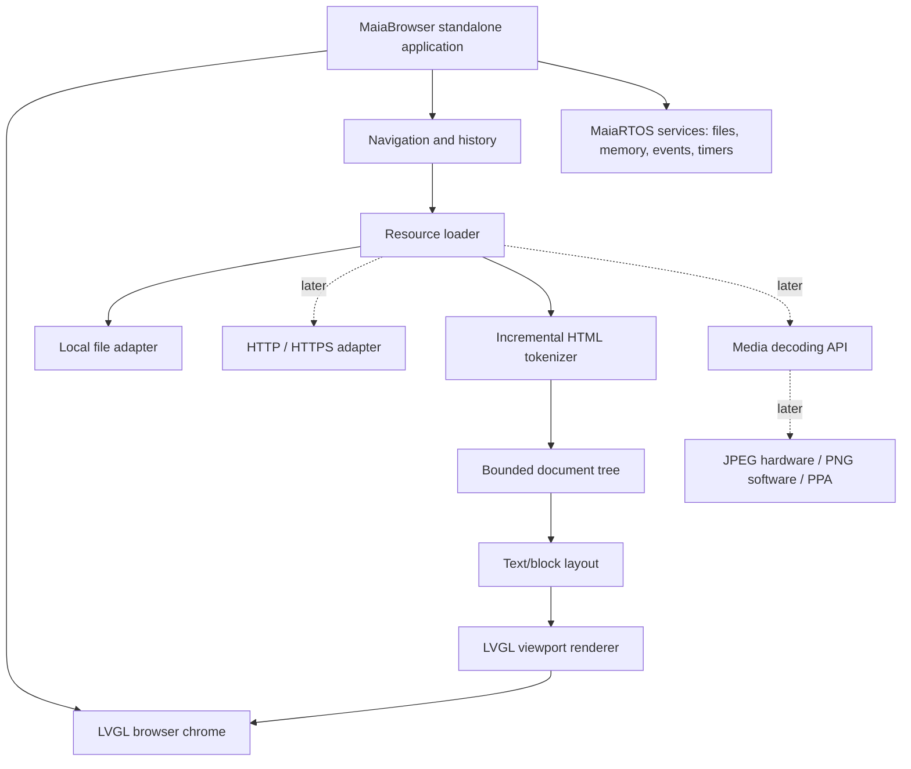

# MaiaBrowser — Incremental Project Plan

**Status:** Proposed architecture, not an implementation report  
**Target:** MaiaRTOS on ESP32-P4 / M5Stack Tab5  
**Initial release:** MaiaBrowser 0.1 — Offline HTML Viewer  
**Language:** C++ (standalone MaiaRTOS application)  
**UI:** LVGL through the MaiaRTOS desktop/application API

## 1. Executive summary

MaiaBrowser is a lightweight, Lynx-inspired browser for MaiaRTOS. It starts as an offline HTML document viewer and evolves toward HTTP(S), images, limited CSS, forms, and selected multimedia. It must run as a **standalone application**, not as code embedded in the desktop executable. The HTML engine must be reusable by other MaiaRTOS applications and, eventually, MaiaScript Native.

The desktop already has a syntax-highlighting editor. Its text-handling infrastructure is a potential reuse point, **subject to code inspection**; HTML parsing and rendering must not assume that editor syntax highlighting is an HTML parser.

### Design principles

1. **Standalone first:** the browser has its own application lifecycle and uses stable system APIs.
2. **Offline first:** no network dependency in the first milestone.
3. **Separation of concerns:** fetching, HTML tokenization, document model, layout, LVGL rendering, and navigation are independent components.
4. **Bounded resources:** cap input size, DOM nodes, nesting depth, decoded image size, and processing work per UI iteration.
5. **Graceful failure:** malformed documents must not crash the application or kernel.
6. **Incremental hardware acceleration:** hardware JPEG/PPA/DMA integration is optional and isolated behind media APIs.
7. **No full-web compatibility claim:** JavaScript, full CSS and browser-grade HTML error recovery are out of scope initially.

## 2. Existing-system assumptions and verification checklist

The following are **reported project characteristics**, not verified against a specific MaiaRTOS commit:

- ESP32-P4 is the hardware target.
- MaiaRTOS has an LVGL desktop and window management.
- Applications previously embedded in the desktop are being separated into standalone programs.
- A desktop editor already provides syntax highlighting.

Before coding, inspect the current MaiaRTOS tree and record: application entrypoint, startup/shutdown, event loop ownership, LVGL thread/context rules, window creation, filesystem interface, allocator, logging, timer API, build targets, loader/linking conventions, and available networking drivers. Avoid inventing or hardcoding API names until verified.

**Gate G0:** a minimal standalone application opens and closes an LVGL window repeatedly without leaks or desktop instability.

## 3. High-level architecture



### Proposed internal modules

| Module | Responsibility | MVP |
|---|---|---|
| `browser_app` | Standalone lifecycle, window and commands | Yes |
| `resource_loader` | Read local documents with bounded buffers | Yes |
| `html_tokenizer` | Tokens, attributes, entities, comments, error handling | Yes |
| `document_tree` | Compact, bounded node representation | Yes |
| `layout_engine` | Paragraph flow, line breaks, links and scroll extents | Yes |
| `lvgl_view` | Rendering and hit testing | Yes |
| `navigation` | URLs, history, relative paths and anchors | Yes |
| `http_client` | HTTP/1.1, redirects, transfer encoding | Later |
| `tls_adapter` | Certificate-validated HTTPS | Later |
| `image_decoder` | JPEG, PNG, memory-budgeted images | Later |
| `css_subset` | Explicitly supported style properties | Later |
| `forms` | GET/POST, controls and focus | Later |

## 4. Milestones and acceptance criteria

### Phase 0 — Integration audit and empty window

**Work:** inspect actual standalone application template; identify desktop window API, LVGL ownership, filesystem, heap, logging and event loop; create empty browser window with toolbar placeholder. Verify clean close/reopen.

**Deliverables:** `docs/integration-audit.md`, buildable standalone app skeleton, lifecycle smoke test.

**Acceptance:** 100 consecutive open/close cycles without observable resource growth or a system crash; correct focus and desktop interaction.

### Phase 1 — Local HTML reader (MaiaBrowser 0.1)

**Scope:** open `.html` files from local storage. Parse text, comments, entities, attributes and elements `html`, `head`, `title`, `body`, `h1`–`h6`, `p`, `br`, `strong`, `b`, `em`, `i`, `pre`, `a`, `ul`, `ol`, `li`. Ignore unsupported tags safely, preserving readable text where practical.

**Implementation sequence:**

1. Bounded file loader with UTF-8 validation/replacement policy.
2. Incremental tokenizer with quoted/unquoted attributes and named/numeric entity decoding for a defined subset.
3. Compact document representation with text spans, block nodes and link targets.
4. Block layout with line wrapping and scrollable viewport.
5. LVGL rendering using a bounded number of widgets or a custom-draw viewport; do **not** create one widget per word.
6. Local relative links, `#fragment` anchors and page title.

**Deliverables:** offline viewer, parser tests, sample HTML fixtures, performance log.

**Acceptance:** sample pages display correctly; links work; large or malformed inputs terminate with a clear error or degrade safely; UI stays responsive.

### Phase 2 — Navigation and usability

**Scope:** address/path bar, back, forward, reload, bookmarks, scroll position, keyboard and touch navigation, source-view mode. Explore reuse of editor text spans for source highlighting after verifying implementation.

**Acceptance:** navigate between at least 20 local documents, including anchors, without losing history integrity or leaking document trees.

### Phase 3 — Networking

**Prerequisites:** verify or implement network interface, DNS, TCP, time source and TLS. ESP32-P4 requires an external network interface for Wi-Fi connectivity.

**Scope:** HTTP/1.1 GET, response size limits, `Content-Length`, chunked transfer, redirects with maximum hop count, timeouts, cancellation and nonblocking/asynchronous loading. Then HTTPS with certificate validation, hostname checks and a trust-store/update strategy.

**Acceptance:** retrieve a small controlled HTTP test site; handle redirect loops, truncated responses, invalid certificates and timeouts without freezing LVGL. Never silently downgrade HTTPS to HTTP.

### Phase 4 — Images and media infrastructure

**Scope:** reusable `Maia Media API`, JPEG decoding via hardware where feasible, PNG software fallback, image cache, bounds checking, pixel conversion/scaling using PPA when beneficial. Verify exact peripheral behavior and driver dependencies on real hardware.

**Acceptance:** display representative JPEG/PNG files; reject malformed images; enforce maximum dimensions and decoded-byte budget; measure peak RAM and decode latency.

**Note:** hardware H.264 **encoding** does not imply hardware H.264 **decoding**. Video playback requires a separate feasibility study.

### Phase 5 — Basic CSS and forms

**CSS subset:** text color, background color, font weight/style/size (bounded), margins/padding, simple block/inline display, basic width constraints. Define explicit cascade and unsupported-property behavior.

**Forms:** text fields, buttons, checkbox, radio, select, GET and POST submission, URL encoding, focus navigation.

**Acceptance:** curated fixture pages render consistently and forms send correctly encoded requests to a controlled endpoint.

### Phase 6 — Optimization and 1.0 candidate

**Scope:** downloads, bookmarks persistence, partial layout/viewport rendering, document/image caches with eviction, low-memory behavior, fault injection, longer soak tests, user documentation.

**Acceptance:** defined memory budget met on target hardware, repeated browsing without leaks, reproducible tests, no kernel hangs from malformed content.

## 5. Initial MVP interface

```text
+--------------------------------------------------+
| MaiaBrowser                                  [X] |
+--------------------------------------------------+
| [<] [>] [R]  file:///docs/index.html             |
+--------------------------------------------------+
| MaiaRTOS Documentation                           |
|                                                  |
| Welcome to MaiaRTOS.                             |
|                                                  |
|  • Getting Started                               |
|  • Applications                                  |
|  • Hardware                                      |
|                                                  |
| [Getting Started]                                |
|                                                  |
+--------------------------------------------------+
| Local document  |  Ready                         |
+--------------------------------------------------+
```

Navigation is file-based in 0.1. A URL parser should already distinguish schemes, but only `file:` and relative paths are enabled until networking is ready.

## 6. Security and robustness

- Treat every HTML file, response, image and URL as untrusted.
- Apply configurable limits for source bytes, token length, attribute count, node count, nesting depth, line length and total rendered text.
- Reject or normalize path traversal (`..`) according to the filesystem sandbox policy.
- Avoid executing scripts, arbitrary commands, embedded binaries or external resources in the MVP.
- Prevent UI starvation by yielding between parsing/layout batches.
- Define allocator failure behavior and unwind partially built trees.
- Do not assume standalone applications provide memory isolation; protect the kernel with strict validation and resource limits.
- HTTPS must validate certificates and hostnames; absence of a trusted clock/trust store is a release blocker for HTTPS.

## 7. Testing strategy

### Unit tests (host simulator first)

| Area | Positive cases | Negative / stress cases |
|---|---|---|
| Tokenizer | text, tags, attrs, entities, comments | missing quotes, oversized token, malformed UTF-8 |
| Tree | nested blocks, links, lists | excessive nesting, missing close tags |
| Layout | wrapping, `pre`, long lines, anchors | tiny viewport, enormous paragraph |
| Navigation | relative path, history, fragment | path traversal, invalid scheme, loops |
| Files | empty, small, UTF-8, multi-page | missing file, partial read, huge file |
| LVGL lifecycle | open, scroll, resize, close | repeated open/close, low memory |
| HTTP/TLS later | redirects, chunked, valid cert | timeout, truncated body, invalid cert |
| Images later | valid JPEG/PNG | corrupt headers, decompression bombs |

### Suggested fixture tree

```text
maia-browser/
  README.md
  docs/
    architecture.md
    integration-audit.md
    test-plan.md
  src/
    app/
    core/
      resource_loader/
      html_tokenizer/
      document_tree/
      layout/
      navigation/
    platform/
      maiartos/
    ui/
      lvgl/
  tests/
    fixtures/
      simple.html
      headings.html
      links.html
      lists.html
      entities.html
      malformed.html
      long-document.html
    unit/
    integration/
    fuzz/
  tools/
```

### Measurement protocol

Collect peak heap usage, allocation count, time to first text, total parse/layout time, scroll responsiveness, and free memory after close. Record board, firmware commit, compiler flags, document fixture and run count. Set numerical pass/fail budgets **after** the Phase 0 baseline rather than inventing limits now.

## 8. Work breakdown for the first implementation cycle

- [ ] Audit current MaiaRTOS standalone application ABI and LVGL lifecycle.
- [ ] Create a buildable `maia-browser` standalone target.
- [ ] Add bounded local file reader.
- [ ] Implement tokenizer and unit tests on desktop/host.
- [ ] Implement document tree and parser tests.
- [ ] Implement block layout and link hit testing.
- [ ] Integrate LVGL viewport and navigation.
- [ ] Run malformed-file, memory and repeated lifecycle tests on Tab5.
- [ ] Tag MaiaBrowser 0.1 only after acceptance gates pass.

## 9. Future integration with MaiaScript Native

Keep the browser's reusable modules accessible through narrow C/C++ interfaces. Once the MaiaScript compiler and native application ABI are stable, expose safe wrappers for file access, HTTP, document parsing and UI widgets. Do not couple the initial browser release to completion of MaiaScript or MaiaASM.

## 10. Open architectural decisions

1. What exact MaiaRTOS standalone binary format, loader and symbol ABI are currently used?
2. Who owns the LVGL event loop and when may standalone apps call LVGL?
3. Does the existing editor offer reusable styled-text rendering, or only syntax tokenization?
4. Which filesystem(s) and paths are available to apps?
5. What RAM/PSRAM budgets are realistic for the browser?
6. Which networking components are already operational?
7. Is an application sandbox or capability system planned?
8. What input devices and focus conventions must be supported?

## 11. Definition of done for MaiaBrowser 0.1

A user can launch MaiaBrowser from the MaiaRTOS desktop, open a local HTML file, read formatted headings/paragraphs/lists, follow local links, scroll with the available input devices, return to the desktop, and relaunch the browser repeatedly. Malformed files produce a recoverable error instead of a system crash. The tokenizer, document model and layout engine are independently testable, and memory/performance measurements are recorded on the ESP32-P4.

---

**Implementation note:** This document is a project proposal. API names, filesystem conventions, compiler/linker commands and peripheral integrations must be reconciled with the current MaiaRTOS source before implementation.
