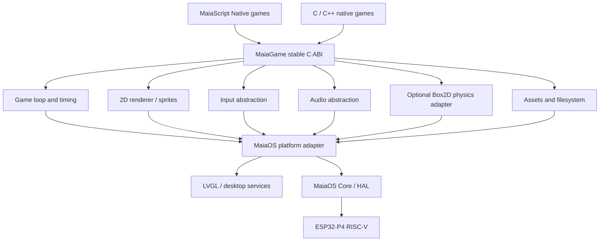

# MaiaGame — Native 2D Game Framework for MaiaOS

**Engineering proposal and implementation roadmap**  
**Version:** 0.1 (proposal)  
**Date:** November 2026  
**Project ecosystem:** Maia Platform / MaiaOS / MaiaScript Native  
**Initial target:** M5Stack Tab5, ESP32-P4 (RISC-V)

> **Status:** This document defines a proposed API and roadmap. It does not claim that the MaiaGame library, Box2D integration, or additional board ports have already been implemented. The MaiaOS desktop and native application environment are the project's existing foundation, as reported by its developer.

## 1. Executive summary

MaiaGame is a small, modular, native 2D game framework designed for MaiaOS. It combines a portable game loop, 2D physics, sprite rendering, input handling, audio, and asset management with the existing MaiaOS standalone application model and LVGL desktop. It is intended to support retro arcade games, physics puzzles, educational simulations, and games written in MaiaScript Native or C/C++.

The initial proof of concept will compile the **C-language Box2D physics engine** for the ESP32-P4 target and render a small scene using LVGL. A second milestone will produce a complete Breakout-style game. MaiaGame must remain usable without Box2D for games that only need simple arcade collision detection.

**Primary design principle:** a portable game framework, with explicit board-specific adapters. A game engine that can compile on a board does not automatically mean that MaiaOS itself supports that board.

## 2. Goals and non-goals

### Goals

- Build and run native 2D games as MaiaOS standalone applications.
- Provide a stable, narrow C ABI callable from MaiaScript Native and C/C++.
- Offer a simple game loop, input, 2D drawing, sprites, audio, timers, and optional physics.
- Integrate with the MaiaOS desktop and LVGL without bypassing application lifecycle or GUI-thread ownership.
- Target a practical performance envelope determined by measurements on actual ESP32-P4 hardware.
- Preserve a path toward additional ESP32-P4 boards and, eventually, other processor architectures.
- Make the framework attractive to hobbyists, educators, embedded developers, and device manufacturers.

### Non-goals for version 0.1

- A 3D engine, Vulkan/OpenGL, or a desktop-class browser runtime.
- Full Box2D editor tooling, network multiplayer, or a generalized scripting VM.
- Compatibility with commercial game ROMs or copyrighted game assets.
- Promising a particular FPS before on-device profiling.
- Claiming native RV32 binaries run on ESP32-S3/Xtensa hardware.

## 3. Platform facts and adoption strategy

| Device / family | Processor | Display / positioning | Proposed status |
|---|---|---|---|
| **M5Stack Tab5** | ESP32-P4, RISC-V | 5-inch 1280×720 touchscreen, 32 MB PSRAM | **Tier 1:** reference implementation and first benchmarks |
| **Waveshare ESP32-P4 boards** | ESP32-P4, RISC-V | Multiple touch LCD and development board variants | **Tier 2:** board-support package and driver validation |
| **LILYGO T-Deck** | ESP32-S3, Xtensa LX7 | 2.8-inch 320×240 LCD, keyboard and trackball | **Future port only:** requires different CPU toolchain, board support, and MaiaOS adaptation |
| **LILYGO T-Deck Plus** | ESP32-S3, Xtensa LX7 | 2.8-inch 320×240 touchscreen, keyboard and trackball | **Future port only:** same architecture distinction |

The T-Deck family is strategically interesting because it combines a compact screen and physical controls. However, it is **not an ESP32-P4 family**. A portable MaiaGame core could be compiled separately for Xtensa, but a MaiaOS port and an architecture-specific MaiaScript compiler/backend would be separate efforts.

### Portability tiers

1. **Game source portability:** game logic uses the public MaiaGame API, not hardware registers.
2. **Engine portability:** platform-neutral C/C++ modules build for multiple targets.
3. **Runtime portability:** each target provides memory, timers, display, input, audio, filesystem, and synchronization adapters.
4. **OS portability:** MaiaOS boot, scheduler, application loader, executable ABI, and MaiaScript compiler must support that CPU/board.

A board is only described as *supported* after its complete integration tests pass.

## 4. High-level architecture



### Core modules

- `game_core`: lifecycle, update loop, timekeeping, pause/resume, error codes.
- `game_render`: coordinate transforms, primitives, sprites, clipping, draw batching where feasible.
- `game_input`: keyboard, touchscreen, gamepad abstraction and remappable actions.
- `game_physics`: optional Box2D adapter, world/body/shape handles, contacts.
- `game_audio`: sound effects, volume, optional mixing, backend capabilities.
- `game_assets`: images, palettes, sprite sheets, asset manifests and caches.
- `game_platform_maiaos`: desktop window, LVGL, memory, synchronization and timers.
- `game_platform_host`: desktop host adapter for automated tests and profiling.

## 5. Physics engine selection

**Preferred candidate:** Box2D, current C API. The version selected for the port must be pinned to a specific upstream tag and its build and license verified before release. Disable unsupported SIMD paths and avoid sample/test dependencies in the firmware build. Keep the physics library optional so simpler games do not pay its code-size and RAM costs.

### Physics integration requirements

- Build as a static library for the exact MaiaOS RV32 toolchain, ABI and floating-point configuration.
- Check target compiler support for the selected Box2D release's C language requirements.
- Avoid assuming that a desktop CMake build automatically works with a freestanding runtime.
- Audit allocations, alignment, atomics, math intrinsics, threading hooks, and standard library dependencies.
- Use a **fixed physics timestep** (initially 1/60 s) and a bounded catch-up accumulator.
- Run world mutations and simulation steps under a defined single-owner policy.
- Translate physics contacts to a bounded event queue; do not mutate the LVGL object tree inside physics callbacks.
- Expose opaque, generation-checked handles rather than raw pointers.
- Establish hard caps on bodies, fixtures/shapes, contacts, and memory usage.

### Initial physics benchmark

A world containing a static floor and 100 falling boxes should be measured on the Tab5, including: step time (mean/p95), render time (mean/p95), total frame time, memory high-water mark, fragmentation indicators, contact count, and sustained FPS. Repeat with 25, 50, 100, and 200 boxes. These are test workloads, **not performance promises**.

## 6. Rendering with LVGL

LVGL is the desktop/UI framework, but games require a deliberately designed rendering path. MaiaGame should start with a dedicated game surface inside a MaiaOS application window and avoid creating/destroying hundreds of LVGL widgets every frame.

**Candidate rendering backends:**

1. **Canvas/framebuffer path:** draw sprites/primitives into a managed buffer, then invalidate the game surface.
2. **Custom draw path:** use supported LVGL drawing APIs for scene rendering where appropriate.
3. **Hardware-assisted path:** optionally use ESP32-P4 PPA/DMA for supported transfers, conversions or scaling after benchmarking.

Do not assume JPEG acceleration decodes PNG, or that hardware H.264 encoding provides H.264 decoding. Use the existing MaiaOS media services if they are available; otherwise implement explicit adapters.

### Rendering contract

- Game coordinates are independent of physical screen resolution.
- Support integer/pixel-perfect scaling for retro graphics.
- Preserve aspect ratio with optional letterboxing.
- Clip all drawing to the game's viewport.
- Keep asset decoding outside the GUI-critical path whenever possible.
- Make all LVGL operations on the designated GUI owner task or via its event queue.
- Account for buffer ownership and cache/DMA synchronization when hardware acceleration is used.

### Suggested initial resolutions

- Logical resolution: **320×180** or **320×240**.
- Tab5 physical display: scale to its 1280×720 panel with suitable aspect handling.
- T-Deck future target: 320×240 logical resolution, once its separate port exists.

## 7. Input, audio and assets

### Input

Define normalized actions (`LEFT`, `RIGHT`, `UP`, `DOWN`, `CONFIRM`, `BACK`, `PAUSE`) and raw key/touch events. Support keyboard, touch controls, and future controllers without embedding device-specific key codes in games.

### Audio

Start with optional short sound effects and capability queries. Audio must be non-blocking and should degrade gracefully if the board or MaiaOS build has no configured audio output. Do not assume the presence of a speaker or a working mixer merely because the SoC has audio interfaces.

### Assets

Use a small, versioned manifest and resource IDs. Favor compact textures/sprite sheets, bounds-checked loading, and predictable ownership. A simple asset pack format may be introduced after the initial game works. Avoid shipping third-party copyrighted sprites or sounds without permission.

## 8. Proposed public API

The following is a **design sketch**, not a declaration of implemented functions. A stable C ABI should underlie any MaiaScript-friendly syntax.

| Namespace | Function | Description |
|---|---|---|
| `game` | `create(width, height, title)` | Create a game session and logical viewport |
| `game` | `isRunning(session)` | Test whether the session remains active |
| `game` | `poll(session)` | Dispatch input and lifecycle events |
| `game` | `deltaTime(session)` | Read elapsed time for presentation logic |
| `game` | `beginFrame(session)` | Begin a render frame |
| `game` | `endFrame(session)` | Submit the frame to the UI adapter |
| `game` | `destroy(session)` | Release session-owned resources |
| `game.draw` | `clear(session, color)` | Clear viewport |
| `game.draw` | `rect(session, x, y, w, h, color)` | Draw a rectangle |
| `game.draw` | `sprite(session, image, x, y)` | Draw an image/sprite |
| `game.input` | `down(session, action)` | Query held input action |
| `game.input` | `pressed(session, action)` | Query edge-triggered input |
| `game.physics` | `createWorld(gx, gy)` | Create a physics world |
| `game.physics` | `createBox(world, x, y, w, h, dynamic)` | Create a box body |
| `game.physics` | `createCircle(world, x, y, radius, dynamic)` | Create a circular body |
| `game.physics` | `step(world, fixedDt)` | Advance simulation by fixed time |
| `game.physics` | `position(body)` | Read body transform |
| `game.physics` | `destroyWorld(world)` | Destroy world and invalidate child handles |
| `game.audio` | `play(soundId)` | Queue an audio effect when supported |
| `game.assets` | `loadImage(path)` | Load an image with explicit error handling |

**API refinements required before implementation:** return types and error codes; handle encoding; ownership; color and coordinate types; collision filter configuration; body destruction; event delivery; capability discovery; input mapping; audio resource management; version negotiation; and ABI stability policy.

### C ABI illustration

```c
/* Illustrative signatures only; not implemented. */
typedef uint32_t mg_handle_t;
typedef enum { MG_OK = 0, MG_ERR_INVALID = -1, MG_ERR_NOMEM = -2,
               MG_ERR_UNSUPPORTED = -3 } mg_result_t;

mg_result_t mg_game_create(int32_t width, int32_t height,
                           const char *title, mg_handle_t *out_game);
mg_result_t mg_game_poll(mg_handle_t game);
mg_result_t mg_game_destroy(mg_handle_t game);
```

### MaiaScript Native illustration

This example uses the project's C-like MaiaScript syntax. It is **conceptual**: names and calling conventions require compiler/runtime integration.

```c
// MaiaGame API proposal — illustrative, not yet executable.
i32 main() {
    i32 app = game.create(320, 240, "MaiaGame Demo");
    i32 world = game.physics.createWorld(0.0, 9.8);
    i32 ball = game.physics.createCircle(world, 160.0, 20.0, 10.0, true);

    while (game.isRunning(app)) {
        game.poll(app);
        game.physics.step(world, 1.0 / 60.0);
        game.beginFrame(app);
        game.draw.clear(app, 0x101820);
        game.physics.renderDebug(world, app);
        game.endFrame(app);
    }

    game.physics.destroyWorld(world);
    game.destroy(app);
    return 0;
}
```

`game.physics.renderDebug` is a **development-only helper proposal**, not a Box2D function.

## 9. Application lifecycle and safety

1. The MaiaOS loader creates an application context and capability set.
2. MaiaGame creates a game surface/window through desktop services.
3. Assets load with explicit quotas and error reporting.
4. The game processes input, updates logic and physics, then submits rendering.
5. Suspend/resume events pause physics timing and audio safely.
6. Closing the application stops callbacks, frees bodies/assets and invalidates handles.
7. No background worker may call LVGL directly unless synchronized through the GUI ownership model.

### Resource controls

- Per-application memory budget and diagnostics.
- Bounded queues and fixed upper limits on simulation catch-up.
- Watchdog-friendly frame scheduling; avoid busy waiting.
- Explicit cleanup of all native allocations and callbacks.
- Input and filesystem permissions managed by MaiaOS, not by the physics engine.
- Reject malformed asset files and invalid handles without crashing the desktop.

## 10. Repository structure

```text
maiagame/
├── README.md
├── LICENSES/
├── docs/
│   ├── architecture.md
│   ├── api.md
│   ├── porting.md
│   └── benchmarks.md
├── include/maia_game/
│   ├── game.h
│   ├── render.h
│   ├── input.h
│   ├── physics.h
│   ├── audio.h
│   └── assets.h
├── src/
│   ├── core/
│   ├── render/
│   ├── input/
│   ├── physics/
│   ├── audio/
│   ├── assets/
│   └── platform/
│       ├── maiaos_esp32p4/
│       └── host/
├── third_party/
│   └── README.md
├── examples/
│   ├── falling_boxes/
│   ├── breakout/
│   ├── pinball/
│   └── maiascript/
├── tests/
└── tools/
```

Use a pinned dependency or submodule for Box2D with documented upstream revision and license. Keep platform-specific code isolated under `src/platform`.

## 11. Incremental implementation plan

| Phase | Deliverable | Exit criterion |
|---|---|---|
| **0 — Platform audit** | Confirm MaiaOS ABI, allocator, GUI task, filesystem, toolchain and build mode | Minimal standalone game window builds and closes cleanly |
| **1 — Box2D port** | Pinned C Box2D static build, SIMD disabled as appropriate | Headless falling-box test passes on target |
| **2 — Rendering** | LVGL game surface and coordinate scaling | 100 boxes visible; no GUI-thread violations |
| **3 — Input/timing** | Keyboard/touch mapping, fixed-step accumulator, pause/resume | Interactive physics demo remains responsive |
| **4 — Public ABI** | Opaque handles, error codes, versioning, lifecycle | C/C++ example uses only public headers |
| **5 — MaiaScript binding** | Native compiler/runtime bindings | MaiaScript example runs as standalone application |
| **6 — Breakout** | Full small game with title, scoring, restart, assets | Playable on Tab5 with measured resource use |
| **7 — Audio/assets** | Resource pack, sound effects, diagnostics | Repeated start/stop stress test passes |
| **8 — Additional P4 board** | Waveshare BSP adapter | Same sample game passes board acceptance suite |
| **9 — Future architecture** | Feasibility of ESP32-S3/T-Deck port | Separate compiler/OS/runtime port approved before compatibility claims |

## 12. Benchmark and quality plan

### Benchmarks

- Physics step duration (mean, p95, p99).
- Render submission and flush duration.
- FPS and frame-time stability.
- Peak and steady-state RAM; internal RAM versus PSRAM usage.
- Binary size and optional-feature footprint.
- Input latency and touch responsiveness.
- Audio underruns if enabled.
- Application startup/shutdown time.

### Test matrix

- Physics: no bodies, 25/50/100/200 bodies, stacked bodies, sleeping, joints, collision filters.
- Rendering: viewport resize, portrait/landscape, clipping, sprite transparency, frame buffer exhaustion.
- Lifecycle: close while active, suspend/resume, repeated restart, failed asset loads.
- Input: keyboard, touch, focus changes, multiple simultaneous actions.
- Memory: allocation failures, invalid handles, double-destroy attempts, asset corruption.
- Determinism: fixed-step reference scenes, with floating-point tolerance and recorded inputs.
- Portability: host reference build versus Tab5 and subsequent boards.

### Initial acceptance criteria

- Falling-box demo runs without crashes or memory leaks during a sustained test.
- Desktop remains responsive during simulation.
- No unsynchronized LVGL calls from worker tasks.
- Fixed-step timing does not spiral under overload; catch-up steps are capped.
- Every resource is released when the standalone application exits.
- A small Breakout game is playable through the documented public API.

Numerical performance thresholds should be set **after** baseline measurements rather than invented in advance.

## 13. Developer experience and ecosystem

MaiaGame should provide a short getting-started guide, examples in MaiaScript Native and C, host-side unit tests, reproducible builds, and a visible hardware compatibility matrix. Developers should be able to create a game without knowing the LVGL internal object model or Box2D internals.

Suggested showcase projects:

- **Falling Boxes:** physics, performance and visual diagnostics.
- **Breakout:** collision, input, scoring and game states.
- **Pinball Mini:** joints, restitution and collision events.
- **Platformer:** simple character controller and tile/sprite rendering.
- **Physics Lab:** interactive educational simulation suitable for classroom demonstrations.

For adoption, prioritize open-source example games, a straightforward porting guide, reproducible benchmark results, and manufacturer-friendly board support. Avoid claiming endorsement or partnerships with device manufacturers until confirmed.

## 14. Risks and mitigations

| Risk | Mitigation |
|---|---|
| Box2D requires unavailable runtime or compiler features | Audit dependencies, pin version, adapt platform hooks, and keep simple collision fallback |
| Rendering at native panel resolution is expensive | Low logical resolution, scaling, dirty regions, controlled buffers |
| LVGL is accessed from the wrong task | GUI owner task and message queue; assert in debug builds |
| PSRAM latency and fragmentation | Memory budgets, pools, asset limits, telemetry |
| Variable frame rate destabilizes physics | Fixed timestep and bounded accumulator |
| CPU architecture mismatch on T-Deck | Treat Xtensa as a separate port, not an RV32 binary target |
| API churn breaks MaiaScript programs | Versioned C ABI and compatibility tests |
| Third-party license mistakes | Maintain notices and audit dependency trees before distribution |

## 15. Licensing and governance

Box2D is distributed under the MIT license (verify the pinned upstream revision). The MaiaGame project's own license should be selected by its maintainers; this proposal does **not** impose a license. If incorporating third-party image, audio, font, or sample assets, record their licenses separately. Provide attribution and retain required copyright notices.

Recommended governance: public issues, reproducible build scripts, semantic API versioning, hardware-support labels (`experimental`, `tested`, `supported`), and documented acceptance tests for each device.

## 16. Immediate next actions

1. Audit the existing MaiaOS application ABI and LVGL integration points.
2. Create the `maiagame` repository with the modular structure above.
3. Pin and cross-compile the current Box2D C release for the Tab5 toolchain.
4. Run a headless 100-box physics benchmark and record memory/timing.
5. Build the LVGL game surface and render the benchmark scene.
6. Add keyboard/touch controls and implement the first Breakout prototype.
7. Define and stabilize the C ABI before exposing MaiaScript Native bindings.

## 17. References

- Box2D source and license: https://github.com/erincatto/box2d
- Box2D documentation: https://box2d.org/
- LVGL documentation: https://docs.lvgl.io/
- M5Stack Tab5 hardware: https://docs.m5stack.com/en/core/Tab5
- Waveshare ESP32-P4 device family: https://docs.waveshare.com/ESP32-P4
- LILYGO T-Deck hardware: https://wiki.lilygo.cc/products/t-deck-series/t-deck/
- LILYGO T-Deck Plus hardware: https://wiki.lilygo.cc/products/t-deck-series/t-deck-plus/

---

**MaiaGame:** *A native 2D game framework for the MaiaOS ecosystem — starting on ESP32-P4, designed for portability.*
