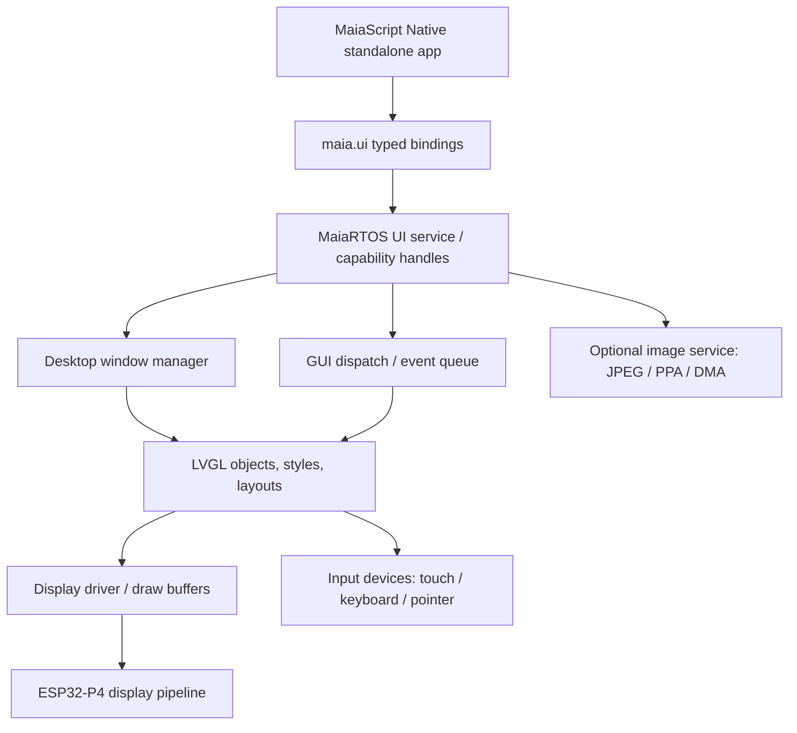

# MaiaScript Native — Graphics and UI API User Guide

**Edition:** 0.1 — Proposed API and implementation contract  
**Target:** MaiaRTOS on ESP32-P4 / M5Stack Tab5  
**Rendering engine:** LVGL (version and enabled modules to be pinned by the port)  
**Audience:** MaiaScript application authors, compiler/runtime implementers, and MaiaRTOS desktop developers  
**Status:** **DESIGN PROPOSAL — NOT AN IMPLEMENTED OR VERIFIED API**

> **Read this first.** This guide proposes a stable, typed MaiaScript-facing interface over LVGL and the MaiaRTOS desktop. Its calls, constructors, event types, and return values are **not** claimed to exist in the current firmware. The examples are intended as executable-style design targets, not as compiler-tested programs. Confirm the MaiaCC grammar, compiler ABI, LVGL version/configuration, and actual desktop/window-manager interfaces before implementing the binding. The existing editor's syntax highlighting is a promising integration point, but its reusable interface has not been audited.

## Contents

1. Scope and design philosophy
2. Architecture and ownership
3. Getting started
4. Types, constants, and errors
5. Application lifecycle and windows
6. Widget reference
7. Layout and geometry
8. Styles, themes, and fonts
9. Events, callbacks, and input
10. Images, drawing, and multimedia
11. Animations, timers, and asynchronous work
12. Dialogs, keyboard, and accessibility
13. Source editor and MaiaBrowser integration
14. Resource management and performance
15. Security, ABI, and LVGL interoperability
16. Complete application examples
17. Migration from JavaScript MaiaScript
18. Implementation roadmap and acceptance tests
19. API quick reference

---

## 1. Scope and design philosophy

`maia.ui` is the **public native graphical API** for MaiaScript programs. It deliberately does **not** expose raw `lv_obj_t*` pointers or allow an application to own the physical display. Applications create **desktop-managed windows**, and those windows contain widget trees. The MaiaRTOS desktop, display service, input router, and LVGL integration remain in control.

**Goals:** small predictable native calls; C/JavaScript-like MaiaScript syntax; touch, keyboard, and pointer input; bounded memory; explicit ownership; compatibility with independent native executables; optional graphics acceleration without hardware-specific application code.

**Non-goals for v0.1:** full browser DOM/CSS, arbitrary user-defined LVGL drivers, JavaScript execution, direct display ownership, unbounded image buffers, automatic thread-safe LVGL calls, or transparent compatibility with browser APIs.

**Feature tiers:**

| Tier | Scope | Examples |
|---|---|---|
| **G0** | Minimum usable desktop UI | Window, Label, Button, TextArea, events, layout, close |
| **G1** | Common application widgets | Checkbox, Switch, Slider, Dropdown, List, Table, dialogs |
| **G2** | Rich rendering | Image, Canvas, Chart, styles, fonts, animation |
| **G3** | Advanced/optional | Rich text, syntax highlighting, keyboard/IME, virtualized lists, custom drawing |

**Terminology:** `ui` is the user-facing namespace in examples, equivalent to the proposed module `maia.ui`; the implementation may expose `import maia.ui;` and/or a short alias. LVGL names in this guide describe *capabilities*, not a one-to-one promise of API or widget availability.

## 2. Architecture and ownership



The GUI service owns the LVGL context. An application owns **handles**, not raw LVGL pointers. Every widget has one parent; destroying a parent invalidates all descendants. Windows are top-level desktop resources, not raw LVGL screens. Only the GUI owner context may directly mutate LVGL state; background workers send commands/messages to it. A standalone app must be able to exit without leaving callbacks, timers, image buffers, or widgets behind.

### Suggested object relationships

```text
Application
  └─ Window (desktop-managed)
       └─ Root container
            ├─ Label
            ├─ Button
            └─ Panel
                 ├─ TextArea
                 └─ Image
```

**Design decision:** public objects are typed wrappers around opaque 32-bit-or-larger capability IDs. A handle should encode or validate an owner and generation to reject stale references after destruction. Handle size is a design choice; do not assume pointer-size identity.

## 3. Getting started

### 3.1 Hello window

```maiascript
import maia.ui;

void greet(ui.Event event) {
    ui.MessageBox.show("Hello", "Welcome to MaiaRTOS!");
}

i32 main() {
    ui.Window win = ui.Window("Hello Maia", 420, 260);
    ui.Label title = ui.Label(win, "MaiaScript Native");
    ui.Button button = ui.Button(win, "Say hello");
    button.onClick(greet);
    win.show();
    return ui.run();
}
```

**Proposed behavior:** the desktop creates a managed window; its children are owned by it; `ui.run()` dispatches events until the window is closed or the app requests exit. In an existing system-wide GUI loop, `ui.run()` may instead be a thin wait/dispatch wrapper; it must **not** start a second LVGL timer handler.

### 3.2 Recommended application pattern

```maiascript
import maia.ui;

void onClose(ui.Event event) {
    ui.quit(0);
}

i32 main() {
    ui.Window win = ui.Window("Application", 480, 320);
    win.onClose(onClose);
    win.show();
    return ui.run();
}
```

**Compiler note:** the above callback syntax uses ordinary named functions and typed parameters, matching the direction of the candidate MaiaScript grammar. Import aliases, constructors, and `ui.Event` types remain proposed. Avoid assuming lambdas, closures, dynamic JavaScript objects, or arbitrary variadic calls are available.

## 4. Types, constants, and errors

### 4.1 Primitive types

| Type | Meaning | Contract |
|---|---|---|
| `i32`, `u32` | Integer dimensions, IDs, colors | Native fixed-width values |
| `bool` | Toggle / visibility | `true` or `false` |
| `string` | Text | UTF-8; lifetime and copy rules defined below |
| `ui.Color` | RGBA or opaque packed color | Use constructors, never assume channel layout |
| `ui.Point` | x/y position | Pixel coordinates in window content space |
| `ui.Size` | width/height | Nonnegative dimensions |
| `ui.Rect` | x/y/width/height | Bounded rectangle |
| `ui.Event` | Event descriptor | Valid for the duration of the callback |
| `ui.Widget` | Base widget handle | Opaque, owner-scoped, generation-checked |
| `ui.Window` | Top-level desktop window | Managed by desktop service |
| `ui.ImageSource` | File, memory, or decoded resource | Explicit lifetime and format |

### 4.2 Color helpers

| Function | Description |
|---|---|
| `ui.rgb(u8 r, u8 g, u8 b) -> ui.Color` | Construct an opaque color |
| `ui.rgba(u8 r, u8 g, u8 b, u8 a) -> ui.Color` | Construct color with alpha |
| `ui.colorHex(u32 rgb) -> ui.Color` | Interpret `0xRRGGBB` |

```maiascript
ui.Color accent = ui.colorHex(0x26A269);
```

### 4.3 Error handling

**Normative proposal:** operations that can fail return `ui.Status` or `Result<T, ui.Error>`; basic property setters may be `void` only if their failure is surfaced through a documented error channel. The short examples omit status checks for readability. Real code must check allocation, invalid handles, missing fonts/images, unsupported widgets, and queue failures.

| Error | Meaning |
|---|---|
| `InvalidHandle` | Object destroyed, wrong owner, or stale generation |
| `OutOfMemory` | Allocation or buffer budget exhausted |
| `Unsupported` | Feature absent from LVGL build or board configuration |
| `WrongContext` | GUI operation attempted from unauthorized worker context |
| `InvalidArgument` | Bounds, format, encoding, or enum error |
| `Busy` | Operation cannot proceed during event or shutdown |
| `PermissionDenied` | Application lacks desktop/service capability |

## 5. Application lifecycle and windows

### 5.1 Window API

| Proposed API | Description | Notes |
|---|---|---|
| `ui.Window(title, width, height)` | Create desktop-managed top-level window | May fail if budget exceeded |
| `win.show()` / `win.hide()` | Set visibility | Does not create/destroy children |
| `win.setTitle(text)` | Change title bar text | Desktop renders decorations |
| `win.setSize(w, h)` | Request content/window size | Desktop may clamp |
| `win.setMinSize(w, h)` | Minimum size request | Desktop policy applies |
| `win.setPosition(x, y)` | Request position | May be ignored on tiled desktops |
| `win.setResizable(enabled)` | Resize policy | Desktop-dependent |
| `win.setModal(enabled)` | Request modality | Requires desktop support |
| `win.focus()` | Request focus | May be denied |
| `win.content()` | Get root content container | Never expose raw LVGL screen |
| `win.onClose(callback)` | Subscribe to close request | Cleanup/exit logic |
| `win.close()` | Close window and descendants | Idempotency to be specified |
| `win.destroy()` | Release owned resources | Invalidates handles |
| `ui.run()` | Wait/dispatch app events | No second LVGL loop |
| `ui.quit(code)` | Request app termination | Should drain/revoke callbacks |

### 5.2 Lifecycle states

`Created → Shown/Hidden → CloseRequested → Destroying → Destroyed`.

Close-request callbacks must not rely on widget handles after teardown. Closing one of several windows should not necessarily terminate the process. `ui.quit` terminates the app's GUI participation; any non-GUI tasks must also be stopped or joined.

### 5.3 Coordinate systems

Window **content** coordinates exclude desktop title bars/borders. Widgets use coordinates relative to their parent unless placed by a layout engine. Prefer layout containers over hard-coded absolute coordinates. Screen dimensions, density, and rotation are obtained from a desktop metrics service, not hardcoded Tab5 assumptions.

## 6. Widget reference

All constructors below are **proposed typed MaiaScript wrappers**. A widget is automatically destroyed with its parent. `ui.Widget` provides common methods: `show`, `hide`, `setEnabled`, `setSize`, `setWidth`, `setHeight`, `setPosition`, `setAlign`, `setStyle`, `addClass`, `removeClass`, `on`, `destroy`, and `isValid` (names subject to ABI review).

### 6.1 Containers and panels

| Widget / method | Purpose | Typical use |
|---|---|---|
| `ui.Panel(parent)` | Generic container | Group related controls |
| `ui.Row(parent)` | Horizontal flex container | Toolbar |
| `ui.Column(parent)` | Vertical flex container | Form |
| `ui.ScrollView(parent)` | Scrollable container | Long document |
| `ui.Tabs(parent)` | Tab container | Settings panes |
| `ui.TabView.addTab(title)` | Add page | Multi-section UI |

LVGL supports Flex and Grid layout engines when enabled in its configuration. `Row` and `Column` are MaiaScript convenience abstractions; not literal LVGL class names. Scroll behavior must be configured to avoid nested scrolling surprises.

### 6.2 Text and input widgets

| Widget / method | Description | Events |
|---|---|---|
| `ui.Label(parent, text)` | Read-only text; wrapping and alignment | Rarely interactive |
| `label.setText(text)` | Replace text | Copies/retains text per binding contract |
| `label.setLongMode(mode)` | Wrap, clip, scroll, or ellipsis | — |
| `ui.TextArea(parent)` | Editable text, single/multiline | `Changed`, `Ready`, `Focused` |
| `textArea.setText(text)` | Set content | May emit `Changed` (policy documented) |
| `textArea.getText()` | Read content | Allocated/copy semantics |
| `textArea.setPlaceholder(text)` | Hint text | — |
| `textArea.setPasswordMode(bool)` | Hide characters | Does not encrypt memory |
| `textArea.setMaxLength(n)` | Limit user input | Clarify UTF-8 byte vs character count |
| `ui.SpinBox(parent)` | Numeric editor | `Changed` |
| `ui.Keyboard(parent)` | On-screen keyboard | Connected to text area |

**Important:** LVGL text-area widgets are not a full syntax-highlighted code editor. The existing MaiaRTOS editor may provide a separate highlighter/text rendering layer. Do not claim `TextArea.setLanguage()` is an LVGL feature.

### 6.3 Controls

| Widget / method | Description | Main events |
|---|---|---|
| `ui.Button(parent, caption)` | Click/tap action | `Clicked`, `Pressed`, `Released` |
| `ui.Checkbox(parent, caption)` | Boolean choice | `Changed` |
| `ui.Switch(parent)` | Boolean toggle | `Changed` |
| `ui.Slider(parent, min, max)` | Numeric range | `Changed`, `Released` |
| `ui.Dropdown(parent)` | Single choice | `Changed` |
| `ui.Roller(parent)` | Scrolling selection | `Changed` |
| `ui.List(parent)` | Menu/list items | `Clicked`, `Selected` |
| `ui.Table(parent, rows, cols)` | Small table/grid | `Selected`, `Changed` |
| `ui.Bar(parent)` | Read-only progress indicator | — |
| `ui.Spinner(parent)` | Indeterminate progress | — |
| `ui.Arc(parent)` | Circular indicator/input | `Changed` |

Example:

```maiascript
import maia.ui;

void onToggle(ui.Event event) {
    bool enabled = event.target().checked();
    system.println(enabled ? "Enabled" : "Disabled");
}

i32 main() {
    ui.Window win = ui.Window("Settings", 420, 300);
    ui.Column form = ui.Column(win);
    ui.Checkbox choice = ui.Checkbox(form, "Enable logging");
    choice.onChanged(onToggle);
    win.show();
    return ui.run();
}
```

### 6.4 Specialized widgets

| Widget | LVGL capability | MaiaScript policy |
|---|---|---|
| `ui.Image` | Display decoded images | File/asset/memory source; bounded buffers |
| `ui.Canvas` | Software drawing to buffer | Explicit pixel format and ownership |
| `ui.Chart` | Simple data series | Bounded points; not a scientific plotting engine |
| `ui.Line` | Line segments | Geometry-based drawing |
| `ui.Scale` | Ticks and labels | Optional module/version-dependent |
| `ui.Calendar` | Date selection | Optional module/version-dependent |
| `ui.Menu` | Navigation menu | Optional module/version-dependent |
| `ui.MessageBox` | Dialog composition | MaiaRTOS modal policy |

**Availability rule:** do not expose a wrapper unless the chosen LVGL build actually enables its underlying widget/module, or the MaiaRTOS implementation provides an equivalent.

## 7. Layout and geometry

### 7.1 Layout methods

| API | Purpose |
|---|---|
| `container.setLayout(ui.Layout.FlexRow)` | Arrange children horizontally |
| `container.setLayout(ui.Layout.FlexColumn)` | Arrange children vertically |
| `container.setLayout(ui.Layout.Grid)` | Place children in tracks |
| `widget.setFlexGrow(weight)` | Distribute free space |
| `widget.setAlign(ui.Align.Center)` | Alignment within parent |
| `widget.setSize(width, height)` | Pixel size |
| `widget.setWidthPercent(percent)` | Relative width |
| `container.setPadding(all)` | Inner spacing |
| `container.setGap(pixels)` | Child spacing |
| `container.setScrollDirection(direction)` | Scroll policy |

```maiascript
ui.Column content = ui.Column(win);
content.setPadding(12);
content.setGap(8);
ui.Label heading = ui.Label(content, "Device information");
ui.Row buttons = ui.Row(content);
ui.Button refresh = ui.Button(buttons, "Refresh");
ui.Button close = ui.Button(buttons, "Close");
```

### 7.2 Flex vs grid

Prefer **Flex** for toolbars, dialogs, forms, and responsive stacks; use **Grid** for dashboards or two-dimensional arrangements. Percent sizing, minimum sizes, content sizing, and scrollbars may interact; document the exact wrapper precedence before release. Pixel values should be interpreted in the desktop's logical coordinate space, with scaling/density rules defined by the port.

### 7.3 Responsive layout

Listen for window resize and update layout constraints. Avoid assuming the display resolution, orientation, or a permanent on-screen keyboard. Test touch targets, narrow windows, and long translated labels.

## 8. Styles, themes, and fonts

LVGL supports styles, states, colors, backgrounds, borders, padding, text styles, and opacity. The public wrapper should offer a **safe subset** rather than expose internal style pointers.

| Proposed method | Effect |
|---|---|
| `widget.setBackground(color)` | Background color |
| `widget.setTextColor(color)` | Text color |
| `widget.setBorder(color, width)` | Border |
| `widget.setRadius(radius)` | Rounded corners |
| `widget.setOpacity(value)` | Opacity, 0–255 (proposed) |
| `widget.setPadding(pixels)` | Inner spacing |
| `widget.setFont(fontId)` | Choose registered font |
| `widget.setStyle(styleId, state)` | Apply registered style |
| `ui.theme.setMode(mode)` | App theme preference, subject to desktop policy |

```maiascript
ui.Button save = ui.Button(win, "Save");
save.setBackground(ui.colorHex(0x2E8B57));
save.setTextColor(ui.rgb(255, 255, 255));
save.setRadius(8);
```

**Font contract:** fonts are registered system resources; arbitrary application-supplied font binaries should not be passed as unchecked pointers. UTF-8 strings require a font with appropriate glyph coverage. Missing glyphs, emoji, CJK scripts, combining marks, bidirectional text, and shaping depend on enabled LVGL/font/text features. Do not promise browser-quality typography by default.

**Theme policy:** system chrome is styled by the desktop; apps may style their content area but should respect system accessibility and contrast settings.

## 9. Events, callbacks, and input

### 9.1 Event model

| Event | When emitted | Example |
|---|---|---|
| `Clicked` | Activated by touch/pointer/keyboard | Button |
| `Pressed` / `Released` | Pointer or key press transitions | Button |
| `Changed` | Value/content changed | Slider, TextArea |
| `Focused` / `Defocused` | Keyboard focus changes | TextArea |
| `LongPressed` | Long press detected | Item context menu |
| `Scrolled` | Scroll offset changed | ScrollView |
| `SizeChanged` | Geometry changed | Window/container |
| `CloseRequested` | Desktop asks window to close | Window |
| `Deleted` | Object about to be removed | Internal cleanup only |

### 9.2 Callback signatures

```maiascript
void onSave(ui.Event event) {
    ui.Widget source = event.target();
    system.println("Save requested");
}

// Register with a named function, not a JavaScript closure:
saveButton.onClick(onSave);
```

The binding must map a MaiaScript function pointer or symbol ID to a native trampoline, verify that the originating executable remains loaded, and unregister callbacks before unload. `ui.Event` is a **borrowed, callback-scoped view**; never store it for later use. To retain data, copy its primitive fields into application-owned memory.

### 9.3 Keyboard, pointer, and touch

Input arrives through the desktop input router. A window only receives events while allowed by focus, capture, and modal policy. On-screen keyboard behavior must be coordinated with physical keyboard input; avoid creating a separate competing focus model. Pointer coordinates should be translated into widget-local or content-local coordinates by explicit APIs.

### 9.4 Thread affinity

**Rule:** never call LVGL APIs directly from arbitrary MaiaScript worker tasks. Public `maia.ui` calls either (a) execute on the authorized GUI context or (b) enqueue a validated command. Blocking waits are forbidden from callbacks if they could deadlock the GUI service.

## 10. Images, drawing, and multimedia

### 10.1 Image API

| API | Description | Notes |
|---|---|---|
| `ui.Image(parent)` | Create image widget | Empty until source assigned |
| `image.setSourceFile(path)` | Load image resource | Requires filesystem permission |
| `image.setSourceAsset(assetId)` | Use packaged asset | Preferred for app icons |
| `image.setScale(percent)` | Scale image | Quality/performance vary |
| `image.setRotation(angle)` | Rotate image | Depends on backend |
| `image.setFit(mode)` | Contain, cover, stretch | Wrapper feature, not guaranteed LVGL primitive |
| `image.clear()` | Release current source | Unpins decoded data |

```maiascript
ui.Image logo = ui.Image(win);
logo.setSourceAsset("app/logo");
logo.setSize(128, 128);
```

**ESP32-P4 reality:** hardware JPEG decode and pixel-processing acceleration are useful but require a real driver, DMA-safe buffers, cache coherency, format conversion, and integration with LVGL's image source/decoder pipeline. The H.264 hardware block is an **encoder**, not a general hardware video decoder. PNG, GIF, and video playback should be treated as separately budgeted software/optional features. An LVGL image widget does not imply native video playback.

### 10.2 Canvas and custom drawing

| API | Purpose |
|---|---|
| `ui.Canvas(parent, width, height, pixelFormat)` | Create bounded drawing surface |
| `canvas.clear(color)` | Fill surface |
| `canvas.drawLine(x1, y1, x2, y2, color, width)` | Draw line |
| `canvas.drawRect(x, y, w, h, color)` | Draw rectangle |
| `canvas.drawText(x, y, text, fontId, color)` | Draw text |
| `canvas.invalidate()` | Request redraw |

Canvas storage must be allocated from an explicitly accounted memory pool; applications must not allocate a full-screen RGBA buffer without a budget check. Prefer small canvases and dirty rectangles. For complex custom draw operations, provide a bounded draw-command list rather than arbitrary C pointers.

### 10.3 Charts

```maiascript
ui.Chart chart = ui.Chart(win);
chart.setRange(0, 100);
chart.addSeries("Temperature");
chart.append("Temperature", 42);
chart.append("Temperature", 45);
```

This is a proposed convenience interface over LVGL charts; define the maximum number of points, update cadence, data copying policy, and handling of missing values. For large scientific datasets, decimate before rendering.

## 11. Animations, timers, and asynchronous work

| API | Purpose | Constraint |
|---|---|---|
| `ui.Timer(intervalMs, callback)` | Periodic GUI timer | Runs in GUI context; lightweight callbacks only |
| `timer.start()` / `timer.stop()` | Control timer | Destroy with owning app |
| `ui.animate(widget, property, from, to, durationMs)` | Property animation | Supported properties only |
| `ui.post(callback)` | Schedule GUI callback | No arbitrary closure capture required |
| `ui.postMessage(window, messageId, value)` | Send typed app event | Cross-task safe when implemented |

**Proposed worker pattern:** a MaiaRTOS task performs I/O or computation, then posts a **small immutable result** to the UI event queue. The GUI callback validates the window handle and updates controls. Never pass a pointer to a worker's stack buffer. Long network operations, image decoding, file loading, and ANN computation belong outside GUI callbacks.

```maiascript
void onRefresh(ui.Event event) {
    // Start a background request using the MaiaRTOS task service.
    // Worker completion must post a message back to the GUI queue.
    system.println("Refresh requested");
}
```

The above intentionally avoids inventing a working task/UI messaging ABI.

## 12. Dialogs, keyboard, and accessibility

### 12.1 Dialogs

| API | Description | Recommended behavior |
|---|---|---|
| `ui.MessageBox.show(title, message)` | Informational dialog | Non-blocking preferred |
| `ui.Dialog.confirm(title, message, callback)` | Yes/no choice | Callback result; no GUI blocking |
| `ui.Dialog.prompt(title, initial, callback)` | Text input | UTF-8, bounded length |
| `ui.FilePicker.open(callback)` | Select file | Optional desktop service |
| `ui.ColorPicker.open(callback)` | Choose color | Optional widget/service |

The original `System.js` includes `showMessageDialog`, `showConfirmDialog`, and `showInputDialog`; native MaiaScript should adapt these to desktop-managed dialogs rather than browser `alert`/`confirm`/`prompt`.

### 12.2 Accessibility and usability

Use large touch targets, visible keyboard focus, contrast-compliant text, labels for controls, predictable tab navigation, and scrollable dialogs. Screen-reader semantics, advanced IME, and complete accessibility-tree support are **not guaranteed by LVGL alone** and require explicit MaiaRTOS services. Document supported languages and input methods per firmware build.

## 13. Source editor and MaiaBrowser integration

### 13.1 Syntax highlighting

The existing MaiaRTOS editor reportedly has syntax highlighting. That does **not** establish a reusable public highlighter API. Before exposing `ui.CodeEditor`, inspect whether highlighting uses (1) LVGL text-area recolor support, (2) custom draw spans, (3) a lexer and separate rich-text renderer, or (4) another implementation. Choose the least invasive reuse strategy.

**Proposed optional API:**

| API | Purpose | Availability |
|---|---|---|
| `ui.CodeEditor(parent)` | Multi-line code editing | G3; only after editor audit |
| `editor.setLanguage("maiascript")` | Select registered lexer | G3 |
| `editor.setText(source)` | Replace source | G3 |
| `editor.setReadOnly(true)` | Source viewer | G3 |
| `editor.setLineNumbers(true)` | Show line numbers | G3 |
| `editor.setTheme("dark")` | Select editor palette | G3 |

### 13.2 MaiaBrowser

The browser should use the **same public widget/layout/event model** while maintaining its own HTML tokenizer, document model, and layout rules. `ui.HtmlView` is **not** a built-in LVGL widget; it would be a separate MaiaBrowser component, with source/text/graphic modes and explicit HTML/CSS support levels.

```text
MaiaBrowser HTML parser → document tree → layout fragments
                                        ↓
                               MaiaRTOS UI widgets / custom draw
                                        ↓
                                    LVGL display
```

A text-only browser mode can reuse labels and links; a full browser cannot be constructed by mapping every HTML element to a generic LVGL widget without careful layout and memory planning.

## 14. Resource management and performance

### 14.1 Ownership rules

1. A window owns its root widget tree; destroying a parent invalidates descendants.
2. Callbacks, timers, and animations must be canceled before executable unload.
3. Text passed to setters must be copied or explicitly pinned; never retain ephemeral stack memory.
4. Image sources are reference-counted or copied with a documented lifetime.
5. Every app receives quotas for windows, widgets, events, images, and timers.
6. UI calls from workers are marshaled through bounded queues; queue-full errors are observable.
7. All externally supplied lengths, paths, and UTF-8 strings are validated at the ABI boundary.

### 14.2 Suggested initial budgets (illustrative, not measured)

| Resource | Initial *policy candidate* | Why |
|---|---|---|
| Windows per app | 1–4 | Limit desktop complexity |
| Widgets per window | 256 | Bound object graph |
| Pending UI events | 64 | Backpressure |
| GUI timers per app | 16 | Avoid timer storms |
| Canvas size | e.g. 320×240 RGB565 (~150 KiB) | Avoid large allocations |
| TextArea content | e.g. 64 KiB | Bound copies and reflow |
| Decoded image cache | Board-configured | Depends on PSRAM availability/config |

These are **not ESP32-P4 limits**. They must be tuned using measured heap, PSRAM, draw-buffer, LVGL object, and fragmentation data from the actual firmware.

### 14.3 Performance guidance

Avoid full-screen invalidations, excessive nested containers, hundreds of simultaneous animations, and updating labels on every sensor sample. Batch updates; decimate chart series; reuse widgets; release hidden image buffers; measure FPS, UI task latency, high-water memory, and close/reopen stability. LVGL display rendering may use partial draw buffers; application developers should not assume full-frame double buffering.

## 15. Security, ABI, and LVGL interoperability

### 15.1 Native binding boundary

The binding layer should export a versioned C ABI (or stable syscall/service ABI) from MaiaRTOS. The compiler links typed MaiaScript wrappers against that ABI. **Never** bake `lv_obj_t*`, `lv_style_t*`, or direct LVGL internal structures into the MaiaScript public ABI.

```c
/* Illustrative C ABI sketch — not implemented. */
typedef uint32_t maia_ui_handle_t;
typedef int32_t maia_ui_status_t;
maia_ui_status_t maia_ui_window_create(
    const char *title_utf8, uint32_t title_bytes,
    int32_t width, int32_t height,
    maia_ui_handle_t *out_window);
maia_ui_status_t maia_ui_widget_destroy(maia_ui_handle_t widget);
```

The ABI must specify calling convention, integer widths, UTF-8 ownership, alignment, callback registration, error codes, capability permissions, and binary compatibility/version negotiation. On RV32, a native pointer is not a safe cross-app capability token. An app should not be able to forge a handle to another app's widget or request unrestricted framebuffer access.

### 15.2 LVGL port checklist

- Pin a tested LVGL major/minor release and enabled modules.
- Provide one display initialization and one scheduling/tick ownership strategy.
- Configure draw buffers, color depth, rotation, flushing, and DMA/cache handling.
- Connect touch, physical keyboard, pointer, and focus groups through desktop routing.
- Establish a single GUI context or a rigorously locked equivalent.
- Define safe object deletion and event callback removal.
- Audit font/image decoders and optional modules for RAM and license requirements.
- Test app unload/reload and stale handles under SMP scheduling.

### 15.3 Compatibility and deprecation

Version `maia.ui` separately from MaiaScript language and MaiaRTOS kernel. Use feature discovery such as `ui.features.has("chart")` rather than silently returning invalid widgets. Keep deprecated methods as forwarding wrappers for at least one documented release cycle where feasible.

## 16. Complete application examples

### 16.1 Counter application

```maiascript
import maia.ui;

static i32 count = 0;
static ui.Label counterLabel;

void increment(ui.Event event) {
    count = count + 1;
    // Explicit numeric-to-string conversion follows the core API proposal.
    counterLabel.setText(core.toString(count));
}

i32 main() {
    ui.Window win = ui.Window("Counter", 400, 280);
    ui.Column root = ui.Column(win);
    root.setPadding(16);
    root.setGap(12);
    counterLabel = ui.Label(root, "0");
    ui.Button add = ui.Button(root, "+1");
    add.onClick(increment);
    win.show();
    return ui.run();
}
```

**Implementation caveat:** module-level `ui.Label` handles and constructors require the compiler's global initialization and object-value semantics to be specified. If unsupported, use an application context registry keyed by window ID.

### 16.2 Device dashboard

```maiascript
import maia.ui;

static ui.Label temperatureLabel;

void refresh(ui.Event event) {
    // Replace this sample value with a real sensor API after it exists.
    f32 simulatedTemperature = 25.5;
    temperatureLabel.setText("Temperature: 25.5 C");
}

i32 main() {
    ui.Window win = ui.Window("Device dashboard", 480, 320);
    ui.Column root = ui.Column(win);
    root.setGap(10);
    temperatureLabel = ui.Label(root, "Temperature: --");
    ui.Bar load = ui.Bar(root);
    load.setRange(0, 100);
    load.setValue(45);
    ui.Button button = ui.Button(root, "Refresh");
    button.onClick(refresh);
    win.show();
    return ui.run();
}
```

### 16.3 Simple notes editor

```maiascript
import maia.ui;

void onSave(ui.Event event) {
    // The production version reads TextArea content and uses maia.fs.
    // Avoid blocking filesystem I/O in a GUI callback.
    system.println("Save requested");
}

i32 main() {
    ui.Window win = ui.Window("Notes", 560, 400);
    ui.Column root = ui.Column(win);
    ui.TextArea notes = ui.TextArea(root);
    notes.setPlaceholder("Write a note...");
    ui.Button save = ui.Button(root, "Save");
    save.onClick(onSave);
    win.show();
    return ui.run();
}
```

### 16.4 Image viewer

```maiascript
import maia.ui;

i32 main() {
    ui.Window win = ui.Window("Images", 480, 360);
    ui.ScrollView viewport = ui.ScrollView(win);
    ui.Image image = ui.Image(viewport);
    image.setSourceAsset("gallery/sample.jpg");
    image.setFit(ui.ImageFit.Contain);
    win.show();
    return ui.run();
}
```

This example assumes a registered image asset and a configured decoder; it is not evidence that a JPEG hardware driver is already integrated.

### 16.5 Settings form

```maiascript
import maia.ui;

i32 main() {
    ui.Window win = ui.Window("Preferences", 480, 320);
    ui.Column form = ui.Column(win);
    form.setPadding(12);
    form.setGap(8);
    ui.Label title = ui.Label(form, "Display preferences");
    ui.Checkbox dark = ui.Checkbox(form, "Prefer dark theme");
    ui.Slider brightness = ui.Slider(form, 0, 100);
    brightness.setValue(70);
    ui.Button apply = ui.Button(form, "Apply");
    win.show();
    return ui.run();
}
```

### 16.6 Browser shell UI

```maiascript
import maia.ui;

void navigate(ui.Event event) {
    // Future integration point: send URL to MaiaBrowser network/document engine.
    system.println("Navigate requested");
}

i32 main() {
    ui.Window win = ui.Window("MaiaBrowser", 640, 440);
    ui.Column root = ui.Column(win);
    ui.Row toolbar = ui.Row(root);
    ui.Button back = ui.Button(toolbar, "Back");
    ui.TextArea address = ui.TextArea(toolbar);
    address.setPlaceholder("file:///index.html");
    ui.Button go = ui.Button(toolbar, "Go");
    go.onClick(navigate);
    ui.ScrollView page = ui.ScrollView(root);
    ui.Label content = ui.Label(page, "Local HTML viewer: pending parser integration");
    win.show();
    return ui.run();
}
```

This builds only the proposed browser *chrome*, not an HTML parser, network stack, or renderer.

## 17. Migration from JavaScript MaiaScript

| Legacy JavaScript approach | Proposed MaiaScript Native approach | Reason |
|---|---|---|
| `alert(message)` | `ui.MessageBox.show(...)` | Desktop-managed non-browser dialog |
| `confirm(message)` | `ui.Dialog.confirm(..., callback)` | Avoid blocking GUI loop |
| `prompt(message)` | `ui.Dialog.prompt(..., callback)` | Controlled input, bounded text |
| DOM element manipulation | `ui.Window` + widget tree | No browser DOM |
| `addEventListener(...)` | Typed `onClick` / `onChanged` | Native callbacks, explicit lifetime |
| CSS stylesheets | `ui.Style` / theme helpers | LVGL style system, not CSS |
| Canvas 2D browser API | `ui.Canvas` | Explicit pixel buffer and memory budget |
| Web Workers | MaiaRTOS tasks + `ui.postMessage` | Native scheduling and GUI thread affinity |
| HTML rendering | MaiaBrowser document engine | LVGL does not implement HTML/CSS browser layout |
| GPU.js | Optional compute service | Not equivalent to JPEG/PPA acceleration |

The uploaded `System.js` documents browser-style dialogs; the earlier MaiaScript Native API proposal introduced `maia.ui` conceptually. No uploaded legacy JavaScript file implements this native GUI API.

## 18. Implementation roadmap and acceptance tests

### Milestones

| Milestone | Deliverable | Gate |
|---|---|---|
| **UI-0: Audit** | Actual LVGL version/config, desktop/window manager, editor, loader ABI | Record verified interfaces and missing services |
| **UI-1: ABI** | Versioned handles, status codes, UTF-8, ownership, GUI queue | Host-side ABI tests |
| **UI-2: G0** | Window, Label, Button, TextArea, close, events | Standalone demo on target |
| **UI-3: Layout/style** | Flex, sizing, fonts, theme subset | Resize/touch/keyboard tests |
| **UI-4: G1** | Forms, lists, dialogs, focus | Input regression suite |
| **UI-5: G2** | Images, canvas, chart; optional JPEG integration | Decode/budget/latency tests |
| **UI-6: G3** | Editor highlighter integration, richer text, browser primitives | Feature-gated tests |
| **UI-7: Stability** | App unload, SMP race tests, soak, fuzz | Zero stale callbacks and bounded leaks |

### Acceptance test matrix

| Area | Required test |
|---|---|
| Construction | Create/destroy widgets in correct/incorrect parent order |
| Ownership | Destroy parent then call child; must reject stale handle |
| Isolation | One app cannot manipulate another app's widget |
| Events | Click, key, focus, resize, close; ordering documented |
| Teardown | Unload app during queued event and timer callback |
| Memory | Widget/image/text quotas, fragmentation, failure injection |
| Concurrency | Worker attempts GUI mutation; deterministic rejection/marshalling |
| Fonts | UTF-8, missing glyphs, long strings, invalid byte sequences |
| Images | Truncated JPEG/PNG, huge dimensions, unsupported format |
| Layout | Narrow windows, rotation, virtual keyboard, nested scrolling |
| Performance | Frame latency, redraw bounds, long-running stress |
| ABI | Version mismatch, malformed string, invalid callback address |

**Definition of done for G0:** a separately loadable MaiaScript Native executable creates a window with a label, button, and text area; responds to touch and keyboard; closes and unloads cleanly; passes stale-handle, OOM, and repeated open/close tests on the actual device. Until that evidence exists, the API remains a proposal.

## 19. API quick reference

| Namespace / class | Main proposed entry points |
|---|---|
| `ui` | `run`, `quit`, `rgb`, `rgba`, `colorHex`, `post`, `postMessage` |
| `ui.Window` | constructor, `show`, `hide`, `close`, `destroy`, `setTitle`, `setSize`, `onClose` |
| `ui.Widget` | `setSize`, `setPosition`, `setEnabled`, `setStyle`, `destroy`, `on` |
| `ui.Panel`, `ui.Row`, `ui.Column` | constructor, `setLayout`, `setPadding`, `setGap` |
| `ui.ScrollView` | constructor, `setScrollDirection` |
| `ui.Label` | constructor, `setText`, `setLongMode` |
| `ui.Button` | constructor, `onClick` |
| `ui.TextArea` | constructor, `setText`, `getText`, `setPlaceholder`, `setMaxLength` |
| `ui.Checkbox`, `ui.Switch` | constructor, `checked`, `onChanged` |
| `ui.Slider` | constructor, `setValue`, `setRange`, `onChanged` |
| `ui.Dropdown`, `ui.List`, `ui.Table` | constructor, item/cell operations |
| `ui.Image` | constructor, `setSourceFile`, `setSourceAsset`, `setFit` |
| `ui.Canvas` | constructor, `clear`, `drawLine`, `drawRect`, `drawText`, `invalidate` |
| `ui.Chart` | constructor, `addSeries`, `append`, `setRange` |
| `ui.Timer` | constructor, `start`, `stop` |
| `ui.MessageBox`, `ui.Dialog` | `show`, `confirm`, `prompt` |
| `ui.CodeEditor` | optional: `setLanguage`, `setReadOnly`, `setLineNumbers` |
| `ui.features` | optional: `has(featureName)` |

---

## Appendix A — Binding implementation checklist

- [ ] Freeze exact LVGL release and enabled configuration.
- [ ] Audit existing desktop and editor sources rather than infer capabilities.
- [ ] Confirm MaiaCC-generated C++ parser and native compiler supported syntax.
- [ ] Specify C ABI and generated symbol naming for `maia.ui`.
- [ ] Implement app-owned generation-checked handles.
- [ ] Implement desktop-managed window creation, not raw LVGL screen access.
- [ ] Define single GUI owner context and bounded cross-task command queue.
- [ ] Define callback trampoline, registration, and unload safety.
- [ ] Define UTF-8 copy/ownership semantics.
- [ ] Set and measure resource quotas on ESP32-P4.
- [ ] Integrate touch, keyboard, focus, and display rotation.
- [ ] Implement host mocks and target hardware tests.
- [ ] Document unsupported widgets/features per firmware build.

## Appendix B — Provenance and status

This guide extends the earlier **MaiaScript Native — Standard Library and MaiaRTOS API Proposal** and the attached legacy MaiaScript JavaScript libraries, particularly the browser-dialog functions in `System.js`. The LVGL mapping and native `maia.ui` signatures are architectural proposals based on LVGL's established widget/event/layout model, **not** direct extracts from a verified MaiaRTOS GUI binding. The local MaiaRTOS repository snapshot reviewed for this guide describes itself as an architectural bootstrap; it does not prove the current deployed desktop state. The user's reported desktop, standalone applications, and syntax-highlighting editor are treated as project context pending source-level audit.

**Compatibility warning:** LVGL's widget names, module availability, event details, and style APIs vary by version/configuration. The wrapper must be implemented and tested against a pinned version before this guide can be promoted from *proposal* to *user reference*.
